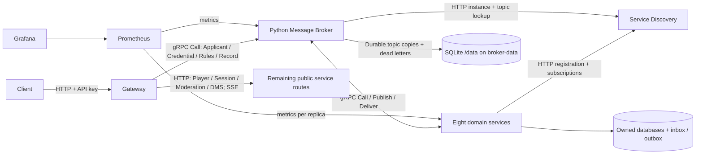
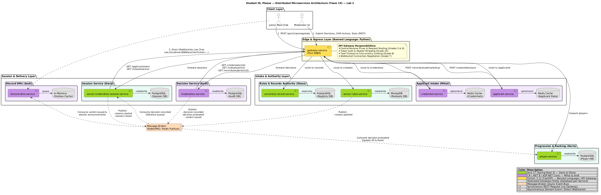
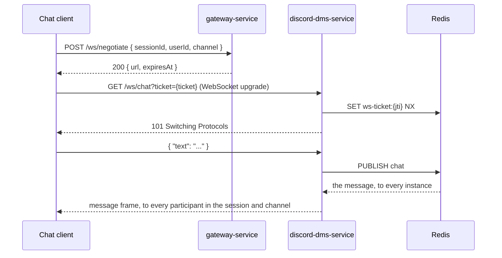
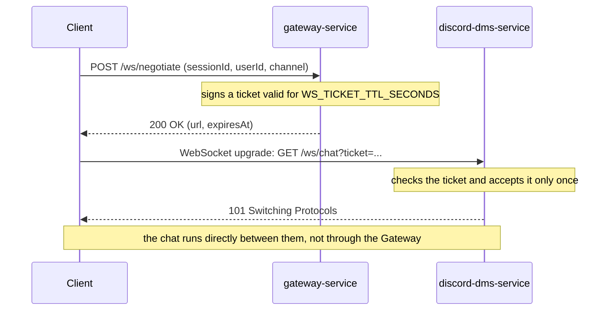

# cpr-pad-team-19

Common Public Repository (CPR) for Team 19 — **Topic 3: Student ID, Please** (FAF.PAD21.1, Autumn 2026).

A distributed system of eight domain services, Gateway, Service Discovery and Message Broker powering a cooperative verification and moderation platform set within a university Discord server, where student credentials, academic records, and dynamic access rules are evaluated by moderator teams in real time.

## Laboratory 5: run and verify

The Lab 5 stack uses published `0.6.0` application images. Create `.env` from `.env.example`
and set local passwords, `GATEWAY_API_KEYS` and `GATEWAY_CACHE_PASSWORD`. Use the monitoring profile
and the cache overlay to reproduce the Lab 5 demonstration. The Andi overlay enables gRPC for
Moderation and DMS. The Mihai overlay specifies the Applicant and Credential adapters.

```powershell
docker compose -f docker-compose.yml -f docker-compose.lab4-mihai.yml -f docker-compose.lab4-andi.yml -f docker-compose.lab5-cache.yml -f docker-compose.monitoring.yml --profile monitoring up -d --wait
```

Gateway serves `http://localhost:8080/health`. The public API uses the key in `.env`.
Grafana is on port 3000 and Prometheus is on port 9090. For the individual demonstrations see the
[deployment diagram](#laboratory-5-the-complete-deployment),
[PostgreSQL failover](docs/LAB_5_DATABASE_FAILOVER.md),
[2PC runbook](docs/LAB_5_TWO_PHASE_COMMIT.md) and [Saga runbook](docs/LAB_5_SAGA.md).

An isolated 26 November run of CPR commit `152ec94` passed 13 Newman collections, all five 2PC
scenarios, SSE and WebSocket chat. Prometheus had 20 UP targets and Grafana served 42 panels.
DMS Redis did not resume writes after the primary stopped in that run. The follow-up ETL fix
in #331 preserves the complete `deceptions` list and passed migration and repeated-load checks
against a local PostgreSQL test database. See [release #328](https://github.com/caramisca/cpr-pad-team-19/pull/328)
for final integrated validation.

## Laboratory 4: Breaking and Brokering

The common Compose configuration pins each application image to its verified release. The
release checks verify linux/amd64 and linux/arm64 manifests and compare each pinned tag with
`latest`. Source gitlinks pin individual service commits.
The [Lab 4 acceptance report](docs/LAB_4_RELEASE_READINESS_2026-11-12.md) records the 12 November commits and test results.

Start the complete documented Lab 4 mode after creating `.env` from `.env.example` and setting
local credentials. Set `BROKER_GRPC_URL=message-broker:9091`,
`SESSION_APPLICANT_CLIENT_MODE=broker` and `SESSION_RULES_CLIENT_MODE=broker` in `.env`:

```powershell
docker compose -f docker-compose.yml -f docker-compose.lab4-mihai.yml -f docker-compose.lab4-andi.yml -f docker-compose.monitoring.yml --profile monitoring up -d
python scripts/check_lab4_release.py --require-published
python scripts/check_lab4_monitoring.py --scope team
```

Grafana is at `http://localhost:3000/d/lab4-services` and Prometheus at `http://localhost:9090`.
The isolated acceptance instance uses ports 13000 and 19090; see the report. Business HTTP enters
through Gateway on 8080; DMS exposes 8088 for direct ticket-authenticated WebSockets. Private
gRPC ports, logs, metrics and health endpoints stay inside the Compose network.

| Component | Current implementation |
|---|---|
| Gateway | Optional gRPC `MessageBroker.Call` for Applicant/Credential/Rules/Record; other client routes and Session SSE still use HTTP. `GET /logs` downloads correlated NDJSON; retired internal event routes are blocked |
| Broker | Thread-per-request gRPC, instance selection and breakers, per-subscriber topic fan-out, SQLite topic queues and dead letters. Release `0.6.0` adds in-memory subscriber request queues for Rules and Record by default. |
| Service Discovery | Physical instance registry with topic subscriptions; broker uses instance and topic lookups over the HTTP control plane |
| Applicant / Credential (Mihai) | gRPC adapters and dependency calls, Redis shared inbox/outbox, session/applicant cleanup, logs and metrics; enabled in the base Compose |
| Player / Session (Daria) | gRPC adapters, topic consumers and Session publisher; broker dependency modes configured in `.env` |
| Moderation / DMS (Andi) | gRPC adapters, outbox/consumers, private logs/metrics and DMS Redis chat relay; enabled by the Andi overlay |
| Rules / Record (Diana) | gRPC adapters; both require `BROKER_GRPC_URL=message-broker:9091` at startup (configured in base Compose) |
| Monitoring | All eight domain services scraped per replica, plus Broker and Prometheus. Gateway and Service Discovery have blackbox health probes. |



The diagram shows the current mixed transport. Broker request queues cover Rules and Record by
default. The broker skips instances with open circuits on subsequent calls. Feeding live service
load into the selector and retrying a failed call on another instance remain Lab 4 follow-ups.

Use the [Lab 4 runbook](docs/LAB_4_RUNBOOK.md), [message contract](docs/MESSAGE_BROKER_CONTRACT.md),
[Service Discovery contract](docs/SERVICE_DISCOVERY_CONTRACT.md) and
[monitoring guide](monitoring/README.md). Run Postman collections from `docs/postman` on a test
stack, set `baseUrl`/`apiKey`, and enable `runLab4GatewayChecks=true` for Applicant/Credential.
Full-stack tests now confirm real University Record issuance, real Session cleanup, SSE and
two-client WebSocket delivery. Error-contract failures remain listed in the acceptance report.

The inherited Lab 1–3 API descriptions below describe retained capabilities and historical
release behavior. Current deployment versions and transport modes are the Lab 4 settings above.

## Team Definition & Microservice Allocation

The team works in **2 polyglot backend languages** (Java and C#) for domain services, with an **API Gateway** implemented in Python (the previously banned language) as required by Laboratory 2:

| Member | Assigned Service | Tech Stack | Storage Engine |
| :--- | :--- | :--- | :--- |
| **Daria** | `player-service`<br>`server-moderation-session-service` | Java (Spring Boot) | PostgreSQL |
| **Mihai** | `applicant-service`<br>`credential-service` | C# (.NET 8) | Redis / In-Memory |
| **Diana** | `server-rules-service`<br>`university-record-service` | Java (Spring Boot) | MongoDB / PostgreSQL |
| **Andi** | `moderation-service`<br>`discord-dms-service` | C# (.NET 8) | PostgreSQL / Redis |
| **Team 19 (All)** | `gateway-service` (API Gateway) | Python 3.12 (FastAPI) | In-Memory / Stateless |

## Service Boundaries

Every microservice encapsulates a single business capability and owns its own datastore
(Database-per-Service). No service reads or writes another service's database; all data crossing a
boundary travels over an explicit contract — gRPC request/reply or asynchronous domain
events in Lab 4, with public HTTP at the Gateway and the remaining HTTP routes described above. Each boundary below states what the service owns, what it deliberately does not own, and the
operations it exposes to the rest of the system.

### 1. `player-service`

Owner: Daria — Java (Spring Boot) — PostgreSQL

- **Encapsulates:** the identity and progression of a moderator (the player). Registration,
  profile, XP, level, rank, accuracy score, and lifetime statistics.
- **Owns:** `players`, `player_stats`, `processed_events` tables.
- **Does not own:** shift scheduling, decision correctness, or the rules a decision is judged
  against. It only consumes evaluated outcomes and projects them into a score.
- **Exposes:** `GET /players/{id}`, `POST /players`, `PATCH /players/{id}`, `DELETE /players/{id}`,
  `GET /players/{id}/stats`, `GET /players/{id}/rank`, and the status of each instance,
  `GET /health` (Lab 3).
- **Consumes:** `decision.evaluated` events to recompute score and rank, and `session.closed` to
  count the shifts each moderator worked (`totalShifts`, `lastShiftAt`), from the message broker over
  gRPC (Lab 4).
- **Observability:** the private `GET /internal/logs` (the last 1,000 requests as NDJSON, collected
  by the Gateway's `GET /logs`) and `GET /actuator/prometheus`, on port `8081` (Lab 4).

### 2. `server-moderation-session-service`

Owner: Daria — Java (Spring Boot) — PostgreSQL

- **Encapsulates:** the lifecycle of a moderation shift. Opening and closing a session, the queue
  of applicants presented during that shift (when each was presented and resolved), and the shift
  summary.
- **Owns:** `sessions`, `session_junior_moderators`, `session_queue_entry`, `session_summary`,
  `processed_events` tables.
- **Does not own:** applicant generation, rule content, or verdict evaluation. It orchestrates the
  shift, it does not judge it.
- **Exposes:** `POST /sessions`, `GET /sessions/{id}`, `POST /sessions/{id}/close`,
  `DELETE /sessions/{id}`, `GET /sessions/{id}/next-applicant`, the live stream
  `GET /sessions/{id}/events` (Server-Sent Events), and the status of each instance, `GET /health`
  (Lab 3).
- **Consumes:** `decision.recorded` events to resolve the applicant's queue entry and advance the
  queue, from the message broker over gRPC (Lab 4).
- **Observability:** the private `GET /internal/logs` (the last 1,000 requests as NDJSON, collected
  by the Gateway's `GET /logs`) and `GET /actuator/prometheus`, on port `8082` (Lab 4).
- **Publishes:** `session.started` and `session.closed` to their topics on the message broker (Lab 4).

### 3. `applicant-service`

Owner: Mihai — C# (.NET 8) — Redis / In-Memory

- **Encapsulates:** generation and short-lived storage of applicant profiles — the people
  requesting entry to the Discord server. Name, faculty, study year, photo reference, and the
  intentional inconsistencies that make an applicant valid or invalid.
- **Owns:** the ephemeral `applicant:{id}` keys, scoped to the lifetime of a session, and the
  `session:{sessionId}:applicants` index of each session.
- **Does not own:** the documents an applicant presents, nor whether the applicant is ultimately
  legitimate. Ground truth lives in `university-record-service`.
- **Exposes:** `POST /applicants/generate`, `GET /applicants/{id}`, `GET /applicants`,
  `PUT /applicants/{id}`, `DELETE /applicants/{id}`.
- **Calls:** `credential-service` through the Message Broker in Lab 4 to attach a credential bundle to a freshly generated applicant.

### 4. `credential-service`

Owner: Mihai — C# (.NET 8) — Redis / In-Memory

- **Encapsulates:** student ID documents. Issuing a credential bundle for an applicant, computing
  its integrity hash, expiry, and issuing authority, and serving the bundle for inspection.
- **Owns:** the ephemeral `credential:{id}` keys and the document-format definitions.
- **Does not own:** the verdict on a credential. It reports what the document says; it does not
  decide whether the document is acceptable.
- **Exposes:** `POST /credentials/issue`, `GET /credentials/{id}`,
  `POST /credentials/{id}/verify-hash`, `GET /credentials`, `PUT /credentials/{id}`,
  `DELETE /credentials/{id}`.
- **Calls:** `university-record-service` through the Message Broker in Lab 4 to derive authentic field values for legitimate applicants.

### 5. `server-rules-service`

Owner: Diana — Java (Spring Boot) — MongoDB

- **Encapsulates:** the access ruleset in force for a given day or session — required documents,
  accepted faculties, expiry tolerances, blacklists — and the versioning of that ruleset as it
  changes mid-shift.
- **Owns:** the `rulesets` and `rule_revisions` collections. Document storage is chosen because
  rule shapes differ per rule type and evolve between revisions.
- **Does not own:** the evaluation of a specific applicant against the rules. It publishes the
  rules; `moderation-service` applies them.
- **Exposes:** `GET /rulesets/active`, `GET /rulesets/{id}`, `POST /rulesets`,
  `GET /rulesets/{id}/revisions`.
- **Publishes:** `ruleset.updated` events when a revision takes effect.

### 6. `university-record-service`

Owner: Diana — Java (Spring Boot) — PostgreSQL

- **Encapsulates:** the authoritative university registry. Enrolled students, faculty, group,
  study year, enrolment status, and academic standing. This is the system of record against which
  presented credentials are cross-checked.
- **Owns:** `student_record`, `enrolment`, `faculty` tables. Relational storage is chosen for
  referential integrity across enrolments and faculties.
- **Does not own:** anything about gameplay, sessions, or moderators. It is a read-mostly
  reference authority.
- **Exposes:** `GET /records/students/{studentId}`, `POST /records/students/lookup`,
  `GET /records/faculties`.

### 7. `moderation-service`

Owner: Andi — C# (.NET 8) — PostgreSQL

- **Encapsulates:** the decision path. It accepts a moderator's accept or deny call, gathers the
  presented credential, the active ruleset, and the university record, evaluates correctness,
  persists the verdict, and emits the outcome.
- **Owns:** `decision`, `verdict`, `violation` tables — the permanent audit trail of every call
  made during every shift.
- **Does not own:** the score derived from a verdict, the shift queue, or the outbound message.
  It publishes the evaluated outcome and lets the interested services react.
- **Exposes:** `POST /decisions`, `GET /decisions/{id}`, `PATCH /decisions/{id}`,
  `DELETE /decisions/{id}`, `GET /sessions/{id}/decisions`.
- **Calls:** `credential-service`, `server-rules-service`, `university-record-service`, each
  behind a circuit breaker ([see Circuit Breaker](#circuit-breaker)), through the message broker
  over gRPC (`MessageBroker.Call`, Lab 4) or through the Gateway over REST.
- **Publishes:** `decision.recorded`, `decision.evaluated`, `verdict.issued`, `decision.amended`,
  `decision.voided`, from a transactional outbox to the message broker (`MessageBroker.Publish`).
- **Serves the broker:** `pad.messaging.v1.ServiceEndpoint` on its private gRPC port `9087`, which
  runs the broker's calls through the same pipeline as the REST API.
- **Registers with:** `service-discovery`, which the Gateway and the message broker read to find
  the replicas ([see Service Discovery](#service-discovery)). It consumes no topic
  (`"topics": []`).
- **Observability:** the private `GET /internal/logs` (the last 1,000 requests as NDJSON, collected
  by the Gateway's `GET /logs`) and `GET /metrics` (Prometheus), on port `8087`.

### 8. `discord-dms-service`

Owner: Andi — C# (.NET 8) — Redis

- **Encapsulates:** all outbound communication toward Discord. Direct messages to applicants
  carrying their verdict, shift notifications to moderators, rule-change announcements, delivery
  retries, and rate limiting against the Discord API. Also the real-time chat of each shift, where
  moderators and junior mods talk in the `enrollment-check`, `faculty-check`, and
  `general-mod-chat` channels over a WebSocket.
- **Owns:** the Redis outbox: every notification with its delivery status, the delivery queue, the
  ids of the events already processed, and the moderator of each open shift. Chat messages are
  relayed, not stored; only the ids of the chat tickets already used are kept.
- **Does not own:** any business decision. It is a pure delivery edge and never calls back into
  the domain services. Who may join which chat is settled by the gateway when it issues the ticket.
- **Exposes:** `POST /notifications/dm`, `GET /notifications/{id}/status`, `GET /notifications/{id}`,
  `POST /notifications/{id}/retry`, `DELETE /notifications/{id}`, and the chat WebSocket
  `GET /ws/chat?ticket={ticket}`, over REST and, through the message broker, over gRPC
  (`ServiceEndpoint` on its private port `9088`, Lab 4).
- **Consumes:** `verdict.issued`, `session.started`, `session.closed`, `ruleset.updated`, delivered
  by the message broker (`ServiceEndpoint.Deliver`). A delivery is answered `COMMITTED` only after
  the notifications and the event ID are stored in one Redis transaction.
- **Registers with:** `service-discovery`, which the Gateway and the message broker read to find
  the replicas and the topics they consume ([see Service Discovery](#service-discovery)).
- **Observability:** the private `GET /internal/logs` (the last 1,000 requests as NDJSON, collected
  by the Gateway's `GET /logs`) and `GET /metrics` (Prometheus), on port `8088`.

### 9. `gateway-service` (API Gateway)

Owner: Team 19 (All Members) — Python 3.12 (FastAPI / Uvicorn)

- **Encapsulates:** the single unified ingress point and reverse proxy for the distributed system. Central
  reverse proxying, client-to-service and service-to-service routing, token authorization and header
  stripping, request timeout enforcement, concurrency limiting, and WebSocket connection ticket negotiation.
- **Owns:** the dynamic routing table, rate limiting semaphores, and short-lived connection tickets.
- **Does not own:** any domain business logic, persistent application datastores, or direct background
  event broker subscriptions.
- **Exposes:** all downstream service paths (proxied transparently — no prefix added),
  `GET /health`, and `POST /ws/negotiate`, which returns a short-lived ticket and the direct URL
  of the `discord-dms-service` chat. See
  [`gateway-service` — WebSocket negotiation](#gateway-service--websocket-negotiation).
  `GET /logs` downloads the logs of the whole system (Lab 4). See
  [`gateway-service` — log download](#gateway-service--log-download).
- **Authorization:** every client request on port `8080` needs `Authorization: Bearer <key>`; the
  Gateway validates it and never forwards the header. The services call each other through its
  internal port `8090` (no key, not published to the host). See
  [`gateway-service` — authorization](#gateway-service--authorization).
- **Circuit breaker:** 3 failed calls to a service within the task timeout x 3.5 trip its circuit,
  and its requests get `503 CIRCUIT_OPEN` until a trial request succeeds. With the Service
  Discovery, a discovered instance whose circuit trips is removed: it leaves the round-robin and is
  deregistered. See [`gateway-service` — circuit breaker](#gateway-service--circuit-breaker).
- **Calls:** all downstream services over HTTP.


## Technologies & Communication Patterns

The team works in 2 languages, split by repo/member pair. Python was excluded to keep both stacks
statically typed and consistent with the team's existing Spring Boot / .NET expertise, and to
enforce compile-time type safety across the credential/verdict logic where correctness matters
most.

| Repo | Service | Language / Framework | Sync communication | Async communication |
|---|---|---|---|---|
| `gateway-service` | API Gateway | Python 3.12 (FastAPI / Uvicorn) | Central reverse proxy for all client-to-service and service-to-service REST requests; transparent path forwarding with no prefix added | — |
| `player-service` | Player | Java (Spring Boot) | REST CRUD (profile, rank, stats lookup) | Consumes `decision.evaluated` to update score/rank/penalties |
| `server-moderation-session-service` | Session | Java (Spring Boot) | REST to open/close a shift, pull next applicant, assign moderator/junior-mod roles | Publishes `session.started`/`session.closed`; consumes `decision.recorded` to advance the queue |
| `server-rules-service` | Server Rules | Java (Spring Boot) | REST to read active ruleset/revisions | Publishes `ruleset.updated` for services that need to react to mid-shift rule changes |
| `university-record-service` | University Record | Java (Spring Boot) | REST for authoritative student/faculty/enrolment lookups | — (read-mostly system of record; no events published) |
| `applicant-service` | Applicant | C# (.NET 8) | REST to generate/fetch an applicant; calls Credential Service via Gateway to attach documents | — |
| `credential-service` | Credential | C# (.NET 8) | REST to issue/fetch/verify a credential; calls University Record Service via Gateway to derive authentic fields | — |
| `moderation-service` | Moderation | C# (.NET 8) | REST for the accept/deny call; calls Credential, Rules, and University Record via Gateway | Publishes `decision.recorded`, `decision.evaluated`, `verdict.issued` for Session/Player/DMs to consume, and `decision.amended`/`decision.voided` when a call is corrected |
| `discord-dms-service` | Discord DMs | C# (.NET 8) | WebSocket for real-time moderator ↔ junior-mod chat channels (`enrollment-check`, `faculty-check`, `general-mod-chat`) | Purely event-driven for outbound notifications: consumes `verdict.issued`, `session.started`/`closed`, `ruleset.updated`; no service calls it synchronously |

**Why this split:**

- **Python 3.12 (FastAPI / Uvicorn)** for `gateway-service`: implemented in the previously banned language
  per Laboratory 2 Grade 5 requirements (*"Initialize the new service – Gateway – which will serve as a
  point of entry in your system. Use the banned language for that"*). FastAPI was selected for its
  high-performance asynchronous ASGI event loop, lightweight non-blocking HTTP proxying via `httpx`,
  and clean middleware architecture for request timeouts, concurrency throttling, and token authorization.
- **Java (Spring Boot)** for Player, Session, Rules, University Record: these hold the most
  structured, long-lived, relational domain data (player progression, shift/queue state, versioned
  rulesets, the authoritative enrolment registry) and benefit from Spring's mature ecosystem for
  transactional REST APIs, JPA-backed consistency, and strong typing where correctness matters
  most — e.g. no two junior mods ever pulling the same applicant, no stale enrolment data feeding
  a verdict.
- **C# (.NET 8)** for Applicant, Credential, Moderation, Discord DMs: these sit closer to the live
  decision path — applicant/credential generation is short-lived and disposable per shift,
  Moderation is the single most latency-sensitive call in the system (a moderator's accept/deny
  should never feel slow), and Discord DMs is a connection-heavy delivery/chat edge where .NET's
  async I/O and lower per-instance overhead are a good fit.
- **WebSockets** are used specifically for `discord-dms-service`'s moderator ↔ junior-mod chat,
  since that interaction is inherently real-time and bidirectional — negotiated via Gateway, but connected
  directly to prevent Gateway thread starvation.
- **Async events** are used wherever a service shouldn't block on, or depend on the availability
  of, a downstream consumer — most notably after a verdict is produced in Moderation Service
  (scoring, queue advancement, and Discord delivery all react independently) and for rule changes
  propagating out via `ruleset.updated`.


## Architecture Diagram

### Laboratory 5: the complete deployment

The diagram below shows every container of the common Compose configuration (`docker-compose.yml`,
plus `docker-compose.monitoring.yml` for the monitoring profile and `docker-compose.lab5-cache.yml`
for the Gateway cache) and every port inside the Compose network. Only the Gateway's `8080` and the
DMS WebSocket port `8088` are published to the host;
Prometheus (`9090`) and Grafana (`3000`) are published on `127.0.0.1` only. The source is kept in
[`docs/architecture-diagram-lab5.mmd`](docs/architecture-diagram-lab5.mmd).

- **Thin arrows:** synchronous calls.
- **Dashed arrows:** the direct WebSocket connection and the control traffic of the coordinators
  (Sentinel, etcd).
- **Thick arrows:** the two distributed transactions:
  - the decision-verdict **saga**, coordinated by the Gateway
    ([`contracts/saga.md`](contracts/saga.md));
  - the shift-close **two-phase commit**, coordinated by the message broker
    ([`contracts/two-phase.md`](contracts/two-phase.md)).
- **Instance counts:** `x2` marks the replicas each service runs by default (the `*_REPLICAS`
  variables in `.env.example`).
- **Replicated stores:** each has three members. Patroni clusters have one primary, one
  synchronous standby and one asynchronous standby. `rules-mongo` is a replica set, and
  Redis groups for DMS, Applicant and Credential each have one primary and two replicas.
  Sentinels elect primaries and HAProxy exposes stable addresses. The optional Gateway cache
  uses independent Redis shards for GET responses and authentication metadata.

```mermaid
flowchart TB
  CLIENT["Client<br/>Postman, Discord-side tools"]

  subgraph EDGE["Edge"]
    GW["gateway-service<br/>public :8080 (API key), internal :8090 (Compose network only)<br/>routing, load balancing, circuit breakers, discovery snapshot cache<br/>saga coordinator: decision-verdict"]
    GWDATA[("gateway-data<br/>SQLite saga log")]
    subgraph CACHE["Gateway cache overlay (Grades 6 and 7)"]
      SHARDS[("cache-redis-1..3 :6379<br/>independent cache shards")]
      SHARD4[("cache-redis-4 :6379<br/>profile cache-extra, joins the ring<br/>once listed in nodes.txt")]
    end
  end

  subgraph PLATFORM["Platform"]
    SD["service-discovery :8089<br/>instance registry, topic subscriptions,<br/>health checks, Discord / Telegram alerts"]
    MB["message-broker<br/>HTTP :8091, gRPC :9091<br/>Call routing, topic fan-out, dead letters,<br/>two-phase commit coordinator"]
    MBDATA[("broker-data<br/>SQLite topic queues, dead letters, 2PC log")]
  end

  subgraph MON["Monitoring (profile monitoring)"]
    PROM["prometheus :9090<br/>published on 127.0.0.1"]
    GRAF["grafana :3000<br/>published on 127.0.0.1"]
    BBX["blackbox-exporter :9115<br/>HTTP probes of /health"]
  end

  subgraph SERVICES["Domain services: every instance registers with service-discovery"]
    PS["player-service x2<br/>HTTP :8081, gRPC :9081"]
    SS["server-moderation-session-service x2<br/>HTTP :8082, gRPC :9082"]
    AS["applicant-service x2<br/>HTTP :8083, gRPC :9083"]
    CS["credential-service x2<br/>HTTP :8084, gRPC :9084"]
    RS["server-rules-service x2<br/>HTTP :8085, gRPC :9085"]
    US["university-record-service x2<br/>HTTP :8086, gRPC :9086"]
    MS["moderation-service x2<br/>HTTP :8087, gRPC :9087"]
    DS["discord-dms-service and discord-dms-service-replica<br/>HTTP + WebSocket :8088 (published by discord-dms-service), gRPC :9088"]
  end

  subgraph DATA["Data stores: Database-per-Service, private to the Compose network"]
    ETCD["postgres-etcd-1..3 :2379<br/>leader locks of the four Patroni clusters"]

    subgraph PPG["player-postgres: Patroni"]
      PPGH["HAProxy player-postgres :5432<br/>health :8404"] --> PP1[("player-postgres-1<br/>primary")]
      PP1 -->|"WAL, synchronous"| PP2[("player-postgres-2<br/>sync standby")]
      PP1 -->|"WAL"| PP3[("player-postgres-3<br/>standby")]
    end

    subgraph SPG["session-postgres: Patroni"]
      SPGH["HAProxy session-postgres :5432"] --> SP1[("session-postgres-1<br/>primary")]
      SP1 -->|"WAL, synchronous"| SP2[("session-postgres-2<br/>sync standby")]
      SP1 -->|"WAL"| SP3[("session-postgres-3<br/>standby")]
    end

    subgraph RPG["record-postgres: Patroni"]
      RPGH["HAProxy record-postgres :5432"] --> RP1[("record-postgres-1<br/>primary")]
      RP1 -->|"WAL, synchronous"| RP2[("record-postgres-2<br/>sync standby")]
      RP1 -->|"WAL"| RP3[("record-postgres-3<br/>standby")]
    end

    subgraph MPG["moderation-postgres: Patroni"]
      MPGH["HAProxy moderation-postgres :5432"] --> MP1[("moderation-postgres-1<br/>primary")]
      MP1 -->|"WAL, synchronous"| MP2[("moderation-postgres-2<br/>sync standby")]
      MP1 -->|"WAL"| MP3[("moderation-postgres-3<br/>standby")]
    end

    subgraph RMG["rules-mongo: replica set rs0"]
      RM1[("rules-mongo-1 :27017<br/>primary")] -->|"oplog"| RM2[("rules-mongo-2<br/>secondary")]
      RM1 -->|"oplog"| RM3[("rules-mongo-3<br/>secondary")]
    end

    subgraph DRD["dms-redis: Sentinel"]
      DRS["dms-redis-sentinel-1..3 :26379<br/>master name dms-redis, quorum 2"]
      DRH["HAProxy dms-redis :6379<br/>to the member with role:master"]
      DR1[("dms-redis-1 :6379<br/>primary, fixed address")] -->|"replication, async"| DR2[("dms-redis-2<br/>replica")]
      DR1 -->|"replication, async"| DR3[("dms-redis-3<br/>replica")]
      DRS -.->|"monitor, promote"| DR1
      DRH --> DR1
    end

    subgraph ACRED["Applicant and Credential Redis HA (Grade 5)"]
      AR["HAProxy applicant-redis :6379"]
      CR["HAProxy credential-redis :6379"]
      AM[("applicant-redis-1..3<br/>elected primary and two replicas")]
      CM[("credential-redis-1..3<br/>elected primary and two replicas")]
      ACS["redis-sentinel-1..3 :26379<br/>quorum 2 for each group"]
      AR -->|elected primary| AM
      CR -->|elected primary| CM
      ACS -.->|monitor and promote| AM
      ACS -.->|monitor and promote| CM
    end
  end

  subgraph ANALYTICS["Analytics (Lab 5, Grade 4)"]
    ETL["etl (pad-etl)<br/>scheduled, every ETL_INTERVAL_SECONDS"]
    WH[("warehouse-db :5432<br/>PostgreSQL star schema")]
  end

  subgraph SETUP["One-shot setup jobs: run once at start, exit 0"]
    SEED["applicant-seed, credential-seed<br/>load the demo data of docs/db/ into an empty Redis"]
    RMSET["rules-mongo-setup<br/>rs.initiate of rs0"]
  end

  CLIENT -->|"HTTP + API key"| GW
  CLIENT -.->|"WebSocket chat, ticket from POST /ws/negotiate"| DS

  GW -->|"HTTP: player, session, moderation, DMS; SSE"| SERVICES
  GW -->|"gRPC MessageBroker.Call: applicant, credential, rules, record"| MB
  SERVICES -->|"service-to-service HTTP through :8090"| GW
  MB <-->|"gRPC Call / Publish / Deliver"| SERVICES
  GW ==>|"saga steps 1 and 3: /internal/sagas/{id}/decision"| MS
  GW ==>|"saga step 2: /internal/sagas/{id}/notification"| DS
  SS ==>|"POST /two-phase/transactions"| MB
  MB ==>|"2PC prepare / commit / abort"| PS
  MB ==>|"2PC prepare / commit / abort"| SS
  GW --- GWDATA
  GW -->|"consistent hash: GET responses and auth metadata"| SHARDS
  GW -->|"once listed in nodes.txt"| SHARD4
  MB --- MBDATA

  SERVICES -->|"register, heartbeat, subscriptions"| SD
  GW -->|"instance lookup"| SD
  MB -->|"instance + topic lookup"| SD
  PROM -->|"scrape /metrics per replica"| SERVICES
  PROM -->|"scrape /metrics"| MB
  GRAF --> PROM
  PROM -->|"probe"| BBX
  BBX -->|"GET /health"| GW
  BBX -->|"GET /health"| SD

  PS --> PPGH
  SS --> SPGH
  US --> RPGH
  MS --> MPGH
  RS -->|"replica set URI"| RM1
  AS --> AR
  CS --> CR
  DS -->|"dms-redis:6379"| DRH
  PPG & SPG & RPG & MPG <-.->|"leader lock"| ETCD

  ETL -->|"read-only: 4 Postgres and 3 Redis HAProxys, rs0 URI"| DATA
  ETL -->|"INSERT ... ON CONFLICT"| WH
  SEED --> AR
  SEED --> CR
  RMSET -->|"mongosh"| RM1
```



| Component | Ports (Compose network) | Replicas / members | Coordinator or failover mechanism |
|---|---|---|---|
| `gateway-service` | `8080` public (API key), `8090` internal | 1 (owns the saga log) | Saga coordinator, `gateway-data` SQLite log, recovery loop |
| `message-broker` | HTTP `8091`, gRPC `9091` | 1 | Two-phase commit coordinator, `broker-data` SQLite log |
| `service-discovery` | `8089` | 1 | Health checks and alerts |
| Domain services | HTTP `8081`-`8088`, gRPC `9081`-`9088` | 2 each | Registered per instance; the Gateway and the broker pick instances |
| `player-postgres`, `session-postgres`, `record-postgres`, `moderation-postgres` | `5432` (HAProxy), `8008` (Patroni REST), `8404` (HAProxy health) | 3 each | Patroni with the `postgres-etcd-1..3` leader lock (`2379`) |
| `rules-mongo` | `27017` | 3 (`rs0`) | MongoDB replica set election |
| `dms-redis` | `6379` (HAProxy and members), `26379` (Sentinels) | 3 members, 3 Sentinels | Redis Sentinel, quorum 2 |
| `applicant-redis`, `credential-redis` | `6379` (HAProxy and members), `26379` (Sentinels) | 3 members per group, 3 shared Sentinels | Redis Sentinel, quorum 2; session-scoped data, AOF on |
| Gateway cache overlay | `6379` per shard | 3 shards, optional fourth | Gateway-side consistent hashing for GET responses and authentication data |
| `warehouse-db`, `etl` | `5432` | 1 each | Idempotent loads, a source outage only skips that source |
| Prometheus, Grafana | `9090`, `3000` (on `127.0.0.1`) | 1 each | Profile `monitoring` |

### Laboratory 1-3: layered view

Solid arrows represent synchronous REST requests in the request path (all routed via the API Gateway).
Dashed arrows represent asynchronous domain events delivered through the message broker. The dotted
arrow denotes direct client WebSocket streaming following Gateway ticket negotiation.



### Communication Matrix

| Caller | Callee | Style | Purpose |
| :--- | :--- | :--- | :--- |
| `Moderator UI` | `gateway-service` | Sync REST | External ingress for shift operations, decisions, and player stats |
| `Junior Mod Chat` | `gateway-service` | Sync REST | Request WebSocket ticket negotiation (`POST /ws/negotiate`), answered with the direct chat URL |
| `Junior Mod Chat` | `discord-dms-service` | WebSocket | Direct real-time chat connection using negotiated ticket (`/ws/chat?ticket=...`) |
| `gateway-service` | `server-moderation-session-service` | Sync REST | Forward shift lifecycle requests (`/sessions/**`) |
| `gateway-service` | `moderation-service` | Sync REST | Forward decision evaluation calls (`/decisions/**`) |
| `gateway-service` | `player-service` | Sync REST | Forward player profile and rank queries (`/players/**`) |
| `gateway-service` | `message-broker` $\rightarrow$ `player-service`, `server-moderation-session-service` | gRPC `Call` (Lab 4) | Every client endpoint of both services can also be served through the broker, with the same answers; the SSE stream `GET /sessions/{id}/events` stays direct REST |
| `Moderator UI` | `gateway-service` | Sync REST (Lab 5) | Issue a verdict as one saga (`POST /sagas/decision-verdicts`) and follow it (`GET /sagas/{id}`, `GET /sagas`); [`contracts/saga.md`](contracts/saga.md) |
| `gateway-service` (saga coordinator) | `moderation-service` | Sync REST (Lab 5) | Saga steps 1 and 3 and their compensation: `POST /internal/sagas/{id}/decision`, `/decision/confirm`, `/decision/compensate` |
| `gateway-service` (saga coordinator) | `discord-dms-service` | Sync REST (Lab 5) | Saga step 2 and its compensation: `POST /internal/sagas/{id}/notification`, `/notification/cancel` |
| `server-moderation-session-service` | `gateway-service` $\rightarrow$ `applicant-service` | Sync REST | Pull next queued applicant for current shift (Lab 4: or gRPC `MessageBroker.Call` through `message-broker`, `APPLICANT_CLIENT_MODE=broker`) |
| `server-moderation-session-service` | `gateway-service` $\rightarrow$ `server-rules-service` | Sync REST | Fetch active ruleset in force for current session |
| `applicant-service` | `gateway-service` $\rightarrow$ `credential-service` | Sync REST | Attach issued credential bundle to generated applicant |
| `credential-service` | `gateway-service` $\rightarrow$ `university-record-service` | Sync REST | Cross-reference student registry for authentic credentials |
| `moderation-service` | `gateway-service` $\rightarrow$ `credential-service` | Sync REST | Read applicant credential bundle for evaluation |
| `moderation-service` | `gateway-service` $\rightarrow$ `server-rules-service` | Sync REST | Read ruleset to evaluate decision against |
| `moderation-service` | `gateway-service` $\rightarrow$ `university-record-service` | Sync REST | Verify registry enrollment standing for verdict |
| `moderation-service` | `server-moderation-session-service` | Async event (broker topic, Lab 4) | `decision.recorded` advances shift queue |
| `moderation-service` | `player-service` | Async event (broker topic, Lab 4) | `decision.evaluated` updates score, rank, penalties |
| `moderation-service` | `discord-dms-service` | Async event | `verdict.issued` delivers the DM to the applicant (not published for a saga decision: saga step 2 queues the DM) |
| `server-moderation-session-service` | `discord-dms-service` | Async event (broker topic, Lab 4) | `session.started` and `session.closed` notify moderators |
| `server-moderation-session-service` | `player-service` | Async event (broker topic, Lab 4) | `session.closed` credits the shift to the moderator and every junior moderator (`totalShifts`); with the Lab 5 two-phase close the shift is credited inside the commit and this event is skipped as already applied |
| `server-moderation-session-service` | `message-broker` (two-phase commit coordinator) | Sync HTTP `POST /two-phase/transactions` (Lab 5) | Closing a shift (`SHIFT_CLOSE_MODE=two-phase`): one transaction across the session and player databases; the close waits for the decision ([`contracts/two-phase.md`](contracts/two-phase.md)) |
| `message-broker` | `server-moderation-session-service`, `player-service` | gRPC `ServiceEndpoint.Call` (Lab 5) | Two-phase commit: phase 1 `POST /internal/two-phase/{id}/prepare` (the vote), phase 2 `commit` / `abort`, sent again until acknowledged |
| `player-service`, `server-moderation-session-service` | `message-broker` | Sync HTTP `GET /two-phase/transactions/{id}` (Lab 5) | The participants' sweeper asks for the decision of a transaction prepared too long (`404` = presumed abort) |
| `server-rules-service` | `discord-dms-service` | Async event | `ruleset.updated` announces a mid-shift rule change |

Synchronous REST is routed centrally through the API Gateway, ensuring unified access logging, task
timeouts, concurrency limiting, and authorization enforcement with header stripping. The Gateway also
mediates WebSocket handshake requests, returning direct connection tickets so that high-throughput
bidirectional streams do not burden the Gateway process. Everything downstream of a verdict remains
asynchronous via the message broker.

`player-service` and `discord-dms-service` are never called synchronously by another service, and
`discord-dms-service` never calls back into the domain. These two boundaries are deliberately kept
event-driven so that a failure in scoring or in the Discord API cannot block a shift in progress.
Lab 5 adds two exceptions:

- the two-phase commit that closes a shift: the coordinator in `message-broker` calls
  `player-service`'s internal participant routes while the close waits, and a NO vote or no answer
  aborts the close (`409 SHIFT_CLOSE_ABORTED`) instead of blocking the shift.
- the verdict saga: its coordinator in the Gateway calls `discord-dms-service` to queue (or cancel)
  the verdict DM, and the DM is still delivered by the service's own worker, so the Discord API never
  blocks the saga.

## Communication Contract

### Data Management Strategy

The system follows **Database-per-Service**: every microservice owns an isolated datastore and no
service is ever granted direct access to another service's schema, tables, or keys. The storage
engine is picked per service based on the shape of the data it owns, not on team-wide consistency:

| Service | Storage Engine | Why |
| :--- | :--- | :--- |
| `player-service` | PostgreSQL | Relational integrity between a player and its stats/penalty history. |
| `server-moderation-session-service` | PostgreSQL | Sessions and their queue entries are relational and transactional (close-shift is atomic). |
| `applicant-service` | Redis / In-Memory | Applicants are scoped to a single session and expire with it; no durability is needed. |
| `credential-service` | Redis / In-Memory | Credentials are as ephemeral as the applicant they belong to. |
| `server-rules-service` | MongoDB | Rule shapes vary by rule type and change between revisions; document storage avoids rigid schemas. |
| `university-record-service` | PostgreSQL | Enrolments and faculties need referential integrity as the system of record. |
| `moderation-service` | PostgreSQL | Decisions/verdicts/violations form the permanent audit trail and must not be lost. |
| `discord-dms-service` | Redis | The outbox, the delivery queue, and the processed event ids must survive a restart so that retries continue and redelivered events are not sent twice; entries expire once they are no longer needed. |
| `gateway-service` | In-Memory + SQLite (Lab 5) | Routing table, concurrency control semaphores, and short-lived connection tickets in memory. Since Lab 5 the saga coordinator keeps its write-ahead saga log in SQLite on the `gateway-data` volume, so a saga survives a Gateway restart. |

All cross-service data access happens exclusively over the contract published below:

- **Synchronous REST** is used when the caller cannot proceed without the answer (e.g.
  `moderation-service` needs the credential, the ruleset, and the student record before a verdict
  exists).
- **Asynchronous domain events**, delivered through the message broker, are used everywhere the
  caller does not need to block on the result (scoring, queue advancement, Discord delivery).
- Every event consumer treats events as **at-least-once** and deduplicates on the event's `eventId`,
  since retried deliveries must never double-award XP, double-advance a queue, or double-send a DM.
- No service ever queries another service's database, cache, or message topics directly — only the
  endpoints and event payloads documented below are considered part of the public contract.

### Endpoint Contracts

Unless noted otherwise, all endpoints accept and return `application/json`, and error responses share
the shape `{ "error": "string (machine-readable code)", "message": "string (human-readable detail)" }`.

From Lab 2 on, clients call every endpoint below **through the API Gateway** at
`http://localhost:8080`, with the same paths and an API key (`Authorization: Bearer <key>`, see
[`gateway-service` — authorization](#gateway-service--authorization)). The Gateway's own errors
(`401`, `404 ROUTE_NOT_FOUND`, `502`, `503`, `504`) are listed there; everything else comes
from the service unchanged.

#### `player-service`

**`POST /players`** — register a new player.

Request:
```json
{
  "discordId": "string",
  "displayName": "string"
}
```
Response `201 Created`:
```json
{
  "id": "string (uuid)",
  "discordId": "string",
  "displayName": "string",
  "rank": "string",
  "xp": "integer",
  "level": "integer",
  "createdAt": "string (ISO-8601 datetime)"
}
```

Response `400 Bad Request` (`VALIDATION_ERROR`): `discordId` or `displayName` is missing or blank.
Response `409 Conflict` (`DUPLICATE_DISCORD_ID`): a player with that `discordId` already exists.

**`GET /players/{id}`** — fetch a player profile.

Response `200 OK`: same shape as the `POST /players` response.
Response `404 Not Found`: standard error shape (`PLAYER_NOT_FOUND`).

**`PATCH /players/{id}`** — change the display name. Progression fields (`rank`, `xp`, `level`)
are never client-writable; they only change through `decision.evaluated`.

Request:
```json
{ "displayName": "string" }
```
Response `200 OK`: same shape as the `POST /players` response. Response `400 Bad Request`
(`VALIDATION_ERROR`) or `404 Not Found` (`PLAYER_NOT_FOUND`).

**`DELETE /players/{id}`** — remove a player account. Response `204 No Content`, or `404 Not Found`
(`PLAYER_NOT_FOUND`).

**`GET /players/{id}/stats`** — fetch lifetime moderation statistics.

Response `200 OK`:
```json
{
  "playerId": "string (uuid)",
  "totalShifts": "integer",
  "correctDecisions": "integer",
  "incorrectDecisions": "integer",
  "accuracyScore": "number (0-1)",
  "lastShiftAt": "string (ISO-8601 datetime) | null"
}
```
`accuracyScore` = `correctDecisions / (correctDecisions + incorrectDecisions)` (`0` before the first
decision). `totalShifts` counts the shifts the player worked as moderator or junior moderator and
`lastShiftAt` is the end of the latest one, both from `session.closed` (Lab 4; `null` before the
first shift).

**`GET /players/{id}/rank`** — fetch current rank standing.

Response `200 OK`:
```json
{
  "playerId": "string (uuid)",
  "rank": "string",
  "xp": "integer",
  "level": "integer",
  "percentile": "number (0-100)"
}
```

**Consumes `decision.evaluated`** — adds `xpAwarded` to the player's XP (which recomputes level and
rank) and counts the decision as correct or incorrect in the stats. Penalties are not applied yet:
the event carries no penalty data.
```json
{
  "eventId": "string (uuid)",
  "decisionId": "string (uuid)",
  "playerId": "string (uuid)",
  "sessionId": "string (uuid)",
  "correct": "boolean",
  "xpAwarded": "integer",
  "evaluatedAt": "string (ISO-8601 datetime)"
}
```
Every field is required and `xpAwarded` must be `0` or more (moderation-service awards 0 to 15);
anything else is never valid. Deduplicated on `eventId`. Delivered by the broker (Lab 4,
`decision.evaluated` topic) the answer is `COMMITTED`, `RETRY` (temporary failure) or `REJECTED`
(invalid payload, unknown player), see the [message contract](docs/MESSAGE_BROKER_CONTRACT.md).

**Consumes `session.closed`** (Lab 4, broker only) — credits the shift to the `moderatorId` and every
`juniorModeratorIds` entry: `totalShifts` + 1, `lastShiftAt` = `closedAt` (unless a later shift was
already counted). Uses only `eventId`, `sessionId`, `moderatorId`, `juniorModeratorIds` and
`closedAt` of the payload published by `server-moderation-session-service` (below); `moderatorId` is
required (`REJECTED` without it). A moderator who isn't a registered player is skipped, not an error.
Deduplicated on `eventId`.

**`POST /internal/mock-events/decision-evaluated`** — the REST stand-in for the `decision.evaluated`
consumer above, for local runs without a broker: same request body as the event payload, same
handler. Since Lab 4 it exists only with `MOCK_EVENTS_ENABLED=true` (never in the CPR Compose
setup); otherwise `404 ROUTE_NOT_FOUND`. Response `202 Accepted`, empty body. Deduplicates on
`eventId`, safe to replay. Response `400 Bad Request` (`VALIDATION_ERROR`) when a field is missing or
invalid, `404 Not Found` (`PLAYER_NOT_FOUND`) when `playerId` is not a registered player.

**Common to every `player-service` endpoint:**
- Any `{id}` that is not a UUID: `400 Bad Request` (`INVALID_PATH_VARIABLE`).
- Every error is `{ "error", "message" }` JSON, also the ones Spring used to answer itself: a body
  that isn't JSON `400 MALFORMED_REQUEST_BODY` (a field of the wrong type `400 VALIDATION_ERROR`
  naming it), an unknown path `404 ROUTE_NOT_FOUND`, another method `405 METHOD_NOT_ALLOWED` with
  `Allow`, a body without a JSON `Content-Type` `415 UNSUPPORTED_MEDIA_TYPE`, anything unexpected
  `500 INTERNAL_ERROR` (no internals in the message).
- **Through the message broker** (Lab 4): every endpoint above is also served by gRPC
  `ServiceEndpoint.Call` on port 9081 (private), with the same status, body and headers as over HTTP
  (see the [message contract](docs/MESSAGE_BROKER_CONTRACT.md)).
- **Task timeout and concurrent task limit** (Lab 2): a request that runs longer than `TASK_TIMEOUT`
  (default `10s`) gets `504 Gateway Timeout` (`REQUEST_TIMEOUT`); a request while
  `MAX_CONCURRENT_TASKS` (default `20`) are running gets `503 Service Unavailable` (`SERVICE_BUSY`)
  with `Retry-After: 1`, straight away.
- **Database unavailable** (Lab 5): while the replicated `player-postgres` fails over to a new
  primary (about 20 s), a request that needs the database gets `503 Service Unavailable`
  (`DATABASE_UNAVAILABLE`, "The database is unavailable right now; retry shortly") with
  `Retry-After: 5`, within `DATABASE_CONNECTION_TIMEOUT_MS` (default 3 s); the same request succeeds
  once the new primary is in place. A broker delivery that can't reach the database is answered `RETRY`.
- **`GET /health`** (Lab 3): the status of this instance, polled by `service-discovery` at the
  `healthUrl` the instance registered; not routed through the Gateway, and never blocked by the task
  limit. `200 OK`, or `503 Service Unavailable` with `"status": "Unhealthy"` when PostgreSQL refuses
  a connection or doesn't answer within 2 s:
  ```json
  {
    "status": "Healthy",
    "service": "player-service",
    "version": "string",
    "instanceId": "string",
    "checks": { "database": "Healthy" },
    "activeThreads": "integer (tasks running)",
    "maxThreads": "integer (MAX_CONCURRENT_TASKS)",
    "load": "string (NORMAL | HIGH | CRITICAL)"
  }
  ```
  Format and thresholds: [Service Discovery contract](docs/SERVICE_DISCOVERY_CONTRACT.md), "Status".
- `GET /actuator/health` returns `{"status":"UP"}` for the Compose healthcheck. It is not routed
  through the Gateway.
- **Several instances** (Lab 3): every instance registers with `service-discovery` and the Gateway
  spreads requests over them. All instances share one database, and every change to a player locks
  that player's row, so any instance can answer any request and events delivered to two instances at
  once are applied once.
- Makes no business calls (its only outgoing calls register it with `service-discovery`), so it has
  no circuit breaker of its own; and it has nothing to push to clients live.
- **`GET /internal/logs`** (Lab 4, Grade 4): this instance's last 1,000 business requests as NDJSON
  (`application/x-ndjson`, oldest first), the collection interface of the Gateway's `GET /logs`
  ([message contract](docs/MESSAGE_BROKER_CONTRACT.md), "Logs and metrics"). Each line has `timestamp`,
  `service`, `instanceId`, `requestId`, `method`, `path` (no query string), `status`, `durationMs` and
  `transport` (`http`, or `grpc` through the broker; a delivery is `DELIVER topics/<topic>` with its
  `outcome`). Not a task (answers while the service is busy), not routed through the Gateway, and
  it leaves out the health checks, the metrics and itself.

#### `server-moderation-session-service`

**`POST /sessions`** — open a new moderation shift.

Request:
```json
{
  "moderatorId": "string (uuid)",
  "juniorModeratorIds": ["string (uuid)"]
}
```
Response `201 Created`:
```json
{
  "id": "string (uuid)",
  "moderatorId": "string (uuid)",
  "juniorModeratorIds": ["string (uuid)"],
  "status": "string (OPEN | CLOSED)",
  "startedAt": "string (ISO-8601 datetime)"
}
```
`400 Bad Request` (`VALIDATION_ERROR`): `moderatorId` missing, a `null` in `juniorModeratorIds`, the
same junior listed twice, or the moderator listed as their own junior. `juniorModeratorIds` may be
omitted (no juniors).

**`GET /sessions/{id}`** — fetch session state.

Response `200 OK`:
```json
{
  "id": "string (uuid)",
  "moderatorId": "string (uuid)",
  "juniorModeratorIds": ["string (uuid)"],
  "status": "string (OPEN | CLOSED)",
  "queueLength": "integer",
  "applicantsProcessed": "integer",
  "startedAt": "string (ISO-8601 datetime)",
  "closedAt": "string (ISO-8601 datetime) | null"
}
```

**`POST /sessions/{id}/close`** — end the shift and compute the summary.

Request: empty body.
Response `200 OK`:
```json
{
  "id": "string (uuid)",
  "status": "CLOSED",
  "closedAt": "string (ISO-8601 datetime)",
  "summary": {
    "applicantsProcessed": "integer",
    "correctDecisions": "integer",
    "incorrectDecisions": "integer",
    "score": "number"
  }
}
```
Response `404 Not Found` (`SESSION_NOT_FOUND`), `409 Conflict` (`SESSION_ALREADY_CLOSED`). **Lab 5
(two-phase commit, `SHIFT_CLOSE_MODE=two-phase`, the Compose default):** the shift is closed in this
service's database and credited to its moderators in `player-service`'s as one distributed
transaction, coordinated by `message-broker` ([`contracts/two-phase.md`](contracts/two-phase.md)).
`409 Conflict` (`SHIFT_CLOSE_ABORTED`): a participant refused (e.g. a moderator of the shift isn't a
registered player) or didn't answer; the shift stays open and nothing changed anywhere.
`503 Service Unavailable` (`DEPENDENCY_UNAVAILABLE`) with `Retry-After: 5`: no decision from the
coordinator; the close may still complete, so read `GET /sessions/{id}` before closing again.

**`GET /sessions/{id}/next-applicant`** — pull the next queued applicant.

Response `200 OK`:
```json
{
  "sessionId": "string (uuid)",
  "applicantId": "string (uuid)",
  "queuePosition": "integer",
  "presentedAt": "string (ISO-8601 datetime)"
}
```
Response `404 Not Found` (`QUEUE_EMPTY`): the shift already presented
`SESSION_MAX_APPLICANTS_PER_SHIFT` applicants (default `10`). Response `404 Not Found`
(`SESSION_NOT_FOUND`). Response `409 Conflict` (`SESSION_ALREADY_CLOSED`). Response
`503 Service Unavailable` (`DEPENDENCY_UNAVAILABLE`): `applicant-service` or `server-rules-service`
could not be reached through the Gateway, timed out, or answered with an error; nothing is queued.
While that dependency's circuit is open (Lab 3, see the common bullets below), the same `503` comes
at once, with `Retry-After` set to the seconds left.

**Calls (Lab 2: through the Gateway's internal port, `GATEWAY_URL`; Lab 4: the applicant call can go
through the message broker instead, gRPC `MessageBroker.Call`, `APPLICANT_CLIENT_MODE=broker`):**
`POST /applicants/generate` with `{ "sessionId", "difficulty" }` on `applicant-service` for the next
applicant, and `GET /rulesets/active` on `server-rules-service` for the ruleset version in force
(`404 NO_ACTIVE_RULESET` → the applicant is still presented, without a version).

**`DELETE /sessions/{id}`** — cancel a shift and remove its record. Response `204 No Content`, or
`404 Not Found` (`SESSION_NOT_FOUND`).

**`GET /sessions/{id}/events`** — live updates of one shift as **Server-Sent Events** (Lab 2,
`Content-Type: text/event-stream`, works with a browser `EventSource`). Each `data` is JSON:

| Event | When | `data` |
| :--- | :--- | :--- |
| `state` | Right after connecting | Same shape as `GET /sessions/{id}` |
| `applicant-presented` | After `next-applicant` | `{ "sessionId", "applicantId", "queuePosition", "presentedAt", "queueLength" }` |
| `decision-recorded` | After a `decision.recorded` resolved an applicant | `{ "sessionId", "applicantId", "action", "recordedAt", "queueLength", "applicantsProcessed" }` |
| `closed` | After `POST /sessions/{id}/close`; the stream then ends | Same shape as the close response |
| `deleted` | After `DELETE /sessions/{id}`; the stream then ends | `{ "sessionId" }` |

Events are sent only after the change is committed. A `:keep-alive` comment comes every `15s`; a
stream lasts at most `30m`, then ends without an error (an `EventSource` reconnects and gets a fresh
`state`). Errors, as JSON before the stream starts: `404 SESSION_NOT_FOUND`,
`409 SESSION_ALREADY_CLOSED` (also stops an `EventSource` from reconnecting), and
`503 SERVICE_BUSY` when `100` streams are already open. The stream is always direct HTTP through the
Gateway, never through the message broker (through `ServiceEndpoint.Call` it is answered
`406 NOT_ACCEPTABLE`, like an HTTP client that doesn't accept `text/event-stream`).

**Consumes `decision.recorded`** — resolves the applicant's queue entry (stores `action` and when it
was resolved) and counts it in `applicantsProcessed`, which advances the queue.
```json
{
  "eventId": "string (uuid)",
  "decisionId": "string (uuid)",
  "sessionId": "string (uuid)",
  "applicantId": "string (uuid)",
  "action": "string (ACCEPT | REJECT | FLAG | BAN)",
  "recordedAt": "string (ISO-8601 datetime)"
}
```
Every field is required and `action` must be one of the four values. A decision recorded after the
shift closed (`recordedAt` later than `closedAt`) can't belong to it: `409 SESSION_ALREADY_CLOSED`
(Lab 4); one recorded before the close but delivered later still counts. Deduplicated on `eventId`.
Delivered by the broker (Lab 4, `decision.recorded` topic) the answer is `COMMITTED`, `RETRY`
(temporary failure) or `REJECTED` (invalid payload, unknown shift or pending applicant, recorded
after the close).

**`POST /internal/mock-events/decision-recorded`** — the REST stand-in for the `decision.recorded`
consumer above, for local runs without a broker: same request body as the event payload, same
handler. Since Lab 4 it exists only with `MOCK_EVENTS_ENABLED=true` (never in the CPR Compose
setup); otherwise `404 ROUTE_NOT_FOUND`. Response `202 Accepted`, empty body. Deduplicates on
`eventId`, safe to replay. Response `400 Bad Request` (`VALIDATION_ERROR`) when a field is missing or
invalid; `404 Not Found` (`SESSION_NOT_FOUND`, or `QUEUE_ENTRY_NOT_FOUND` when no unresolved queue
entry matches the applicant); `409 Conflict` (`SESSION_ALREADY_CLOSED`) for a decision recorded after
the close.

**Publishes `session.started`:**
```json
{ "eventId": "string (uuid)", "sessionId": "string (uuid)", "moderatorId": "string (uuid)", "startedAt": "string (ISO-8601 datetime)" }
```
**Publishes `session.closed`:**
```json
{ "eventId": "string (uuid)", "sessionId": "string (uuid)", "moderatorId": "string (uuid)", "juniorModeratorIds": ["string (uuid)"], "closedAt": "string (ISO-8601 datetime)", "summary": { "applicantsProcessed": "integer", "score": "number" } }
```
`moderatorId` and `juniorModeratorIds` (`[]` when none) were added in Lab 4 (session `0.5.0`), so a
subscriber such as `player-service` can credit the shift to everyone who worked it; no field changed.
Since Lab 4 both events are published to their topics on the message broker (gRPC
`MessageBroker.Publish`, `DMS_CLIENT_MODE=broker`), for every service that registered the topic,
after the commit and off the request thread; an unavailable broker is retried with the same
`eventId` (3 attempts in all). A client of this service never waits for or fails because of it. The
retries stay with the broker's durable queues (Lab 4, Grade 9): the broker keeps an event only once
it has accepted it, so they carry it over a broker that is down or restarting; a retry never
duplicates it (the broker never queues a `messageId` twice, subscribers skip a known `eventId`). The
Lab 2/3 delivery as `POST /internal/events/...` through the Gateway was removed (`DMS_CLIENT_MODE=http`
now stops the service at startup).

**Common to every `server-moderation-session-service` endpoint:**
- Every error is `{ "error", "message" }` JSON, as for `player-service` (`MALFORMED_REQUEST_BODY`,
  `ROUTE_NOT_FOUND`, `METHOD_NOT_ALLOWED` with `Allow`, `UNSUPPORTED_MEDIA_TYPE`, `INTERNAL_ERROR`),
  also for a client that asked for an event stream.
- **Through the message broker** (Lab 4): every endpoint above except the event stream is also
  served by gRPC `ServiceEndpoint.Call` on port 9082 (private), with the same status, body and
  headers as over HTTP.
- Any `{id}` that is not a UUID: `400 Bad Request` (`INVALID_PATH_VARIABLE`); a missing required
  field: `400 Bad Request` (`VALIDATION_ERROR`).
- **Task timeout and concurrent task limit** (Lab 2): `504 Gateway Timeout` (`REQUEST_TIMEOUT`)
  after `TASK_TIMEOUT` (default `10s`); `503 Service Unavailable` (`SERVICE_BUSY`) with
  `Retry-After: 1` while `MAX_CONCURRENT_TASKS` (default `20`) requests are running. The SSE stream
  has its own limits (above).
- **Database unavailable** (Lab 5): as in `player-service`, `503 Service Unavailable`
  (`DATABASE_UNAVAILABLE`) with `Retry-After: 5` while the replicated `session-postgres` fails over;
  an open SSE stream stays open and gets the session's current `state` again once the instances
  receive each other's changes again.
- **`GET /health`** (Lab 3): the status of this instance, polled by `service-discovery`; not routed
  through the Gateway, and never blocked by the task or stream limits. The same shape as
  `player-service`'s (with `"service": "server-moderation-session-service"`), plus the SSE streams:
  `openStreams` (streams open on this instance) and `maxStreams` (`SSE_MAX_CONNECTIONS`, default
  `100`). `load` is the worse of the task load and the stream load.
- `GET /actuator/health` returns `{"status":"UP"}` for the Compose healthcheck. It is not routed
  through the Gateway.
- **Several instances** (Lab 3): every instance registers with `service-discovery` and the Gateway
  spreads requests over them. Every change to a shift locks that shift's row in the shared database,
  so concurrent requests on different instances take turns (queue positions stay unique, a shift
  closes once). A change made on one instance reaches the SSE streams open on every instance
  (PostgreSQL `LISTEN`/`NOTIFY` on the shared database).
- **Circuit breaker** (Lab 3): each dependency called through the Gateway (`applicant-service`,
  `server-rules-service`) has its own circuit. A connection error, timeout, `5xx` or the Gateway's
  `404 ROUTE_NOT_FOUND` is a failure; 3 failures within `TASK_TIMEOUT` × 3.5 (35 s) open it for as
  long, then one trial call closes or reopens it. While it is open, `next-applicant` answers
  `503 DEPENDENCY_UNAVAILABLE` at once and event deliveries wait. When a circuit opens, the
  dependency's instances are looked up in `service-discovery`, each one's `healthUrl` is checked,
  and the unhealthy ones are deregistered (`DELETE /instances/{serviceName}/{instanceId}`).
- **Calls through the message broker** (Lab 4, Grades 5 and 8): with `APPLICANT_CLIENT_MODE` /
  `RULES_CLIENT_MODE=broker`, `POST /applicants/generate` and `GET /rulesets/active` go as gRPC
  `MessageBroker.Call`. Then the broker's circuit breakers (one per instance) guard them, not
  Session's: Session keeps no circuit and removes no instance for them, and passes the broker's
  `CIRCUIT_OPEN` / `TOO_MANY_REQUESTS` on as `503 DEPENDENCY_UNAVAILABLE` with the broker's
  `Retry-After`. `404 NO_ACTIVE_RULESET` from server-rules-service still means "no ruleset in force".
- **`GET /internal/logs`** (Lab 4, Grade 4): this instance's last 1,000 business requests as NDJSON
  (`application/x-ndjson`, oldest first), the collection interface of the Gateway's `GET /logs`
  ([message contract](docs/MESSAGE_BROKER_CONTRACT.md), "Logs and metrics"). Each line has `timestamp`,
  `service`, `instanceId`, `requestId`, `method`, `path` (no query string), `status`, `durationMs` and
  `transport` (`http`, or `grpc` through the broker; a delivery is `DELIVER topics/<topic>` with its
  `outcome`). Not a task (answers while the service is busy), not routed through the Gateway, and
  it leaves out the health checks, the metrics and itself.
- Known gap: `correctDecisions`, `incorrectDecisions` and `score` in the summary stay `0`, because
  `decision.recorded` carries no verdict; `applicantsProcessed` is counted correctly.

#### `applicant-service`

**`POST /applicants/generate`** — generate a new applicant for a session.

Request:
```json
{
  "sessionId": "string (uuid)",
  "difficulty": "string (EASY | MEDIUM | HARD, case-insensitive) | null (means MEDIUM)"
}
```
Response `201 Created`, with a `Location: /applicants/{id}` header:
```json
{
  "id": "string (uuid)",
  "name": "string",
  "studentId": "string | null",
  "faculty": "string",
  "year": "integer | null",
  "role": "string (STUDENT | OTHER_MAJOR | TA | STAFF | ALUMNUS | OUTSIDER)",
  "photoRef": "string (url)",
  "credentialId": "string (uuid)",
  "createdAt": "string (ISO-8601 datetime)",
  "expiresAt": "string (ISO-8601 datetime)"
}
```

`role` is the role the applicant claims, and `expiresAt` is 60 minutes after `createdAt` by
default. The profile follows the credential the applicant holds; a dishonest applicant misrepresents
itself in character (an outsider impersonating a student, another major claiming FAF, a graduate
claiming enrollment), and the harder the session, the more applicants lie and the subtler the lies.
The truth is kept with the applicant and never returned.
Errors: `400 INVALID_SESSION_ID`, `400 INVALID_DIFFICULTY`, `400 MALFORMED_REQUEST`,
`415 UNSUPPORTED_MEDIA_TYPE`, `503 CREDENTIAL_SERVICE_UNAVAILABLE` (nothing is stored),
`503 STORAGE_UNAVAILABLE`.

**`GET /applicants/{id}`** — fetch an applicant profile.

Response `200 OK`: same shape as the `POST /applicants/generate` response.
Response `404 Not Found`: standard error shape, also returned once the applicant has expired.

**`GET /applicants?sessionId={uuid}`** — list applicants, oldest first; without `sessionId`, every
applicant (at most 500).

Response `200 OK`:
```json
{ "applicants": [ "object (same shape as POST /applicants/generate response)" ] }
```
Errors: `400 INVALID_SESSION_ID`.

**`PUT /applicants/{id}`** — replace the profile. `id`, `credentialId`, `createdAt` and `expiresAt`
never change.

Request:
```json
{
  "name": "string",
  "studentId": "string | null",
  "faculty": "string",
  "year": "integer (1-6) | null",
  "role": "string (STUDENT | OTHER_MAJOR | TA | STAFF | ALUMNUS | OUTSIDER, case-insensitive)",
  "photoRef": "string (absolute http(s) url)"
}
```
Response `200 OK`: same shape as the `POST /applicants/generate` response.
Errors: `400 VALIDATION_FAILED`, `400 MALFORMED_REQUEST`, `404 APPLICANT_NOT_FOUND`.

**`DELETE /applicants/{id}`** — remove an applicant (its credential bundle is not touched).

Response `204 No Content`, or `404 APPLICANT_NOT_FOUND`.

**`GET /health`** — service and Redis health.

Response `200 OK`, or `503 Service Unavailable` with `"status": "Unhealthy"` when Redis is unreachable:
```json
{ "status": "Healthy", "service": "applicant-service", "version": "0.4.0", "checks": { "redis": "Healthy" }, "instanceId": "container-hostname", "activeThreads": 0, "maxThreads": 200, "load": "NORMAL" }
```

`404 APPLICANT_NOT_FOUND` is also returned for an id that is not a UUID. Unmatched routes return
`404 NOT_FOUND`, wrong methods `405 METHOD_NOT_ALLOWED`, and unexpected failures `500 INTERNAL_ERROR`.

**Calls:** `credential-service` (`POST /credentials/issue`) to attach a credential bundle to a freshly
generated applicant. Only a `201 Created` with a bundle counts as success; any other answer, a
timeout (5 s) or a refused connection returns `503 CREDENTIAL_SERVICE_UNAVAILABLE`. Until
credential-service is reachable, `Services__CredentialServiceMode=Mock` issues contract-shaped
bundles locally.

#### `credential-service`

**`POST /credentials/issue`** — issue a credential bundle for an applicant.

Request:
```json
{
  "applicantId": "string (uuid)",
  "isLegitimate": "boolean",
  "seed": {
    "studentId": "string | null",
    "faculty": "string | null",
    "year": "integer | null"
  }
}
```
`seed` and each of its fields may be null; a seed without `studentId` is issued as a `STAFF_BADGE`.

Response `201 Created`, with a `Location: /credentials/{id}` header:
```json
{
  "id": "string (uuid)",
  "applicantId": "string (uuid)",
  "documentType": "string (STUDENT_ID | ENROLLMENT_CONFIRMATION | STAFF_BADGE)",
  "fields": {
    "fullName": "string",
    "studentId": "string | null",
    "faculty": "string",
    "year": "integer | null"
  },
  "issuedAt": "string (ISO-8601 datetime)",
  "expiresAt": "string (ISO-8601 datetime)",
  "integrityHash": "string (sha256)",
  "issuingAuthority": "string"
}
```
An authentic bundle (`isLegitimate: true`) prints the registry record of `seed.studentId`. A forged
one prints what the applicant claims and carries at least one detectable forgery: fields that
contradict the registry, an expired `expiresAt`, a fabricated `integrityHash` that fails
`verify-hash`, an issuing authority that is not a university office, or a student document without
a `studentId`. `integrityHash` is the SHA-256 of
`v1|id|applicantId|documentType|fullName|studentId|faculty|year|issuedAt|expiresAt|issuingAuthority`.
Errors: `400 INVALID_APPLICANT_ID`, `400 VALIDATION_FAILED`, `400 MALFORMED_REQUEST`,
`415 UNSUPPORTED_MEDIA_TYPE`, `503 UNIVERSITY_RECORD_SERVICE_UNAVAILABLE` (authentic bundles only;
nothing is stored), `503 STORAGE_UNAVAILABLE`.

**`GET /credentials/{id}`** — fetch a credential bundle.

Response `200 OK`: same shape as the `POST /credentials/issue` response.
Response `404 Not Found`: `CREDENTIAL_NOT_FOUND`, also for an id that is not a UUID and for a bundle
past its retention (60 minutes by default).

**`POST /credentials/{id}/verify-hash`** — check whether a presented hash matches the stored one.

Request:
```json
{ "providedHash": "string (sha256)" }
```
Response `200 OK`:
```json
{
  "credentialId": "string (uuid)",
  "valid": "boolean",
  "checkedAt": "string (ISO-8601 datetime)"
}
```
The comparison ignores case and runs in constant time.
Errors: `400 INVALID_HASH` (not 64 hexadecimal characters), `400 MALFORMED_REQUEST`,
`404 CREDENTIAL_NOT_FOUND`.

**`GET /credentials?applicantId={uuid}`** — list bundles, oldest first; without `applicantId`, every
bundle (at most 500).

Response `200 OK`:
```json
{ "credentials": [ "object (same shape as POST /credentials/issue response)" ] }
```
Errors: `400 INVALID_APPLICANT_ID`.

**`PUT /credentials/{id}`** — the registrar reissues a bundle with corrected fields: `issuedAt`
becomes now, the authority is the official one, and the bundle is re-signed, so it verifies as
authentic afterwards.

Request:
```json
{
  "documentType": "string (STUDENT_ID | ENROLLMENT_CONFIRMATION | STAFF_BADGE, case-insensitive)",
  "fields": { "fullName": "string", "studentId": "string | null", "faculty": "string", "year": "integer (1-6) | null" },
  "expiresAt": "string (ISO-8601 datetime, in the future)"
}
```
Student documents require `fields.studentId`; a `STAFF_BADGE` must not carry one.
Response `200 OK`: same shape as the `POST /credentials/issue` response.
Errors: `400 VALIDATION_FAILED`, `400 MALFORMED_REQUEST`, `404 CREDENTIAL_NOT_FOUND`.

**`DELETE /credentials/{id}`** — revoke a bundle.

Response `204 No Content`, or `404 CREDENTIAL_NOT_FOUND`.

**`GET /health`** — service and Redis health.

Response `200 OK`, or `503 Service Unavailable` with `"status": "Unhealthy"` when Redis is unreachable:
```json
{ "status": "Healthy", "service": "credential-service", "version": "0.4.0", "checks": { "redis": "Healthy" }, "instanceId": "container-hostname", "activeThreads": 0, "maxThreads": 200, "load": "NORMAL" }
```

Unmatched routes return `404 NOT_FOUND`, wrong methods `405 METHOD_NOT_ALLOWED`, and unexpected
failures `500 INTERNAL_ERROR`.

**Calls:** `university-record-service` (`POST /records/students/lookup`) to derive authentic field
values when `isLegitimate` is true. The lookup sends only `studentId`; a `404` counts as no match,
and a student missing from the registry is printed from the seed. Any other failure returns
`503 UNIVERSITY_RECORD_SERVICE_UNAVAILABLE`; forged bundles are still issued without the registry.
`Services__UniversityRecordMode=Mock` answers lookups locally: it knows the registry's demo students
and derives an enrolled record for any 10-digit student ID with a valid Luhn check digit (second
digit: faculty, third: study year), the encoding applicant-service uses for the IDs it generates.

#### `server-rules-service`

**`GET /health`** — service and database health.

Response `200 OK`, or `503 Service Unavailable` with `"status": "Unhealthy"` when MongoDB is
unreachable:
```json
{ "status": "Healthy", "service": "server-rules-service", "version": "string", "checks": { "database": "Healthy" } }
```

**`GET /rulesets/active`** — fetch the ruleset currently in force.

Response `200 OK`:
```json
{
  "id": "string (uuid)",
  "version": "integer",
  "effectiveFrom": "string (ISO-8601 datetime)",
  "rules": [
    {
      "type": "string (e.g. ALLOWED_FACULTY, MIN_ENROLLMENT_YEARS, BLACKLIST)",
      "description": "string",
      "params": "object (rule-specific, e.g. { \"faculties\": [\"FAF\"] })"
    }
  ]
}
```

**`GET /rulesets/{id}`** — fetch a specific ruleset by id.

Response `200 OK`: same shape as `GET /rulesets/active`.
Response `404 Not Found`: standard error shape.

**`POST /rulesets`** — publish a new ruleset revision.

Request:
```json
{
  "effectiveFrom": "string (ISO-8601 datetime)",
  "rules": [
    { "type": "string", "description": "string", "params": "object" }
  ]
}
```
Response `201 Created`: same shape as `GET /rulesets/active`.

**`GET /rulesets/{id}/revisions`** — fetch the revision history of a ruleset.

Response `200 OK`:
```json
{
  "rulesetId": "string (uuid)",
  "revisions": [
    {
      "revisionNumber": "integer",
      "changedAt": "string (ISO-8601 datetime)",
      "changedFields": ["string"]
    }
  ]
}
```

**`PUT /rulesets/{id}`** — update an existing ruleset's rules/effective date in place (does not
bump its version or write a revision entry — use `POST /rulesets` to publish a new version).

Request: same shape as `POST /rulesets`. Response `200 OK`: same shape as `GET /rulesets/active`.

**`DELETE /rulesets/{id}`** — permanently delete a ruleset. Response `204 No Content`.

**Publishes `ruleset.updated`:**
```json
{
  "eventId": "string (uuid)",
  "rulesetId": "string (uuid)",
  "version": "integer",
  "effectiveFrom": "string (ISO-8601 datetime)",
  "changedFields": ["string"]
}
```

**Error codes:**

| Code | HTTP Status | When |
| :--- | :--- | :--- |
| `RULESET_NOT_FOUND` | 404 | `GET`/`PUT`/`DELETE /rulesets/{id}` or `GET /rulesets/{id}/revisions` with an unknown `id`. |
| `NO_ACTIVE_RULESET` | 404 | `GET /rulesets/active` before any ruleset has ever been published. |
| `ROUTE_NOT_FOUND` | 404 | Request path doesn't match any endpoint on this service. |
| `METHOD_NOT_ALLOWED` | 405 | Request uses an HTTP method the matched path doesn't support. |
| `MALFORMED_REQUEST_BODY` | 400 | Request body is missing or is not valid JSON. |
| `VALIDATION_ERROR` | 400 | `POST`/`PUT /rulesets` with a missing/invalid `effectiveFrom` or empty/invalid `rules`. |
| `DATABASE_UNAVAILABLE` | 503 | MongoDB is unreachable (fails fast within ~3s rather than hanging). |
| `INTERNAL_ERROR` | 500 | Unexpected server-side failure. |

#### `university-record-service`

**`GET /health`** — service and database health.

Response `200 OK`, or `503 Service Unavailable` with `"status": "Unhealthy"` when PostgreSQL is
unreachable:
```json
{ "status": "Healthy", "service": "university-record-service", "version": "string", "checks": { "database": "Healthy" } }
```

**`GET /records/students/{studentId}`** — fetch the authoritative record for one student.

Response `200 OK`:
```json
{
  "studentId": "string",
  "fullName": "string",
  "faculty": "string",
  "groupName": "string",
  "studyYear": "integer",
  "enrolmentStatus": "string (ENROLLED | GRADUATED | EXPELLED | ON_LEAVE)",
  "academicStanding": "string (GOOD | PROBATION)"
}
```
Response `404 Not Found`: standard error shape.

**`POST /records/students/lookup`** — fuzzy lookup by any known field, used to cross-check a
presented credential.

Request (at least one field required):
```json
{
  "studentId": "string | null",
  "fullName": "string | null",
  "faculty": "string | null"
}
```
Response `200 OK`:
```json
{
  "matches": [
    {
      "studentId": "string",
      "fullName": "string",
      "faculty": "string",
      "studyYear": "integer",
      "enrolmentStatus": "string (ENROLLED | GRADUATED | EXPELLED | ON_LEAVE)"
    }
  ]
}
```

**`GET /records/faculties`** — list known faculties.

Response `200 OK`:
```json
{ "faculties": [ { "code": "string", "name": "string" } ] }
```

**`PUT /records/students/{studentId}`** — update an existing student's record.

Request:
```json
{
  "fullName": "string",
  "faculty": "string",
  "groupName": "string",
  "studyYear": "integer",
  "enrolmentStatus": "string (ENROLLED | GRADUATED | EXPELLED | ON_LEAVE)",
  "academicStanding": "string (GOOD | PROBATION)"
}
```
Response `200 OK`: same shape as `GET /records/students/{studentId}`.

**`DELETE /records/students/{studentId}`** — permanently delete a student's record. Response
`204 No Content`.

**Error codes:**

| Code | HTTP Status | When |
| :--- | :--- | :--- |
| `STUDENT_NOT_FOUND` | 404 | `GET`/`PUT`/`DELETE /records/students/{studentId}` with an unknown `studentId`. |
| `INVALID_LOOKUP_REQUEST` | 400 | `POST /records/students/lookup` with all of `studentId`/`fullName`/`faculty` empty. |
| `ROUTE_NOT_FOUND` | 404 | Request path doesn't match any endpoint on this service. |
| `METHOD_NOT_ALLOWED` | 405 | Request uses an HTTP method the matched path doesn't support. |
| `MALFORMED_REQUEST_BODY` | 400 | Request body is missing or is not valid JSON. |
| `VALIDATION_ERROR` | 400 | Request body fails bean validation. |
| `DATABASE_UNAVAILABLE` | 503 | PostgreSQL is unreachable (fails fast within ~3s rather than hanging). |
| `INTERNAL_ERROR` | 500 | Unexpected server-side failure. |

#### `moderation-service`

**`POST /decisions`** — record a moderator's call on an applicant. The service reads the presented
credential, the active ruleset, and the registry record, evaluates the call, and stores the
decision together with its verdict.

Request:
```json
{
  "sessionId": "string (uuid)",
  "applicantId": "string (uuid)",
  "credentialId": "string (uuid)",
  "moderatorId": "string (uuid)",
  "action": "string (ACCEPT | REJECT | FLAG | BAN, case-insensitive)"
}
```
Response `201 Created`, with a `Location: /decisions/{id}` header:
```json
{
  "id": "string (uuid)",
  "sessionId": "string (uuid)",
  "applicantId": "string (uuid)",
  "credentialId": "string (uuid)",
  "moderatorId": "string (uuid)",
  "action": "string (ACCEPT | REJECT | FLAG | BAN)",
  "createdAt": "string (ISO-8601 datetime)",
  "updatedAt": "string (ISO-8601 datetime) | null",
  "verdict": {
    "correct": "boolean",
    "violatedRules": ["string"],
    "xpAwarded": "integer",
    "rulesetVersion": "integer",
    "evaluatedAt": "string (ISO-8601 datetime)"
  },
  "saga": {
    "sagaId": "string (uuid)",
    "state": "string (PENDING | CONFIRMED)"
  }
}
```
`saga` is `null` for a decision recorded through `POST /decisions`. For a decision recorded by the
`decision-verdict` saga, it names the saga and how far it has got, on every route that returns the
decision (see the saga participant routes below).
Errors: `400 VALIDATION_FAILED`, `400 MALFORMED_REQUEST`, `409 DUPLICATE_DECISION`,
`415 UNSUPPORTED_MEDIA_TYPE`, `422 CREDENTIAL_NOT_FOUND`, `422 CREDENTIAL_APPLICANT_MISMATCH`,
`503 NO_ACTIVE_RULESET`, `503 DEPENDENCY_UNAVAILABLE`.

**`GET /decisions/{id}`** — fetch a single decision and its verdict.

Response `200 OK`: same shape as the `POST /decisions` response.
Response `404 Not Found`: `DECISION_NOT_FOUND`.

**`PATCH /decisions/{id}`** — amend the moderator's action. The verdict is re-scored against the
evidence recorded with the decision, so `violatedRules` does not change.

Request:
```json
{ "action": "string (ACCEPT | REJECT | FLAG | BAN, case-insensitive)" }
```
Response `200 OK`: same shape as the `POST /decisions` response, with `updatedAt` set. Sending the
current action changes nothing.
Errors: `400 VALIDATION_FAILED`, `400 MALFORMED_REQUEST`, `404 DECISION_NOT_FOUND`,
`409 DECISION_PENDING`, `415 UNSUPPORTED_MEDIA_TYPE`.

**`DELETE /decisions/{id}`** — void a decision. It stays in the audit trail but is no longer
returned, and the applicant can be decided again in the same session.

Response `204 No Content`.
Response `404 Not Found`: `DECISION_NOT_FOUND`, also for a decision that is already void.
Response `409 Conflict`: `DECISION_PENDING`.

**`GET /sessions/{id}/decisions`** — list the decisions of a session that are not void, oldest
first. An unknown session returns an empty list.

Response `200 OK`:
```json
{ "sessionId": "string (uuid)", "decisions": [ "object (same shape as POST /decisions response)" ] }
```

**Saga participant routes.** This service runs steps 1 and 3 of the Gateway's `decision-verdict`
saga: `record-decision`, with its compensation, and `confirm-decision`. The routes are internal:
the Gateway's public proxy does not route `/internal/**` (`404 ROUTE_NOT_FOUND`), and only its saga
coordinator calls them. `{sagaId}` is the UUID the Gateway gives the saga; a path whose `sagaId` is
not a UUID is `404 NOT_FOUND`. Every call is idempotent per `sagaId`, and accepts `X-Request-Id`
like any other request.

A saga decision is recorded `PENDING`, and its events are held back until the saga confirms it
(semantic lock with deferred publication): no other service sees the decision before the saga has
finished, so a compensation never has to be undone elsewhere. Meanwhile `PATCH /decisions/{id}` and
`DELETE /decisions/{id}` refuse it with `409 DECISION_PENDING`; `GET` returns it with
`"saga": { "state": "PENDING" }`. `verdict.issued` is not published when a saga records or confirms
its decision, because step 2 of the saga queues the verdict DM in `discord-dms-service` itself; only
a later `PATCH` of the confirmed decision publishes it, as for any amended decision.

**`POST /internal/sagas/{sagaId}/decision`** — saga step `record-decision`: validate, gather the
evidence and evaluate exactly as `POST /decisions` does, then store the decision and the saga's
participation, `PENDING`, in one transaction, with no outbox event.

Request: same body as `POST /decisions`.
Response `201 Created`, with a `Location: /decisions/{id}` header: same shape as the
`POST /decisions` response, with `"saga": { "sagaId": "...", "state": "PENDING" }`.
Response `200 OK`, with an `Idempotent-Replay: true` header, when an earlier call for the saga has
recorded the decision (`PENDING` or `CONFIRMED`): the stored decision, which is not evaluated or
recorded again. Of concurrent calls for one saga, one records the decision and the others get this
replay; there is never a second decision.
Errors: those of `POST /decisions`, and `409 SAGA_COMPENSATED` when the saga has been compensated,
also when the compensation arrived before this call.

**`POST /internal/sagas/{sagaId}/decision/confirm`** — saga step `confirm-decision`, which the
Gateway retries until it succeeds. No body. Writes the held events `decision.recorded` and
`decision.evaluated` to the outbox, with the payloads and timestamps (the decision's `createdAt`)
they have for an ordinary decision and the request ID of this call, and marks the participation
`CONFIRMED`, in one transaction. `verdict.issued` is not written.

Response `200 OK`, a `SagaDecisionStateResponse`:
```json
{
  "sagaId": "string (uuid)",
  "state": "string (CONFIRMED | COMPENSATED)",
  "decisionId": "string (uuid) | null",
  "updatedAt": "string (ISO-8601 datetime)"
}
```
Confirming a `CONFIRMED` saga again answers the same and writes nothing.
Errors: `404 SAGA_NOT_FOUND` (no decision recorded for the saga), `409 SAGA_COMPENSATED`.

**`POST /internal/sagas/{sagaId}/decision/compensate`** — compensation of `record-decision`. No
body. Always `200 OK` with a `SagaDecisionStateResponse` whose `state` is `COMPENSATED`, unless the
database is unavailable:

- `PENDING`: the decision is voided without an event, since nothing about it was published.
- `CONFIRMED`: the decision is voided as by `DELETE /decisions/{id}`, publishing `decision.voided`
  (not a second time when it was already deleted).
- No decision recorded for the saga: a tombstone is stored instead (`decisionId` is `null`), so the
  forward call, if it arrives later, gets `409 SAGA_COMPENSATED` and records nothing.
- `COMPENSATED`: nothing changes.

Calls for one saga that race (a forward call or `confirm` with its compensation, or the same call
twice) end consistent: the saga never records a second decision; after a compensation, either the
decision exists and is voided or the tombstone refuses it; and events are published only for a
decision confirmed before its compensation, which then also publishes `decision.voided`.

**`GET /health`** — the status of this instance: service and database health, and load
([see Status Endpoint](#status-endpoint)).

Response `200 OK`, or `503 Service Unavailable` with `"status": "Unhealthy"` when PostgreSQL is
unreachable:
```json
{
  "status": "Healthy",
  "service": "moderation-service",
  "version": "string",
  "instanceId": "string",
  "checks": { "database": "Healthy" },
  "activeThreads": "integer",
  "maxThreads": "integer",
  "load": "string (NORMAL | HIGH | CRITICAL)"
}
```

**Evaluation and scoring.** The expected action is `ACCEPT` when nothing is violated, `BAN` when the
student is blacklisted, and `REJECT` otherwise. A call is correct when it equals the expected
action; `FLAG` is also correct whenever the expected action is not `ACCEPT`. A correct call awards
`ACCEPT` 10, `REJECT` 10, `FLAG` 5, or `BAN` 15 XP; an incorrect call awards 0. `violatedRules`
holds the integrity checks `CREDENTIAL_EXPIRED`, `STUDENT_ID_MISSING`, `RECORD_NOT_FOUND`,
`NAME_MISMATCH`, `FACULTY_MISMATCH`, `STUDY_YEAR_MISMATCH`, `NOT_ENROLLED`, followed by the `type`
of each broken ruleset rule (`ALLOWED_FACULTY`, `MIN_ENROLLMENT_YEARS`, `BLACKLIST`).

**Timeout and concurrency limit.** Every endpoint except `GET /health` runs under both. A request
still running after `Limits__RequestTimeoutMs` (8 seconds by default) is cancelled, together with
its calls to dependencies, and answered with `504 REQUEST_TIMEOUT`. When
`Limits__MaxConcurrentRequests` requests (100 by default) are already in progress, a new one is not
processed: it is answered at once with `503 TOO_MANY_REQUESTS` and a `Retry-After: 1` header
instead of waiting for a free slot.

**Database failover.** While PostgreSQL cannot be used, every endpoint that needs it answers
`503 DATABASE_UNAVAILABLE` with a `Retry-After: 5` header, about the time a restart or a failover
to the replica takes, and `GET /health` reports `Unhealthy` with `503`. This covers a connection
that cannot be opened or breaks (the errors Npgsql reports as transient, and SQLSTATE class `08`),
a server that is shutting down or not yet accepting connections (`57P01` admin shutdown, `57P02`
crash shutdown, `57P03` cannot connect now), and a demoted primary that has become read-only
(`25006` read-only SQL transaction). Any other unexpected database error is
`500 INTERNAL_ERROR`. Opening a connection gives up after `Database__ConnectTimeoutSeconds` (3 s by
default) when the connection string sets no `Timeout`, so a request fails fast during a failover
instead of waiting out the Npgsql default of 15 s. A decision and its events are stored in one
transaction, so a failed request leaves nothing half recorded and can be retried.

**Request ID.** Every response, errors included, has an `X-Request-Id` header: the caller's
`X-Request-Id` when it is usable (1 to 64 letters, digits, `.`, `_`, `:`, `-`, as `gateway-service`
accepts it), otherwise a new UUID. The same ID is sent on the calls to the dependencies and written
on every log line of the request, so one request can be followed through the logs of the Gateway,
this service and its dependencies.

**Error codes:**

| Status | `error` | Meaning |
| :--- | :--- | :--- |
| `400` | `VALIDATION_FAILED` | A field is missing, an id is not a non-empty UUID, or `action` is not one of the four values. The message lists every problem. |
| `400` | `MALFORMED_REQUEST` | The body is missing or is not valid JSON for the endpoint. |
| `404` | `DECISION_NOT_FOUND` | No decision that is not void has this id. |
| `404` | `SAGA_NOT_FOUND` | `confirm` for a saga that has recorded no decision. |
| `404` | `NOT_FOUND` | No endpoint matches the path. |
| `405` | `METHOD_NOT_ALLOWED` | The path exists, but not for this method. |
| `409` | `DUPLICATE_DECISION` | The applicant already has a decision in this session; amend it with `PATCH` instead. |
| `409` | `DECISION_PENDING` | `PATCH` or `DELETE` of a decision whose saga has not finished. Retry once it has. |
| `409` | `SAGA_COMPENSATED` | The saga has been compensated: its decision is not recorded or confirmed again. |
| `415` | `UNSUPPORTED_MEDIA_TYPE` | The body is not sent as `application/json`. |
| `422` | `CREDENTIAL_NOT_FOUND` | `credential-service` does not know `credentialId`. |
| `422` | `CREDENTIAL_APPLICANT_MISMATCH` | The credential belongs to a different applicant. |
| `500` | `INTERNAL_ERROR` | Unexpected failure. |
| `503` | `NO_ACTIVE_RULESET` | `server-rules-service` has no ruleset in force. Nothing was recorded. |
| `503` | `DEPENDENCY_UNAVAILABLE` | A dependency timed out, could not be reached, or answered outside its contract, or its circuit is open ([see Circuit Breaker](#circuit-breaker)). Nothing was recorded. |
| `503` | `DATABASE_UNAVAILABLE` | PostgreSQL is unreachable, restarting or failing over (see Database failover above). Sent with `Retry-After: 5`. |
| `503` | `TOO_MANY_REQUESTS` | The concurrency limit is reached. The request was not processed; retry after the `Retry-After` delay. |
| `504` | `REQUEST_TIMEOUT` | The request did not finish within `Limits__RequestTimeoutMs` and was cancelled. |

**Calls:** `credential-service` (`GET /credentials/{id}`), `server-rules-service`
(`GET /rulesets/active`) and `university-record-service` (`GET /records/students/{studentId}`), all
through `gateway-service`. A `404` from a dependency is treated as evidence (unknown credential, no
active ruleset, student missing from the registry). The exception is the gateway's own
`404 ROUTE_NOT_FOUND`, which only means that no service handles the path: like any other failure, it
returns `503 DEPENDENCY_UNAVAILABLE`.

Events are written to a transactional outbox in the same transaction as the decision and delivered
at least once, in order; consumers deduplicate on `eventId`. `playerId` is the `moderatorId`. For a
decision recorded by the `decision-verdict` saga, `decision.recorded` and `decision.evaluated` are
written when the saga confirms it, with the same payloads and timestamps, no `verdict.issued`
follows them, and `decision.voided` is published only when a confirmed decision is compensated.

**Publishes `decision.recorded`:**
```json
{ "eventId": "string (uuid)", "decisionId": "string (uuid)", "sessionId": "string (uuid)", "applicantId": "string (uuid)", "action": "string", "recordedAt": "string (ISO-8601 datetime)" }
```
**Publishes `decision.evaluated`:**
```json
{ "eventId": "string (uuid)", "decisionId": "string (uuid)", "playerId": "string (uuid)", "sessionId": "string (uuid)", "correct": "boolean", "xpAwarded": "integer", "evaluatedAt": "string (ISO-8601 datetime)" }
```
**Publishes `verdict.issued`** (after `POST /decisions` and after `PATCH`):
```json
{ "eventId": "string (uuid)", "decisionId": "string (uuid)", "applicantId": "string (uuid)", "action": "string", "correct": "boolean", "violatedRules": ["string"], "issuedAt": "string (ISO-8601 datetime)" }
```
**Publishes `decision.amended`** (after `PATCH`; `decision.evaluated` is not repeated, so a score
is adjusted by the difference instead of being counted twice):
```json
{ "eventId": "string (uuid)", "decisionId": "string (uuid)", "playerId": "string (uuid)", "sessionId": "string (uuid)", "applicantId": "string (uuid)", "previousAction": "string", "action": "string", "previousCorrect": "boolean", "correct": "boolean", "previousXpAwarded": "integer", "xpAwarded": "integer", "amendedAt": "string (ISO-8601 datetime)" }
```
**Publishes `decision.voided`** (after `DELETE`, and after the compensation of a confirmed saga
decision; the XP it awarded no longer counts):
```json
{ "eventId": "string (uuid)", "decisionId": "string (uuid)", "playerId": "string (uuid)", "sessionId": "string (uuid)", "applicantId": "string (uuid)", "correct": "boolean", "xpAwarded": "integer", "voidedAt": "string (ISO-8601 datetime)" }
```

#### `discord-dms-service`

**`POST /notifications/dm`** — queue a direct message for delivery.

Request (`metadata` may be omitted):
```json
{
  "recipientId": "string (uuid)",
  "type": "string (VERDICT | SESSION_STARTED | SESSION_CLOSED | RULESET_UPDATED, case-insensitive)",
  "message": "string (not blank, at most 2000 characters)",
  "metadata": "object | null"
}
```
Response `202 Accepted`, with a `Location: /notifications/{id}/status` header:
```json
{ "id": "string (uuid)", "status": "QUEUED", "createdAt": "string (ISO-8601 datetime)" }
```
Errors: `400 VALIDATION_FAILED`, `400 MALFORMED_REQUEST`, `415 UNSUPPORTED_MEDIA_TYPE`.

**`GET /notifications/{id}/status`** — check delivery status.

Response `200 OK`:
```json
{
  "id": "string (uuid)",
  "status": "string (QUEUED | SENT | FAILED | RATE_LIMITED)",
  "attempts": "integer",
  "lastAttemptAt": "string (ISO-8601 datetime) | null"
}
```
Response `404 Not Found`: `NOTIFICATION_NOT_FOUND`.

**`GET /notifications/{id}`** — fetch a notification with its message and delivery details.

Response `200 OK`:
```json
{
  "id": "string (uuid)",
  "recipientId": "string (uuid)",
  "type": "string (VERDICT | SESSION_STARTED | SESSION_CLOSED | RULESET_UPDATED)",
  "message": "string",
  "metadata": "object | null",
  "status": "string (QUEUED | SENT | FAILED | RATE_LIMITED)",
  "attempts": "integer",
  "createdAt": "string (ISO-8601 datetime)",
  "lastAttemptAt": "string (ISO-8601 datetime) | null",
  "nextAttemptAt": "string (ISO-8601 datetime) | null",
  "lastError": "string | null"
}
```
`nextAttemptAt` is when the next attempt is due, and is null once the notification is `SENT` or
`FAILED`. `lastError` says why the last attempt did not deliver the message, and is null once it is
`SENT`.
Response `404 Not Found`: `NOTIFICATION_NOT_FOUND`.

**`POST /notifications/{id}/retry`** — queue a `FAILED` notification again with a fresh attempt
budget.

Request: empty body.
Response `202 Accepted`, with a `Location: /notifications/{id}/status` header: same shape as the
`GET /notifications/{id}/status` response, with `status` `QUEUED` and `attempts` `0`.
Errors: `404 NOTIFICATION_NOT_FOUND`, `409 NOTIFICATION_NOT_FAILED`.

**`DELETE /notifications/{id}`** — delete a notification. One that has not been delivered yet is
never sent.

Response `204 No Content`.
Response `404 Not Found`: `NOTIFICATION_NOT_FOUND`.

**Saga participant.** In the Gateway's `decision-verdict` saga (CPR `contracts/saga.md`), this
service carries out step 2, `queue-verdict-notification`, the pivot step, and its compensation.
The two routes are internal: the Gateway's public proxy does not route `/internal/**`
(`404 ROUTE_NOT_FOUND`), and only its saga coordinator calls them. The service does not
authenticate its callers, so in the CPR `docker-compose.yml` the instance that publishes port
`8088` for the chat answers them on the host too, like every other route of its REST API. Both are
idempotent per `sagaId`, so the coordinator may repeat a call whose outcome it does not know.

**`POST /internal/sagas/{sagaId}/notification`** — saga step `queue-verdict-notification`: queue
the verdict direct message for the applicant.

Request (`SagaVerdictNotificationRequest`; `violatedRules` may be omitted). It has the fields and
validation of the `verdict.issued` payload, without `eventId` and `correct`:
```json
{
  "decisionId": "string (uuid)",
  "applicantId": "string (uuid)",
  "action": "string (ACCEPT | REJECT | FLAG | BAN, case-insensitive)",
  "violatedRules": ["string"],
  "issuedAt": "string (ISO-8601 datetime)"
}
```
The coordinator fills it from the `DecisionResponse` of step 1: `id` as `decisionId`, `applicantId`,
`action`, `verdict.violatedRules`, and `createdAt` as `issuedAt`.

| Answer | When |
| :--- | :--- |
| `202 Accepted`, with a `Location: /notifications/{id}/status` header and the body below | New: a `VERDICT` notification for `applicantId` is queued, and the saga's receipt is stored in the same Redis transaction. |
| `200 OK`, with an `Idempotent-Replay: true` header and the same body as the first answer | The saga has queued its notification already. Nothing is queued again, and the body of the repeated call is not compared with the first one. |
| `409 Conflict`: `SAGA_COMPENSATED` | The saga's notification step was compensated first, so nothing is queued. |
| `400 Bad Request`: `VALIDATION_FAILED`, `MALFORMED_REQUEST`; `415 UNSUPPORTED_MEDIA_TYPE` | The body is invalid, as for `POST /notifications/dm`. Nothing is stored. |
| `503 Service Unavailable`: `STORE_UNAVAILABLE`, with `Retry-After: 5` | Redis is unreachable or failing over. Nothing is queued. |

```json
{
  "id": "string (uuid, the notification)",
  "status": "QUEUED",
  "createdAt": "string (ISO-8601 datetime)",
  "sagaId": "string (uuid)"
}
```
`status` is the status when the notification was queued, also in a replay; how its delivery went
since is answered by `GET /notifications/{id}/status`. The message is the one `verdict.issued`
produces for the same decision, and its `metadata` names the saga instead of an event:
```json
{
  "eventType": "saga.decision-verdict",
  "sagaId": "string (uuid)",
  "decisionId": "string (uuid)",
  "action": "string (ACCEPT | REJECT | FLAG | BAN)",
  "violatedRules": ["string"],
  "issuedAt": "string (ISO-8601 datetime)"
}
```

**`POST /internal/sagas/{sagaId}/notification/cancel`** — compensation of
`queue-verdict-notification`: make sure the saga's notification is never sent.

Request: empty body.

| Answer | When |
| :--- | :--- |
| `200 OK`, `{ "sagaId", "state": "CANCELLED", "notificationId" }` | The notification was not delivered (`QUEUED`, `RATE_LIMITED` or `FAILED`): it is removed from the queue and the store, so it is never sent. |
| The same, with `"notificationId": null` | The saga has queued nothing: a tombstone is stored, so a forward call that arrives later is refused with `409 SAGA_COMPENSATED`. |
| The same answer again | The notification step was cancelled already. |
| `409 Conflict`: `NOTIFICATION_ALREADY_SENT` | The notification was delivered. A direct message cannot be taken back, so the pivot is passed and the coordinator completes the saga forward. |
| `503 Service Unavailable`: `NOTIFICATION_IN_DELIVERY`, with `Retry-After: 1` | A delivery worker is sending the notification to Discord at this moment. The cancellation changed nothing; asked again once the outcome is stored, it answers `200` or `409 NOTIFICATION_ALREADY_SENT`. |
| `503 Service Unavailable`: `STORE_UNAVAILABLE`, with `Retry-After: 5` | Redis is unreachable or failing over. Nothing changed. |

```json
{
  "sagaId": "string (uuid)",
  "state": "CANCELLED",
  "notificationId": "string (uuid) | null"
}
```

The removal is a Redis transaction that fails when the notification or the saga's receipt
changed since they were read, or while the delivery worker's in-delivery marker is set. The
worker sets the marker before it calls Discord, and only on a notification that still exists,
so a cancellation answered `200` is never followed by a delivery. A `{sagaId}` that is not a
UUID is `404 NOT_FOUND`. The saga's receipt expires after `Storage__RetentionHours` (7 days),
like a delivered notification; a saga repeated after that is treated as new. A notification
deleted with `DELETE /notifications/{id}` counts as cancelled, as it is not sent either. One
case is not covered: an instance that stops after Discord accepted the message but before the
outcome was stored. Its marker expires after `Delivery__LeaseSeconds` (30 s); until then a
cancellation answers `503 NOTIFICATION_IN_DELIVERY`, and afterwards `200`, although the
applicant has received the message.

**`GET /health`** — the status of this instance: service and Redis health, and load
([see Status Endpoint](#status-endpoint)).

Response `200 OK`, or `503 Service Unavailable` with `"status": "Unhealthy"` when Redis is
unreachable:
```json
{
  "status": "Healthy",
  "service": "discord-dms-service",
  "version": "string",
  "instanceId": "string",
  "checks": { "redis": "Healthy" },
  "activeThreads": "integer",
  "maxThreads": "integer",
  "load": "string (NORMAL | HIGH | CRITICAL)"
}
```

**Delivery.** A background worker sends due notifications to Discord, at most 5 per second so that
the service stays under the Discord rate limit. `attempts` counts the calls made to Discord.

| `status` | Meaning |
| :--- | :--- |
| `QUEUED` | Waiting for the first attempt, or for the retry after a failed one. |
| `RATE_LIMITED` | Waiting for the rate limit: the service's own, which does not count as an attempt, or a `429` answer from Discord. |
| `SENT` | Discord accepted the message. Final. |
| `FAILED` | Discord refused the message for good, for example because the user does not accept direct messages, or 5 attempts failed. Final until `POST /notifications/{id}/retry`. |

A failed attempt is retried after 2 s, and the wait doubles after each failure up to 60 s; after a
`429`, the service waits as long as Discord asks. Delivery is at least once: an attempt that was
interrupted before its outcome was saved is made again 30 s later. A notification stays available
for 7 days after it becomes `SENT` or `FAILED`.

**Consumes `verdict.issued`, `session.started`, `session.closed`, `ruleset.updated`** — each event is
mapped to a `POST /notifications/dm`-shaped message and enqueued for delivery to the relevant
applicant or moderator; the service never calls back into any domain service.

| Event | Recipient | `type` | Message |
| :--- | :--- | :--- | :--- |
| `verdict.issued` | `applicantId` | `VERDICT` | The decision and, unless it is `ACCEPT`, a reason for each code in `violatedRules`. `correct` is accepted but not shown to the applicant. |
| `session.started` | `moderatorId` | `SESSION_STARTED` | The shift has started. |
| `session.closed` | The `moderatorId` of the session's `session.started` | `SESSION_CLOSED` | The applicants processed and the score. |
| `ruleset.updated` | Every moderator with an open session, once each | `RULESET_UPDATED` | The new version, when it applies, and the changed fields. |

The `metadata` of each message carries the `eventType`, the `eventId`, and the details of the event,
such as its `decisionId`, `sessionId`, or `rulesetId`, so a message can be traced back to its cause.
A session is open from its `session.started` until its `session.closed`, for at most 24 hours.
`session.closed` also ends the chat of the session: every instance closes its chat connections to
that session, even when the event is a redelivery.

The events arrive through the message broker, which delivers each one with the gRPC
`ServiceEndpoint.Deliver`; the payload is the JSON the publisher documents in this contract
([see the message broker contract](docs/MESSAGE_BROKER_CONTRACT.md)). Each `eventId` is processed
once and remembered for 7 days: a redelivery changes nothing. Nobody is notified for a
`session.closed` whose `session.started` was never received, or for a `ruleset.updated` while no
session is open. The Laboratory 3 stand-in,
`POST /internal/events/{eventType}`, is removed and answers `404 NOT_FOUND`.

**`GET /ws/chat?ticket={ticket}`** — join the chat of a session and channel over a WebSocket.

A client first asks the gateway for a ticket at `POST /ws/negotiate`, then connects here directly
with the URL the gateway returns, so the conversation does not pass through the gateway:



The ticket is a JWT signed with HS256 and `Chat__TicketSecret`, which must equal the gateway's
`WS_TICKET_SECRET`; a ticket signed with another algorithm, or not signed, is refused. Its claims
are checked as follows:

| Claim | Requirement |
| :--- | :--- |
| `iss` | Must be `gateway-service`. |
| `aud` | Must be `discord-dms-service`. |
| `sub` | The user id, 1 to 64 characters. It is the `senderId` of every message sent on the connection. |
| `sessionId` | The session id, a hyphenated UUID. |
| `channel` | One of `enrollment-check`, `faculty-check`, or `general-mod-chat`. |
| `exp` | Required. The ticket is accepted until 5 seconds after `exp`, to allow for clock skew; the gateway issues tickets valid for 30 seconds. |
| `nbf` | Optional. When present, it must not be later than `exp` or more than 5 seconds in the future. |
| `jti` | The ticket id. A ticket opens one connection only, on any instance. |

Response `101 Switching Protocols` once the ticket is accepted. Every check runs before the
upgrade, so a refused connection gets an ordinary HTTP response with the contract error shape:
`400 WEBSOCKET_REQUIRED` for a request that is not a WebSocket upgrade, `401 INVALID_TICKET` for a
ticket that is missing, invalid, expired, or already used, `503 WEBSOCKET_UNAVAILABLE` while the
chat is switched off, `503 TOO_MANY_REQUESTS` with a `Retry-After: 1` header when the instance
already has `Chat__MaxConnections` connections open, and `503 STORE_UNAVAILABLE` when Redis is
unreachable. A ticket is used up only when its connection is accepted, so after
`503 TOO_MANY_REQUESTS` the same URL can be retried while the ticket is still valid.

Once connected, the client sends each message as a JSON text frame of at most 16384 bytes; fields
other than `text` are ignored:
```json
{ "text": "string (not blank, at most 2000 characters)" }
```

Each message reaches every participant in its session and channel, the sender included, on
whichever instance they are connected to, and all of them receive the messages in the same order:
```json
{
  "type": "message",
  "sessionId": "string (uuid)",
  "channel": "string (enrollment-check | faculty-check | general-mod-chat)",
  "senderId": "string",
  "text": "string",
  "sentAt": "string (ISO-8601 datetime)"
}
```
`sessionId`, `channel`, and `senderId` come from the sender's ticket, never from the message.
Messages are relayed, not stored: a participant receives only the messages sent while they are
connected.

A message that is not relayed is answered with an error frame, to its sender only, and the
connection stays open:
```json
{
  "type": "error",
  "error": "string (machine-readable code)",
  "message": "string (human-readable detail)"
}
```

| `error` | Meaning |
| :--- | :--- |
| `MALFORMED_MESSAGE` | The frame is binary, is not a JSON object, or has a `text` that is not a string. |
| `VALIDATION_FAILED` | `text` is missing, blank, or longer than 2000 characters. |
| `STORE_UNAVAILABLE` | Redis is unreachable, so the message was not sent; send it again shortly. |

The service closes a connection with:

| Code | Reason | When |
| :--- | :--- | :--- |
| `1000` | `The session is closed.` | `session.closed` was received for the session. Every instance closes its connections to the session, in every channel. |
| `1001` | `discord-dms-service is shutting down.` | The instance is stopping. |
| `1009` | `Messages are limited to 16384 bytes.` | The client sent a message larger than 16384 bytes. |

The frames already queued for the client are sent before the close frame, and the connection is
dropped if the client has not answered with its own close frame within 5 seconds. A close frame
from the client is answered with the same code. A client that stops reading is dropped without a
close frame once 100 frames are waiting for it. A keep-alive frame is sent every 30 seconds, so
proxies do not drop a quiet connection.

**Timeout and concurrency limit.** Every endpoint except `GET /health`, `GET /metrics`,
`GET /internal/logs` and `GET /ws/chat` runs under both, whether the request comes over REST or
through the broker's `ServiceEndpoint.Call`. A request still running after
`Limits__RequestTimeoutMs` (8 seconds by default) is cancelled, together with its wait for Redis,
and answered with `504 REQUEST_TIMEOUT`. The default is longer than the 3-second command timeout of
the Redis client (`Storage__CommandTimeoutMilliseconds`), so a stalled Redis is reported as
`503 STORE_UNAVAILABLE`, and shorter than the gateway's 10-second timeout; keep that order when
changing it. Redis still carries out a write it has already received, so a timed-out request may
have taken effect: sending `POST /notifications/dm` again can queue the message twice, while an
event can safely be delivered again, since its `eventId` is processed once. When
`Limits__MaxConcurrentRequests` requests (100 by default) are already in progress, a new one is not
processed: it is answered at once with `503 TOO_MANY_REQUESTS` and a `Retry-After: 1` header
instead of waiting for a free slot. Both limits are separate from `Delivery__RateLimit__*`, which
paces the delivery worker's calls to Discord. A broker delivery is not a REST request, so neither
limit applies to it: `Messaging__CallTimeoutSeconds` bounds it instead
([see the message broker contract](docs/MESSAGE_BROKER_CONTRACT.md)). A chat connection stays open
for the whole conversation, so `Chat__MaxConnections` (100 by default) caps the connections open on
each instance instead: the next one is refused before the upgrade with `503 TOO_MANY_REQUESTS` and a
`Retry-After: 1` header.

**Request ID.** Every response, errors included, has an `X-Request-Id` header: the caller's
`X-Request-Id` when it is usable (1 to 64 letters, digits, `.`, `_`, `:`, `-`, as `gateway-service`
accepts it), otherwise a new UUID. The same ID is written on every log line of the request, so a
request can be followed from the logs of the Gateway into this service. A chat connection keeps the
ID of its upgrade request, so its join and leave lines carry it too.

**Error codes:**

| Status | `error` | Meaning |
| :--- | :--- | :--- |
| `400` | `VALIDATION_FAILED` | A required field is missing or out of range: an id is the all-zero UUID, `type` or `action` is not one of its values, `message` is blank or longer than 2000 characters, `metadata` is not an object, `version` is below 1, or `summary.applicantsProcessed` is negative. The message lists every problem. |
| `400` | `MALFORMED_REQUEST` | The body is missing or is not valid JSON for the endpoint, for example an id that is not a UUID string or a timestamp that is not an ISO-8601 string. |
| `400` | `WEBSOCKET_REQUIRED` | `GET /ws/chat` was requested without a WebSocket upgrade. |
| `401` | `INVALID_TICKET` | The chat ticket is missing, invalid, expired, or already used; negotiate a new one at the gateway (`POST /ws/negotiate`). |
| `404` | `NOTIFICATION_NOT_FOUND` | No notification has this id: it never existed, was deleted, or has expired. |
| `404` | `NOT_FOUND` | No endpoint matches the path, including an `{id}` or `{sagaId}` that is not a UUID. |
| `405` | `METHOD_NOT_ALLOWED` | The path exists, but not for this method. |
| `409` | `NOTIFICATION_NOT_FAILED` | Only a `FAILED` notification can be retried. |
| `409` | `SAGA_COMPENSATED` | The saga's notification step was compensated, so its notification is not queued. |
| `409` | `NOTIFICATION_ALREADY_SENT` | The saga's notification was delivered and cannot be cancelled. |
| `415` | `UNSUPPORTED_MEDIA_TYPE` | The body is not sent as `application/json`. |
| `500` | `INTERNAL_ERROR` | Unexpected failure. |
| `503` | `STORE_UNAVAILABLE` | Redis is unreachable, does not answer within the command timeout, or is failing over ([see the Lab 5 failover runbook](docs/LAB_5_MODERATION_DMS_FAILOVER.md)). Sent with a `Retry-After: 5` header. Returned by every endpoint that reads or writes notifications, and by `GET /ws/chat`, until it is back; a broker delivery is answered `RETRY` instead. |
| `503` | `NOTIFICATION_IN_DELIVERY` | The saga's notification is being sent to Discord, so it can be neither cancelled nor known to be delivered yet. Sent with a `Retry-After: 1` header. |
| `503` | `TOO_MANY_REQUESTS` | The concurrency limit is reached, or for `GET /ws/chat` the connection limit. The request was not processed; retry after the `Retry-After` delay. |
| `503` | `WEBSOCKET_UNAVAILABLE` | The chat is switched off because `Chat__TicketSecret` is not set. |
| `504` | `REQUEST_TIMEOUT` | The request did not finish within `Limits__RequestTimeoutMs` and was cancelled. |

#### `gateway-service` — WebSocket negotiation

Lab 2, Grade 7: the WebSocket is negotiated through the Gateway, which returns a direct URL to
`discord-dms-service`.

The moderator of a session and its junior mods chat over a WebSocket on `discord-dms-service`. The
Gateway never carries that connection. It gives the client a short-lived signed ticket and the
direct URL, and the client connects to `discord-dms-service` itself.



**`POST /ws/negotiate`** request:
```json
{
  "sessionId": "3f2b8c1e-0000-4000-8000-000000000001",
  "userId": "junior-mod-42",
  "channel": "general-mod-chat"
}
```

| Field | Rule |
| :--- | :--- |
| `sessionId` | A UUID in the usual `8-4-4-4-12` hex form |
| `userId` | A non-empty string of at most 64 characters |
| `channel` | `enrollment-check`, `faculty-check` or `general-mod-chat`, without the `#` |

Response `200 OK`:
```json
{
  "url": "ws://localhost:8088/ws/chat?ticket=eyJhbGciOiJIUzI1NiIsInR5cCI6IkpXVCJ9.eyJpc3Mi...",
  "expiresAt": "2026-10-07T10:00:30Z"
}
```

`url` is `DMS_PUBLIC_WS_URL` followed by `/ws/chat?ticket=` and the ticket. `expiresAt` is the
instant in the ticket's `exp` claim, in UTC to the second. The client has to open the WebSocket
before then: it has `WS_TICKET_TTL_SECONDS` (30 by default) from the call.

Errors, with the usual `{error, message}` body:
- `401 UNAUTHORIZED`: no valid API key, as for every request on the public port.
- `400 VALIDATION_ERROR`: the body is not a JSON object, or a field is missing or invalid. The
  message names the field, for example `sessionId must be a UUID`.
- `503 WEBSOCKET_UNAVAILABLE`: `WS_TICKET_SECRET` is not set. The rest of the Gateway works as usual.
- `503 TOO_MANY_REQUESTS`: as for any other request, since the call counts toward the concurrent
  task limit.

**The ticket** is a JWT signed with HS256 and `WS_TICKET_SECRET`, with these claims:

| Claim | Value |
| :--- | :--- |
| `iss` | `gateway-service` |
| `aud` | `discord-dms-service` |
| `sub` | The `userId` |
| `sessionId` | The `sessionId`, in lowercase |
| `channel` | The `channel` |
| `iat` | When it was issued, in Unix seconds |
| `exp` | `iat` + `WS_TICKET_TTL_SECONDS` |
| `jti` | A random UUID, new for every ticket |

`discord-dms-service` holds the same secret. Before it accepts the WebSocket, it checks that:
- the signature is valid, accepting HS256 only;
- `iss` is `gateway-service` and `aud` is `discord-dms-service`;
- `exp` has not passed, with a few seconds of clock skew at most (.NET's default of 5 minutes
  would keep a 30-second ticket usable for 5.5 minutes);
- the `jti` has not been used before. It remembers each `jti` until its `exp`, so a ticket works
  only once.

It then joins the connection to `channel` in session `sessionId`, as user `sub`.

The chat itself never passes through the Gateway, so an open chat does not hold one of the
`MAX_CONCURRENT_REQUESTS` slots. Only the negotiation call does, while it is being answered.

Try it, with `WS_TICKET_SECRET` set:

```bash
curl -i -X POST http://localhost:8080/ws/negotiate \
  -H "Authorization: Bearer $API_KEY" \
  -H 'Content-Type: application/json' \
  -d '{"sessionId": "3f2b8c1e-0000-4000-8000-000000000001", "userId": "junior-mod-42",
       "channel": "general-mod-chat"}'
```

#### `gateway-service` — authorization

Lab 2, Grade 10: authorization happens at the Gateway, and the `Authorization` header never reaches
a service.

- **Clients** (port `8080`, published) send `Authorization: Bearer <key>` on every request, with a
  key from the Gateway's `AUTH_API_KEYS` (in the root `docker-compose.yml`: `GATEWAY_API_KEYS` from
  `.env`). Only `GET /health` needs no key. The key is checked before routing, so a request without a
  valid key never reaches a service.
- **The header is never forwarded** to a service, on either port. Services don't check credentials
  at all.
- **Services** call each other through the internal port `8090` (`http://gateway-service:8090`),
  which needs no key and is not published to the host, so only containers on the Compose network
  can reach it.
- **The broker stand-ins** (`/internal/mock-events/**`, `/internal/events/**`) need a key on port
  `8080` like every other path, so a tester can fire them through the Gateway; the services send
  theirs over the internal port.

| Status | `error` | When |
| :--- | :--- | :--- |
| `400` | `VALIDATION_ERROR` | The body of `POST /ws/negotiate` is not a JSON object, or a field is missing or invalid. The message names the field |
| `401` | `UNAUTHORIZED` | Port `8080`: the `Authorization` header is missing, repeated, not `Bearer`, or the key is unknown. Sent with `WWW-Authenticate: Bearer realm="gateway-service"` |
| `404` | `ROUTE_NOT_FOUND` | No service owns the path |
| `502` | `UPSTREAM_UNAVAILABLE` | The service is unreachable |
| `503` | `AUTHORIZATION_UNAVAILABLE` | Port `8080` while the Gateway has no API keys configured |
| `503` | `CIRCUIT_OPEN` | The service's circuit is open: it failed too often lately, see [`gateway-service` — circuit breaker](#gateway-service--circuit-breaker). With the Service Discovery, only while every instance left in the rotation has its trial request on its way. Sent with `Retry-After`, the seconds until a request may get through again |
| `503` | `NO_AVAILABLE_INSTANCES` | Every discovered instance of the service is removed for now, see [`gateway-service` — circuit breaker](#gateway-service--circuit-breaker) |
| `503` | `TOO_MANY_REQUESTS` | The Gateway's concurrent request limit is reached (`Retry-After: 1`) |
| `503` | `WEBSOCKET_UNAVAILABLE` | `POST /ws/negotiate` while `WS_TICKET_SECRET` is not set |
| `504` | `REQUEST_TIMEOUT` / `UPSTREAM_TIMEOUT` | The service didn't answer in time |

#### `gateway-service` — timeouts and limits

Lab 2, Grade 8: the Gateway enforces its own task timeout and concurrent task limit, in addition
to those of each service.

- **Task timeout.** A service has `REQUEST_TIMEOUT_SECONDS` (10 by default) to start answering: to
  accept the connection, take the request and send back its status line and headers. If it doesn't,
  the Gateway stops waiting and returns `504 REQUEST_TIMEOUT`. Once the answer has started, the
  timeout no longer applies, so an event stream (`GET /rulesets/events`, `GET /sessions/{id}/events`)
  stays open for as long as the service keeps sending. Only `UPSTREAM_READ_TIMEOUT_SECONDS` limits
  the gap between two of its chunks.
- **Concurrent task limit.** The Gateway handles at most `MAX_CONCURRENT_REQUESTS` (200 by default)
  requests at once. A request over the limit is not queued: it gets `503 TOO_MANY_REQUESTS` with
  `Retry-After: 1` straight away. A request keeps its slot until its response has been sent in full,
  so every open event stream counts toward the limit. The connection pool to the services is as
  large as the limit, so a request that was let in never waits for a connection.
- **Exempt:** `GET /health` is subject to neither, so Compose still sees the Gateway as healthy while
  it is full.

Keep `REQUEST_TIMEOUT_SECONDS` above the services' own task timeouts. A slow service then reports
its own error before the Gateway gives up on it, and the client learns which part was slow.

#### `gateway-service` — circuit breaker

Lab 3, Grades 7 and 10: the Gateway keeps one circuit per service address. A service that keeps
failing gets a rest instead of more requests, and its clients get an answer at once instead of
waiting out the task timeout every time.

- **Failures:** `502 UPSTREAM_UNAVAILABLE`, `504 UPSTREAM_TIMEOUT`, `504 REQUEST_TIMEOUT`, and every
  `5xx` the service answers. A `4xx` is the service doing its job, so it is not one.
- **Closed,** the normal state: every request goes through. `CIRCUIT_BREAKER_FAILURES` (3) failed
  calls within `CIRCUIT_BREAKER_WINDOW_SECONDS` (the task timeout x 3.5, so 35 s by default) trip
  the circuit. Each failure is logged as a `WARNING` with the count so far, the trip as an `ERROR`.
- **Open:** for `CIRCUIT_BREAKER_OPEN_SECONDS` (as long as the window by default), every request to
  the service gets `503 CIRCUIT_OPEN` straight away, with `Retry-After` set to the seconds left. None
  of them reaches the service.
- **Half-open:** then the next request goes through as a trial. If the trial succeeds the circuit
  closes; if it fails the circuit opens again for another `CIRCUIT_BREAKER_OPEN_SECONDS`.

With the Service Discovery, the address is the instance the round-robin picked, so every instance of
a service has its own circuit, and an instance whose circuit trips is removed:

- It leaves the Gateway's round-robin at once, for `CIRCUIT_BREAKER_OPEN_SECONDS`, and the Gateway
  deregisters it from the Service Discovery (`DELETE /instances/{serviceName}/{instanceId}`). The
  request that tripped the circuit is answered as before (`502`, `504` or the service's `5xx`); the
  ones after it go to the other instances.
- An instance that is still alive registers again when its next heartbeat gets `404`. Once the open
  period is over, its first request is the trial: success puts it back in the rotation, failure
  removes it again.
- With every instance of the service removed, its requests get `503 NO_AVAILABLE_INSTANCES` for the
  open period; none is sent to a removed address.
- An address the Service Discovery never listed (the static `*_SERVICE_URL` while no instance is
  registered) has nothing to remove, so its circuit works as above, with `503 CIRCUIT_OPEN`.

#### `gateway-service` — log download

Lab 4, Grade 4: one endpoint downloads the logs of the whole system. The Gateway collects them over
HTTP from every instance of every service, so no service writes to a shared file or volume.

**`GET /logs`** — the last requests of every instance of every service, and of the Gateway, as one
NDJSON file, oldest first. Like every path but `GET /health`, it needs an API key on port `8080`.

```bash
# Everything, saved as system-logs-<UTC time>.ndjson
curl -OJ -H "Authorization: Bearer <key>" http://localhost:8080/logs

# One request through the whole system: the X-Request-Id the Gateway sent back for it
curl -s -H "Authorization: Bearer <key>" "http://localhost:8080/logs?requestId=<X-Request-Id>"
```

- **Collection.** The Gateway sends `GET /internal/logs` to every replica the Service Discovery
  lists, removed ones included, or to the static `*_SERVICE_URL` when it lists none. It asks up to
  16 instances at once, each within `LOG_COLLECT_TIMEOUT_SECONDS` (3 by default), on a connection
  pool of its own, and passes on the request's `X-Request-Id`. It adds its own last 1,000 requests,
  kept in memory in the same line format; `GET /health` and `GET /logs` are not kept.
- **Correlation.** Every line keeps `requestId`, the ID the Gateway gives each request and passes
  on, and `instanceId`, the replica that wrote it. One request can be followed through every
  service and replica it reached.
- **Order.** The lines are sorted by time. Lines with the same time keep the order their instance
  wrote them in, and the services' lines come before the Gateway's.

**Query parameters**, all optional. The list parameters can be repeated (`?service=a&service=b`) or
comma-separated (`?service=a,b`):

| Parameter | Keeps |
| :--- | :--- |
| `service` | Only the lines of these services, and only these are asked: the eight service names and `gateway-service`. |
| `instanceId` | Only the lines written by these instances. |
| `requestId` | Only the lines of these requests. |
| `since`, `until` | Only the lines from / up to this time, both included, in ISO 8601 (`2026-11-12T09:30:00Z`; UTC without an offset). Each may be given once. |
| `limit` | The last N lines left after the other filters, from 1 to 100000. It may be given once. |

An unknown parameter or service, an empty or invalid value, or `since` later than `until` gets
`400 VALIDATION_ERROR` before any service is asked, with a message that names the parameter.

Response `200 OK`, `Content-Type: application/x-ndjson; charset=utf-8`,
`Content-Disposition: attachment; filename="system-logs-<UTC time>.ndjson"`,
`Cache-Control: no-store`:

```text
{"timestamp":"2026-11-12T09:30:00.120000Z","service":"moderation-service","instanceId":"mod-a","requestId":"097941a6-5d1c-4c1e-9a43-2f0e8b7c6d15","method":"POST","path":"/decisions","status":201,"durationMs":41.5}
{"timestamp":"2026-11-12T09:30:00.131000Z","service":"gateway-service","instanceId":"gateway-1","requestId":"097941a6-5d1c-4c1e-9a43-2f0e8b7c6d15","method":"POST","path":"/decisions","status":201,"durationMs":52.3}
```

| Field | Value |
| :--- | :--- |
| `timestamp` | The time of the line, in UTC with microseconds and `Z`. |
| `service` | The service the Gateway asked. |
| `instanceId` | The instance named in the line, else the one the Service Discovery lists for the instance asked, else `null`. |
| `requestId` | The request ID named in the line, or `null`. |
| everything else | Every other field of the line, unchanged (`method`, `path`, `status`, `durationMs`, `level`, ...). A query string left in `path` is cut off. |

| Response header | Value |
| :--- | :--- |
| `X-Log-Sources` | How many instances answered, the Gateway included. |
| `X-Log-Lines` | How many lines the file holds. |
| `X-Log-Lines-Skipped` | How many lines the services sent that were not a JSON object with a readable time. |
| `X-Log-Sources-Failed` | Only when some instance could not be asked: their names (`service/instanceId`, or `service` behind a static URL), comma-separated. |

An instance that is down, slower than `LOG_COLLECT_TIMEOUT_SECONDS`, answers anything but `200`,
sends more than 4 MiB or has no `/internal/logs` yet does not fail the download. The file holds what
the other instances answered, `X-Log-Sources-Failed` names the instance, and the `gateway.logs`
logger writes a warning with the reason.

**What each service provides** (the
[logs and metrics contract](docs/MESSAGE_BROKER_CONTRACT.md#logs-and-metrics)):

- `GET /internal/logs` on the service's own HTTP port, the address it registers in the Service
  Discovery. It answers `200` with `application/x-ndjson`, within 3 seconds and under 4 MiB, and is
  not routed through the Gateway.
- The instance's last 1,000 business requests, oldest first, one JSON object per line, each with at
  least `timestamp`, `service`, `instanceId`, `requestId`, `method`, `status` and `durationMs`. No
  headers, bodies, query values or secrets. Other fields are kept in the file.
- The Gateway also reads the time as `@timestamp` or `time` (ISO 8601 with `Z`, an offset, or none
  for UTC, or Unix epoch seconds or milliseconds), `instance` for `instanceId` and `request_id` for
  `requestId`, so a logstash JSON line with the request ID in the MDC is read as it is.

**Limits.** Each instance keeps a window of its last 1,000 requests in memory, not an archive: a
restarted instance starts empty, and its console log stays complete. The Gateway does not register
in the Service Discovery, so with several Gateway replicas the file holds the requests of the one
that answered the download. The message broker and the Service Discovery have no
`/internal/logs` in the contract and are not collected.

**Postman.** `docs/postman/gateway-log-download.postman_collection.json` sends a business request
with its own `X-Request-Id`, finds every line of it again with `?requestId=`, downloads the whole
file, filters by service, and checks the `400 VALIDATION_ERROR` and `401 UNAUTHORIZED` answers:

```bash
npx newman run docs/postman/gateway-log-download.postman_collection.json --env-var apiKey=<key>
```

#### `gateway-service` — decision-verdict saga


Lab 5, Grade 9: issuing a verdict changes two databases. The decision is stored in
`moderation-service` (PostgreSQL), and the verdict direct message is queued in `discord-dms-service`
(Redis). Either both changes stay or neither does. Neither a direct message that has been delivered
nor Redis can take part in a two-phase commit, so the Gateway coordinates the change as an
orchestrated saga
([`app/saga.py`](https://github.com/diana7376/gateway-service/blob/dev/app/saga.py)). The CPR
contract, with the participants' routes, is [`contracts/saga.md`](contracts/saga.md).

| # | Step | Participant | Forward call | Compensation |
|---|---|---|---|---|
| 1 | `record-decision` | `moderation-service` | `POST /internal/sagas/{sagaId}/decision`, with the request's body unchanged | `POST /internal/sagas/{sagaId}/decision/compensate` |
| 2 | `queue-verdict-notification` | `discord-dms-service` | `POST /internal/sagas/{sagaId}/notification`, with a body made from step 1's `DecisionResponse` | `POST /internal/sagas/{sagaId}/notification/cancel` |
| 3 | `confirm-decision` | `moderation-service` | `POST /internal/sagas/{sagaId}/decision/confirm` | None: retried until it succeeds |

- **Step 1** records the decision as pending. `moderation-service` holds its events until step 3,
  so no other service sees a decision that is later undone.
- **Step 2 is the pivot.** A direct message that has been delivered cannot be taken back. A cancel
  answered `409 NOTIFICATION_ALREADY_SENT` therefore counts step 2 as done, and the saga goes
  forward to step 3 instead of back.
- **Step 2's body** is made from step 1's answer: `id` as `decisionId`, `applicantId`, `action`,
  `verdict.violatedRules` as `violatedRules`, and `createdAt` as `issuedAt`.
- **Idempotent participants.** Every participant route is idempotent per saga ID. A compensation of
  something that never happened leaves a tombstone, so a late forward call is refused with
  `409 SAGA_COMPENSATED`. The coordinator may therefore repeat any call whose outcome it does not
  know.
- **Not reachable from outside.** The participant routes are under `/internal`, which the proxy does
  not route (`404 ROUTE_NOT_FOUND` on both ports). Only the coordinator calls them.

**The saga API.** The routes need an API key on the public port, like every path but
`GET /health`, and none on the internal port. With `SAGA_ENABLED=false`, or while the saga log
cannot be opened, each of them answers `503 SAGA_UNAVAILABLE`; the rest of the Gateway works as
usual.

**`POST /sagas/decision-verdicts`** starts a saga. The body is the `CreateDecisionRequest` of
`moderation-service`'s `POST /decisions` (`sessionId`, `applicantId`, `credentialId`, `moderatorId`,
`action`). The Gateway only checks that it is a JSON object and passes it to step 1 unchanged;
`moderation-service` validates it.

```bash
curl -i -X POST http://localhost:8080/sagas/decision-verdicts \
  -H "Authorization: Bearer $API_KEY" -H "Content-Type: application/json" \
  -H "Idempotency-Key: verdict-2026-11-23-001" \
  -d '{"sessionId":"<uuid>","applicantId":"<uuid>","credentialId":"<uuid>","moderatorId":"<uuid>","action":"ACCEPT"}'
```

- **`Idempotency-Key`**, optional: 1 to 128 visible ASCII characters, sent once. The same key again
  answers the saga it started, and no second saga is created. The key alone names the saga: the body
  of the repeated request is not compared with the first one.
- **The wait.** The request waits for the saga at most `SAGA_RESPONSE_TIMEOUT_SECONDS` (8). The saga
  runs in its own task, so it goes on after the answer.
- **Headers.** Every answer with a saga document has `Location: /sagas/{sagaId}`. An answer for a
  saga found by its key also has `Idempotent-Replay: true`.

| Status | Body | When |
|---|---|---|
| `201 Created` | The saga document | `COMPLETED`: the decision is confirmed and the direct message queued. `200 OK` when the saga was found by its key |
| `202 Accepted` | The saga document | Still `RUNNING` or `COMPENSATING` at the deadline. `GET /sagas/{sagaId}` shows how it ends |
| The participant's status (`400`, `404`, `409`, `422`, ...) | The saga document, with the participant's `error` and `message` | `FAILED`: `moderation-service` refused the decision in step 1, so nothing changed. Also, never expected, a refused step 3 (`CONFIRM_REFUSED`) |
| `409 Conflict` | The saga document, `error: SAGA_COMPENSATED` | `COMPENSATED`: a step failed and every step that had run was undone |
| `400` | `VALIDATION_ERROR` | The body is not a JSON object, or the `Idempotency-Key` is invalid or sent twice. No saga is created |

**`GET /sagas/{sagaId}`** answers `200` with the saga document and its `log`, `404 SAGA_NOT_FOUND`
for a saga the log does not know, and `400 VALIDATION_ERROR` when the ID is not a UUID.

**`GET /sagas?state=&limit=`** answers `200` with `{ "sagas": [ ... ] }`, the newest first and
without their logs. `state` keeps one state (`RUNNING`, `COMPLETED`, `FAILED`, `COMPENSATING` or
`COMPENSATED`, in capitals). `limit` is from 1 to 100 (default 20). An unknown parameter, one given
twice, or an invalid value answers `400 VALIDATION_ERROR`.

**The saga document**, here from `GET /sagas/{sagaId}` for a saga that completed:

```json
{
  "sagaId": "6c1d3b52-8f0e-4a57-9d2b-0f6e1c9a7b34",
  "type": "decision-verdict",
  "state": "COMPLETED",
  "decisionId": "1f54a0c2-3b7d-4e19-8a6f-5c2d9e0b7a13",
  "notificationId": "9a0b6e4d-2c51-4f87-b3a9-7d1e0c5f2b68",
  "createdAt": "2026-11-23T10:15:02.118Z",
  "updatedAt": "2026-11-23T10:15:02.204Z",
  "steps": [
    { "name": "record-decision", "participant": "moderation-service", "state": "SUCCEEDED",
      "attempts": 1, "compensationAttempts": 0, "lastStatus": 201, "lastError": null },
    { "name": "queue-verdict-notification", "participant": "discord-dms-service", "state": "SUCCEEDED",
      "attempts": 1, "compensationAttempts": 0, "lastStatus": 202, "lastError": null },
    { "name": "confirm-decision", "participant": "moderation-service", "state": "SUCCEEDED",
      "attempts": 1, "compensationAttempts": 0, "lastStatus": 200, "lastError": null }
  ],
  "log": [
    { "at": "2026-11-23T10:15:02.118Z", "step": null, "action": "state", "attempt": null, "outcome": "RUNNING" },
    { "at": "2026-11-23T10:15:02.161Z", "step": "record-decision", "action": "forward", "attempt": 1, "outcome": "201" },
    { "at": "2026-11-23T10:15:02.179Z", "step": "queue-verdict-notification", "action": "forward", "attempt": 1, "outcome": "202" },
    { "at": "2026-11-23T10:15:02.203Z", "step": "confirm-decision", "action": "forward", "attempt": 1, "outcome": "200" },
    { "at": "2026-11-23T10:15:02.204Z", "step": null, "action": "state", "attempt": null, "outcome": "COMPLETED" }
  ]
}
```

A saga that is `FAILED` or `COMPENSATED` also has `error`, `message` and `cause`, the step and the
answer that ended it:

```json
{
  "state": "COMPENSATED",
  "error": "SAGA_COMPENSATED",
  "message": "The saga was compensated: queue-verdict-notification has no known outcome (503 STORE_UNAVAILABLE), and every step that had run was undone",
  "cause": { "step": "queue-verdict-notification", "status": 503, "error": "STORE_UNAVAILABLE" }
}
```

| Field | Meaning |
|---|---|
| `sagaId` | A UUID made by the Gateway |
| `decisionId` | The decision of step 1; `null` until step 1 succeeds |
| `notificationId` | The notification of step 2; `null` until step 2 succeeds, and when the pivot was passed through `409 NOTIFICATION_ALREADY_SENT`, which names no notification |
| `steps[].attempts`, `steps[].compensationAttempts` | The calls of the forward route and of the compensation so far, counted across restarts |
| `steps[].lastStatus`, `steps[].lastError` | The last call's status and error code. Without an answer, `lastStatus` is `null` and `lastError` says why: `TIMEOUT`, `UNREACHABLE` or `NO_AVAILABLE_INSTANCES` |
| `log` | Only from `GET /sagas/{sagaId}`: every call and state change, oldest first. A `forward` or `compensate` entry has the attempt and the outcome (`201`, `409 SAGA_COMPENSATED`, `TIMEOUT`, `201 INVALID_RESPONSE`, ...). A `state` entry has the saga's new state, or `RESUMED` when a Gateway took the saga up again from the log |
| `error`, `message` | Only for `FAILED` and `COMPENSATED`. `FAILED` from step 1 copies the participant's (`SAGA_STEP_REFUSED` and a message of the Gateway's own if it sent none); a refused step 3 is `CONFIRM_REFUSED`; `COMPENSATED` is `SAGA_COMPENSATED` |
| `cause` | Only for `FAILED` and `COMPENSATED`: the step, the status (`null` without an answer) and the error code that ended the saga |

**States:**

```text
RUNNING --> COMPLETED      step 3 succeeded
RUNNING --> FAILED         step 1 refused (nothing to undo), or step 3 refused (CONFIRM_REFUSED)
RUNNING --> COMPENSATING   step 1 without a known outcome after every attempt, or step 2 refused or
                           without a known outcome after every attempt
COMPENSATING --> RUNNING   the cancel answered 409 NOTIFICATION_ALREADY_SENT: the pivot is passed
COMPENSATING --> COMPENSATED   every compensation answered 2xx
```

`COMPLETED`, `FAILED` and `COMPENSATED` are final. A step is `PENDING` (not called yet), `RUNNING`,
`SUCCEEDED`, `FAILED`, `COMPENSATING`, `COMPENSATED`, or `SKIPPED`: never called, either after the
step that failed, or because there was nothing to undo.

**How the coordinator decides.** Each call has one of three outcomes:

| Outcome | Answer |
|---|---|
| Success | `2xx`. For steps 1 and 2, only with a UUID `id` in the body: what the step made |
| Definitive refusal | `4xx` except `429`, `409 SAGA_COMPENSATED` included |
| Unknown | No answer within `SAGA_STEP_TIMEOUT_SECONDS`, no connection, no instance available, `5xx`, `429`, or a `2xx` of step 1 or 2 without a usable `id` (`INVALID_RESPONSE`) |

An unknown outcome is retried with the same idempotent call, after `SAGA_RETRY_BACKOFF_SECONDS` (1),
doubled after each call up to `SAGA_MAX_BACKOFF_SECONDS` (30).

| Situation | What the coordinator does |
|---|---|
| Step 1 refused | `FAILED`. Nothing was recorded, so nothing is compensated |
| Step 1 unknown after `SAGA_STEP_ATTEMPTS` (3) calls | The decision may exist. `COMPENSATING`: compensate step 1 (a tombstone if it was never recorded), then `COMPENSATED` |
| Step 2 refused, or unknown after `SAGA_STEP_ATTEMPTS` calls | `COMPENSATING`, in reverse order: cancel the notification, then compensate the decision, then `COMPENSATED`. On `409 NOTIFICATION_ALREADY_SENT`, step 2 becomes `SUCCEEDED`, the saga goes back to `RUNNING` and step 3 runs; the decision is not undone |
| Step 3 unknown | Retried without limit: the saga is past the pivot, and step 3 has no compensation |
| Step 3 refused | Not expected. `FAILED` with `CONFIRM_REFUSED`, logged as an `ERROR`: the direct message is queued and the decision stays pending, for someone to look at |
| A compensation | Retried without limit until it answers `2xx`: it is idempotent. A step that was never called is `SKIPPED`, not compensated |

**The saga log and recovery:**

- **One SQLite file** at `SAGA_LOG_PATH` (`/data/gateway-sagas.sqlite3`), with the standard library's
  `sqlite3`. It has three tables: `sagas` (one row per saga, with its `Idempotency-Key`),
  `saga_steps` (one row per step), and `saga_log` (every call and state change). Triggers make
  `saga_log` append-only.
- **Durable.** The file is opened in WAL mode with `synchronous=FULL`, and every change is one
  transaction. A change that returned survives a crash of the Gateway or of the machine. All access
  runs on one dedicated thread, so the event loop never waits for a disk write.
- **Write-ahead.** Before a participant is called, the attempt is committed: the step's state
  (`RUNNING` or `COMPENSATING`) and its attempt counter. Right after the answer, the outcome is
  committed as a new `saga_log` entry. After a crash, the log therefore shows each call that may have
  happened without a recorded answer, and the coordinator repeats it. The participant answers a
  repeated call as a replay.
- **Recovery.** At startup, after the first instance list from the Service Discovery and before the
  Gateway reports ready, and then every `SAGA_RECOVERY_INTERVAL_SECONDS` (5), the coordinator resumes
  every saga in `RUNNING` or `COMPENSATING` that no task of its own drives. It logs `RESUMED`, then
  repeats the current step's call or goes on compensating. Attempts count across restarts. When the
  last allowed attempt of step 1 or 2 was cut off by the stop, its outcome is unknown (`INTERRUPTED`)
  and the saga compensates. On shutdown the coordinator stops driving; every unfinished saga stays in
  the log where it was.
- **One owner.** One Gateway instance owns the log file. The CPR Compose runs one Gateway. Several
  Gateways on one file are not supported: each would resume the others' sagas.
- **A log that cannot be opened.** The directory of `SAGA_LOG_PATH` is created if it is missing. If
  the file still cannot be opened (no permission, a read-only volume), the Gateway logs one `ERROR`
  naming the path and the reason, and starts anyway: the `/sagas` routes answer
  `503 SAGA_UNAVAILABLE` until it restarts with a writable path, and the proxy is not affected.
- **In Docker.** The image has a `/data` directory owned by its non-root user. The CPR Compose mounts
  the named volume `gateway-data` there (`gateway-data:/data`, `SAGA_LOG_PATH=/data/gateway-sagas.sqlite3`),
  so the log outlives the container. Without a volume, the log is lost with the container.

**Reaching the participants:**

- **Like the proxy.** Each call picks an instance of the participant through the load balancer
  (Service Discovery), preferring one whose circuit lets requests through, else the static
  `MODERATION_SERVICE_URL` or `DMS_SERVICE_URL`. A retry may reach another replica. While every
  discovered instance is removed, the call's outcome is `NO_AVAILABLE_INSTANCES` (unknown).
- **The shared client.** The calls use the proxy's connection pool. Each call is a `POST` with
  `X-Request-Id` (the ID of the request that started the saga, also after a restart) and `X-Saga-Id`.
- **Not counted in the circuit breaker.** The saga handles a failed call itself, by retrying and then
  compensating. Its retries while a participant is down would otherwise open the circuit for the
  ordinary requests to that participant too, and an open circuit would hold back the compensations.
- **The concurrent task limit** counts the `POST /sagas/decision-verdicts` request while it waits, like
  any request, but not the saga's own calls.

**Settings.** Environment variables of the Gateway. The CPR `docker-compose.yml` fixes `SAGA_ENABLED=true` and
`SAGA_LOG_PATH=/data/gateway-sagas.sqlite3` on the `gateway-data` volume, and takes the others from `.env` as
`GATEWAY_` + the name (`.env.example` lists them with these defaults):

| Variable | Default | Meaning |
|---|---|---|
| `SAGA_ENABLED` | `true` | `true` or `false`. `false`: no saga log is opened, and every `/sagas` route answers `503 SAGA_UNAVAILABLE` |
| `SAGA_LOG_PATH` | `/data/gateway-sagas.sqlite3` | The SQLite file of the saga log; its directory is created if missing. One Gateway instance owns it. In Docker, keep it on a volume |
| `SAGA_STEP_ATTEMPTS` | `3` | Calls of step 1 or 2 while the outcome stays unknown, before the saga compensates. Step 3 and the compensations are retried without limit |
| `SAGA_RETRY_BACKOFF_SECONDS` | `1` | The wait before the second call of a step, doubled after each call |
| `SAGA_MAX_BACKOFF_SECONDS` | `30` | The longest that wait gets. At least `SAGA_RETRY_BACKOFF_SECONDS` |
| `SAGA_STEP_TIMEOUT_SECONDS` | `5` | How long one participant call may take. No answer in time is an unknown outcome |
| `SAGA_RESPONSE_TIMEOUT_SECONDS` | `8` | How long `POST /sagas/decision-verdicts` waits for the saga to end before it answers `202` |
| `SAGA_RECOVERY_INTERVAL_SECONDS` | `5` | How often the unfinished sagas in the log that no task drives are resumed |
| `SAGA_STEP_DELAY_SECONDS` | `0` | Demonstrations only: a pause before steps 2 and 3, so the Gateway can be stopped in the middle of a saga. `0`: none |

**Postman.** `docs/postman/gateway-saga.postman_collection.json` runs a saga to `COMPLETED`, reads it
with its log, repeats it with the same `Idempotency-Key`, checks the confirmed decision in
`moderation-service` and the queued `VERDICT` notification in `discord-dms-service`, lists the
completed sagas, and checks a refused saga (`FAILED`, nothing recorded) and the `400`, `401` and
`404` answers:

```bash
npx newman run docs/postman/gateway-saga.postman_collection.json --env-var apiKey=<key>
```

## Contribution Workflow & GitHub Rules

To ensure code quality, predictable releases, and equal team collaboration, all contributions to the
Common Public Repository and the underlying microservices follow strict GitHub workflow rules. Direct
pushes to protected branches are blocked by GitHub Rulesets.

### Laboratory 2/3 common-service exceptions

The Java/C# language restriction and professor-only collaborator rule apply to the eight
individual domain-service repositories. The laboratory instructions explicitly require the
shared **Gateway** (Lab 2) and **Service Discovery** (Lab 3) to use the team's previously banned
language, Python, and to include the professor and all teammates as collaborators.
These shared repositories are private but require peer review like the CPR; they do not use
the individual-service owner-merge exception described below.

Keep `main` and `dev` protected in each common repository. The Gateway owner must apply and
verify the reviewed branch rules: committing ruleset JSON alone does not enable protections.
Every feature begins from current `dev`, targets `dev` in a PR, uses Conventional Commits and
includes Summary, Milestone / Grade Reference and Verification. The CPR PR template records
these fields. A release is a separate `dev` to `main` PR using a merge commit, followed by the
version tag and verified publishing CI. Lab 3 starts at application image version `0.4.0`;
services may publish independent patch releases such as `0.4.1`. Pin each service's published
version in both Compose and `IMAGES` in `scripts/check_lab3_release.py`; upstream database image
versions are independent.

### Branching Strategy

The repository employs a two-tier branch hierarchy:

```text
feature branch (feat/*, fix/*, docs/*)
       │
       ▼  [Pull Request + ≥1 Peer Approval]
      dev  (Active Integration Branch)
       │
       ▼  [Release Pull Request + Review]
     main  (Production-Ready Milestone Branch)
```

- **`main` (Production):** Contains only stable, milestone-verified releases. Direct commits and force
  pushes are permanently blocked.
- **`dev` (Integration):** The primary working branch where all feature and fix pull requests land.
- **Topic / Feature Branches:** All development occurs on dedicated, short-lived branches created from
  the latest `dev`.

#### Branch Naming Conventions

All branch names must follow one of these prefixes:

- `feat/<scope>/<description>` — New features, endpoints, or architecture contracts (e.g. `feat/applicant/generator-api`).
- `fix/<scope>/<description>` — Bug fixes or schema corrections (e.g. `fix/rules/expiry-tolerance`).
- `docs/<scope>/<description>` — Documentation, README updates, or diagrams (e.g. `docs/readme/contract-sync`).
- `chore/<scope>/<description>` — Repository maintenance, gitignore, or submodule updates (e.g. `chore/submodule/link-services`).
- `ci/<scope>/<description>` — CI/CD pipeline additions or changes (e.g. `ci/rules/dockerhub-push`).

### Branch Protection & GitHub Rulesets

Active GitHub Rulesets are configured on the repository to enforce policy at the server level:

1. **`main-protection` Ruleset:**
   - Target: `main` (Default branch).
   - Deletions: Disabled.
   - Force pushes: Disabled.
   - Require Pull Request before merging: Enabled.
   - Required approvals: `1` peer review minimum.
   - Dismiss stale pull request approvals on new pushes: Enabled.
   - Require conversation resolution: Enabled.

2. **`dev-protection` Ruleset:**
   - Target: `dev` branch.
   - Deletions: Disabled.
   - Force pushes: Disabled.
   - Require Pull Request before merging: Enabled.
   - Required approvals: `1` peer review minimum.
   - Require conversation resolution: Enabled.

### Pull Request & Review Standards

Every pull request into `dev` or `main` must meet the following criteria before merging:

1. **Review Requirement:** Must be reviewed and approved by at least one teammate other than the author.
   - **Exception, private service repositories:** teammates cannot be added as collaborators on a
     private repository (course rule), so the owner merges their own pull requests there without a
     peer approval. Those pull requests still follow the branch, commit, template, and merge rules
     on this page. The peer review happens here in the CPR: every contract change and every
     submodule update of a service goes through a CPR pull request that needs a teammate's approval.
2. **Review Scope:** Reviewers must verify:
   - Compliance with the published Communication Contract and Database-per-Service boundary.
   - Absence of hardcoded credentials, API tokens, `.env` files, or binary artifacts.
   - Clean, self-documenting code with appropriate unit test coverage where applicable.
3. **PR Content Template:**
   - **Summary:** Concise bullet points detailing what was added, changed, or removed.
   - **Milestone / Grade Reference:** Which laboratory requirement or issue is addressed.
   - **Verification:** Description or evidence of local testing.

### Merging Strategy

- **Feature Branch to `dev`:** **Squash and merge** is preferred to maintain a clean, linear git history on `dev`.
- **`dev` to `main`:** **Merge commit** is used for milestone releases to preserve individual integration commits.

### Commit Message Conventions

All commit messages across the CPR and individual microservices must adhere to the **Conventional Commits** standard:

```text
<type>(<scope>): <subject in imperative present tense>
```

- Allowed types: `feat`, `fix`, `docs`, `refactor`, `chore`, `test`, `ci`.
- Scope examples: `player`, `session`, `applicant`, `credential`, `rules`, `record`, `moderation`, `dms`, `cpr`.
- Examples:
  - `feat(applicant): add photo reference and inconsistency flags`
  - `fix(session): correct queue advancement on decision event`
  - `docs(contracts): update moderation verdict json payload`
  - `chore(gitmodules): link private service submodules`

### Code Quality, Testing & Secret Safety

1. **Secret Prevention (Strict Policy):** Committing `.env`, `appsettings.Development.json`, `.pem`, private keys, or passwords will result in immediate rejection of the PR.
2. **Build Output Exclusion:** All compiled binaries, intermediate artifacts (`target/`, `bin/`, `obj/`, `.class`, `.dll`), and virtual environments are ignored via `.gitignore`.
3. **Testing Standards:** Core domain logic (e.g. document hash verification, rule evaluation engines, score projections) must include unit tests.

### Versioning Strategy

The project adheres to **Semantic Versioning (SemVer 2.0.0)** formatted as `vMAJOR.MINOR.PATCH`:
- **`v0.1.0`** — Laboratory 0: CPR setup, service boundaries, polyglot selection, communication contracts, and git workflow.
- **`v0.2.0`** — Laboratory 1: Containerization, mock data, and baseline REST endpoints.
- **`v0.3.0`+** — Subsequent laboratories introducing service mesh, resilience patterns, and messaging.


## DockerHub Images

Public images pushed so far, tagged `username/service-name:version` per the lab requirement:

| Service | Image | Requirements |
| :--- | :--- | :--- |
| `service-discovery` | [`drateeva/service-discovery`](https://hub.docker.com/r/drateeva/service-discovery) (`linux/amd64`, `linux/arm64`), Lab 4: `0.5.0`, Lab 5: `0.6.0` | No external database; in-memory registry with one Uvicorn worker. Port `8089` (internal only, never published to the host). Optional: `INSTANCE_TTL_SECONDS` (default `30`), `POLL_INTERVAL_SECONDS` (default `10`), `REQUEST_TIMEOUT_SECONDS` (default `5`), `MAX_CONCURRENT_REQUESTS` (default `200`). Developer alerts are optional; see the [Service Discovery contract](docs/SERVICE_DISCOVERY_CONTRACT.md). |
| `message-broker` | [`drateeva/message-broker`](https://hub.docker.com/r/drateeva/message-broker) (`linux/amd64`, `linux/arm64`), Lab 4: `0.5.0`, Lab 5: `0.6.0` | No external database: durable topic queues, the dead letter channel and (Lab 5) the two-phase commit decision log in SQLite at `QUEUE_STORE_PATH` (`/data/broker.sqlite3` on the `broker-data` volume in `docker-compose.yml`). `DISCOVERY_URL` (`http://service-discovery:8089` in `docker-compose.yml`; while it is empty, it registers nowhere and finds no topic subscribers). Ports `8091` (HTTP: health, metrics, topics, events, dead letters, two-phase transactions) and `9091` (gRPC `MessageBroker`), internal only. Optional: `BROKER_MAX_THREADS` (default `32`), `QUEUE_CAPACITY` (default `10000`), `QUEUE_LEASE_SECONDS` (default `10`), `MAX_DELIVERY_ATTEMPTS` (default `0`: no limit), `CIRCUIT_BREAKER_FAILURES` (default `3`), `CIRCUIT_BREAKER_WINDOW_SECONDS` (default `17.5`), `CIRCUIT_BREAKER_OPEN_SECONDS` (default the window), `REQUEST_QUEUE_SERVICES` (`0.6.0`, default `server-rules-service,university-record-service`), Lab 5 two-phase commit: `TWO_PHASE_PREPARE_TIMEOUT_SECONDS` (default `3`), `TWO_PHASE_COMMIT_TIMEOUT_SECONDS` (default `2`), `TWO_PHASE_RETRY_SECONDS` (default `5`), `TWO_PHASE_PHASE_TWO_DELAY_SECONDS` (default `0`, demonstrations only); see the [Message Broker contract](docs/MESSAGE_BROKER_CONTRACT.md) and [`contracts/two-phase.md`](contracts/two-phase.md). |
| `moderation-service` | [`andiblindu1/moderation-service`](https://hub.docker.com/r/andiblindu1/moderation-service) (`linux/amd64`, `linux/arm64`), Lab 5: `0.6.0` | PostgreSQL 16 (Lab 5: the replicated `moderation-postgres` cluster, reached through its HAProxy); `ConnectionStrings__Moderation` (Npgsql connection string), and `Downstream__<Name>__Mode` (`Http` or `Mock`) with `Downstream__<Name>__BaseUrl` for `Credential`, `Rules`, and `Records` (see the service's README); `docker-compose.yml` points all three at the Gateway's internal port, `http://gateway-service:8090`. `ServiceDiscovery__Url` (`http://service-discovery:8089` in `docker-compose.yml`; while it is empty, the instance does not register). Optional: `Limits__RequestTimeoutMs` (default `8000`), `Limits__MaxConcurrentRequests` (default `100`), `Downstream__TimeoutSeconds` (default `3`), `CircuitBreaker__Failures` (default `3`), `CircuitBreaker__WindowSeconds` (default the request timeout x 3.5, `28`), `CircuitBreaker__OpenSeconds` (default the window), `ServiceDiscovery__InstanceUrl` (default the container's IPv4 address and port), `ServiceDiscovery__InstanceId` (default the hostname), `Database__ConnectTimeoutSeconds` (default `3`: longest wait to open a database connection before `503 DATABASE_UNAVAILABLE` with `Retry-After`). Lab 5 saga participant: the internal routes under `/internal/sagas/{sagaId}/decision`, no setting; see [`contracts/saga.md`](contracts/saga.md). Port `8087` (internal only — route through the gateway on `8080`). |
| `discord-dms-service` | [`andiblindu1/discord-dms-service`](https://hub.docker.com/r/andiblindu1/discord-dms-service) (`linux/amd64`, `linux/arm64`), Lab 5: `0.6.0` | Redis 7 (Lab 5: three members `dms-redis-1/2/3` watched by three Sentinels `dms-redis-sentinel-1/2/3`, master name `dms-redis`, all on fixed addresses on the private network `dms-redis-ha`); `ConnectionStrings__Redis` (StackExchange.Redis connection string: the server, for example `host:6379,password=...`; in `docker-compose.yml` the HAProxy `dms-redis:6379`, which forwards to the current primary; the Sentinels with `serviceName=` also work where the service can reach them). Reports `503 STORE_UNAVAILABLE` with `Retry-After` when the Redis store is unavailable. Optional Redis timeouts: `Storage__ConnectTimeoutMilliseconds` and `Storage__CommandTimeoutMilliseconds` (default `3000` each). For the chat, `Chat__TicketSecret`: the same value as the Gateway's `WS_TICKET_SECRET`, at least 32 bytes; while it is empty, the chat is switched off. `ServiceDiscovery__Url` (`http://service-discovery:8089` in `docker-compose.yml`; while it is empty, the instance does not register). Optional: `Chat__MaxConnections` (default `100`), `Limits__RequestTimeoutMs` (default `8000`), `Limits__MaxConcurrentRequests` (default `100`), `ServiceDiscovery__InstanceUrl` (default the container's IPv4 address and port), `ServiceDiscovery__InstanceId` (default the hostname). Port `8088` (REST through the gateway on `8080`; published only for the chat WebSocket). |
| `gateway-service` | [`diana7376/gateway-service`](https://hub.docker.com/r/diana7376/gateway-service) (`linux/amd64`, `linux/arm64`), Lab 5: `0.6.0` | No external dependencies (Lab 5: the saga log, one SQLite file on the `gateway-data` volume at `/data`). Env vars: `PLAYER_SERVICE_URL`, `SESSION_SERVICE_URL`, `APPLICANT_SERVICE_URL`, `CREDENTIAL_SERVICE_URL`, `RULES_SERVICE_URL`, `RECORD_SERVICE_URL`, `MODERATION_SERVICE_URL`, `DMS_SERVICE_URL`, `AUTH_API_KEYS` (`<client>:<key>` pairs, each key ≥ 32 bytes), `GATEWAY_INTERNAL_PORT` (see `docker-compose.yml`). Optional: `REQUEST_TIMEOUT_SECONDS` (default `10`), `MAX_CONCURRENT_REQUESTS` (default `200`), `CIRCUIT_BREAKER_FAILURES` (default `3`), `CIRCUIT_BREAKER_WINDOW_SECONDS` (default `REQUEST_TIMEOUT_SECONDS` x 3.5, `35`), `CIRCUIT_BREAKER_OPEN_SECONDS` (default the window), `WS_TICKET_SECRET` (≥ 32 bytes, the same value as `Chat__TicketSecret` of `discord-dms-service`; without it `POST /ws/negotiate` answers `503 WEBSOCKET_UNAVAILABLE`), `DMS_PUBLIC_WS_URL` (default `ws://localhost:8088`), `WS_TICKET_TTL_SECONDS` (default `30`). Lab 5 saga coordinator: `SAGA_ENABLED` (default `true`), `SAGA_LOG_PATH` (default `/data/gateway-sagas.sqlite3`), `SAGA_STEP_ATTEMPTS` (default `3`), `SAGA_RETRY_BACKOFF_SECONDS` (default `1`), `SAGA_MAX_BACKOFF_SECONDS` (default `30`), `SAGA_STEP_TIMEOUT_SECONDS` (default `5`), `SAGA_RESPONSE_TIMEOUT_SECONDS` (default `8`), `SAGA_RECOVERY_INTERVAL_SECONDS` (default `5`), `SAGA_STEP_DELAY_SECONDS` (default `0`); see [`contracts/saga.md`](contracts/saga.md). Port `8080` (clients, API key required); internal port `8090` (services only, never published). |
| `server-rules-service` | [`diana7376/server-rules-service`](https://hub.docker.com/r/diana7376/server-rules-service) (`linux/amd64`, `linux/arm64`), Lab 5: `0.6.0` | MongoDB 7 (Lab 5: 3-member replica set `rules-mongo-1/2/3`, RS name `rs0`); `MONGODB_URI` (RS-aware URI with all three seed hosts and `?replicaSet=rs0`). Optional: `MAX_THREADS` (default 200), `REQUEST_TIMEOUT_MS` (default 5000), `GRPC_PORT` (default 9085), `BROKER_GRPC_URL`, `SD_URL`. Returns `503 DATABASE_UNAVAILABLE` within 3 s during a primary election. Port `8085` (internal only — route through gateway on `8080`). |
| `university-record-service` | [`diana7376/university-record-service`](https://hub.docker.com/r/diana7376/university-record-service) (`linux/amd64`, `linux/arm64`), Lab 5: `0.6.0` | PostgreSQL 16 (Lab 5: 3-member Patroni cluster `record-postgres-1/2/3`, HAProxy at `record-postgres`); `DB_URL` (`jdbc:postgresql://record-postgres:5432/university_record` — unchanged), `DB_USERNAME`, `DB_PASSWORD`. Optional: `MAX_THREADS` (default 200), `REQUEST_TIMEOUT_MS` (default 5000), `GRPC_PORT` (default 9086), `BROKER_GRPC_URL`, `SD_URL`. Returns `503 DATABASE_UNAVAILABLE` within 3 s (HikariCP `connectionTimeout`) during a failover. Port `8086` (internal only — route through gateway on `8080`). |
| `etl` | [`diana7376/pad-etl`](https://hub.docker.com/r/diana7376/pad-etl) (`linux/amd64`, `linux/arm64`), Lab 5: `0.6.0` | Lab 5, Grade 4: reads all 8 source databases (player-postgres, session-postgres, record-postgres, moderation-postgres, rules-mongo, applicant-redis, credential-redis, dms-redis) on a schedule and loads a star schema into `warehouse-db` idempotently. Required: `WAREHOUSE_DB_URL`, `PLAYER_POSTGRES_URL`, `SESSION_POSTGRES_URL`, `MODERATION_POSTGRES_URL`, `RECORD_POSTGRES_URL`, `RULES_MONGO_URI`, `APPLICANT_REDIS_URL`, `CREDENTIAL_REDIS_URL`, `DMS_REDIS_URL`. Optional: `ETL_INTERVAL_SECONDS` (default `300`). A source database being down produces a warning log and the run continues for the remaining sources. No published port. |
| `applicant-service` | [`caramisca/applicant-service`](https://hub.docker.com/r/caramisca/applicant-service) (`linux/amd64`, `linux/arm64`), Lab 5: `0.6.0` | Redis 7 with Sentinel failover; `Redis__ConnectionString`, `Services__CredentialServiceMode` (`Grpc`, `Http` or `Mock`), `Services__CredentialServiceUrl`. Optional: `MAX_THREADS` (default 200), `REQUEST_TIMEOUT_MS` (default 5000). Port `8083` (internal only — route through gateway on `8080`). |
| `credential-service` | [`caramisca/credential-service`](https://hub.docker.com/r/caramisca/credential-service) (`linux/amd64`, `linux/arm64`), Lab 5: `0.6.0` | Redis 7 with Sentinel failover; `Redis__ConnectionString`, `Services__UniversityRecordMode` (`Grpc`, `Http` or `Mock`), `Services__UniversityRecordServiceUrl`. Optional: `MAX_THREADS` (default 200), `REQUEST_TIMEOUT_MS` (default 5000). Port `8084` (internal only — route through gateway on `8080`). |
| `player-service` | [`drateeva/player-service`](https://hub.docker.com/r/drateeva/player-service) (`linux/amd64`, `linux/arm64`), Lab 4: `0.5.0`, Lab 5: `0.6.0` | PostgreSQL 16 (Lab 5: the replicated `player-postgres` cluster, reached through its HAProxy); `SPRING_DATASOURCE_URL`, `SPRING_DATASOURCE_USERNAME`, `SPRING_DATASOURCE_PASSWORD`. `DISCOVERY_URL` (`http://service-discovery:8089` in `docker-compose.yml`; while it is empty, the instance does not register). Optional: `TASK_TIMEOUT` (default `10s`), `MAX_CONCURRENT_TASKS` (default `20`), `DATABASE_CONNECTION_TIMEOUT_MS` (default `3000`: longest wait for a database connection before `503 DATABASE_UNAVAILABLE`), `INSTANCE_ID` (default the hostname), `DISCOVERY_ADVERTISED_URL` (default the container's IP address and port; never the shared service name), `LOG_LEVEL` (default `INFO`). Lab 5 two-phase commit: `TWO_PHASE_PARTICIPANT_ENABLED` (default `false`, `true` in `docker-compose.yml`), `TWO_PHASE_COORDINATOR_URL` (default `http://localhost:8091`), see [`contracts/two-phase.md`](contracts/two-phase.md). Port `8081` (internal only — route through the gateway on `8080`). |
| `server-moderation-session-service` | [`drateeva/server-moderation-session-service`](https://hub.docker.com/r/drateeva/server-moderation-session-service) (`linux/amd64`, `linux/arm64`), Lab 4: `0.5.0`, Lab 5: `0.6.0` | PostgreSQL 16 (Lab 5: the replicated `session-postgres` cluster, reached through its HAProxy); `SPRING_DATASOURCE_URL`, `SPRING_DATASOURCE_USERNAME`, `SPRING_DATASOURCE_PASSWORD`; `GATEWAY_URL` with `APPLICANT_CLIENT_MODE`, `RULES_CLIENT_MODE` (`mock`, `http` or `broker`) and `DMS_CLIENT_MODE` (`mock` or `broker`). `DISCOVERY_URL` (`http://service-discovery:8089` in `docker-compose.yml`; while it is empty, the instance does not register and no failing instance is removed). Optional: `SESSION_MAX_APPLICANTS_PER_SHIFT` (default `10`), `TASK_TIMEOUT`, `MAX_CONCURRENT_TASKS`, `SSE_TIMEOUT`, `SSE_HEARTBEAT`, `SSE_MAX_CONNECTIONS`, `SSE_RELAY_MODE` (default `postgres`: live updates across instances), `DATABASE_CONNECTION_TIMEOUT_MS` (default `3000`), `CIRCUIT_BREAKER_FAILURES` (default `3`), `CIRCUIT_BREAKER_WINDOW` (default `TASK_TIMEOUT` x 3.5), `CIRCUIT_BREAKER_OPEN_DURATION` (default the window), `INSTANCE_ID`, `DISCOVERY_ADVERTISED_URL` (see the service's `.env.example`). Lab 5 two-phase commit: `SHIFT_CLOSE_MODE` (`event` by default, `two-phase` in `docker-compose.yml`), `TWO_PHASE_PARTICIPANT_ENABLED`, `TWO_PHASE_COORDINATOR_URL`, `SHIFT_CLOSE_COORDINATOR_TIMEOUT` (default `7s`). Port `8082` (internal only — route through the gateway on `8080`). |


## Getting Started

### Prerequisites

- **Git** $\ge 2.40$
- **Docker & Docker Compose** (for cluster containerization)
- **Java Development Kit (JDK 17+)** & **Maven** (for Services 1, 2, 5, 6)
- **.NET 8 SDK** (for Services 3, 4, 7, 8)

### Cloning the Repository

To clone the Common Public Repository along with all initialized microservice submodules:

```bash
git clone --recurse-submodules https://github.com/caramisca/cpr-pad-team-19.git
cd cpr-pad-team-19
```

If the repository was already cloned without the `--recurse-submodules` flag, initialize and fetch the submodules manually:

```bash
git submodule update --init --recursive
```

### Working with Submodules

Use `git submodule update --init --recursive` to check out the service commits pinned by CPR.
A public image is sufficient to run Compose. Reading a private service's source requires access
granted by its owner.

For a service release, merge its reviewed `dev` into `main` and confirm that the publication job
produced the versioned Linux amd64 and arm64 image. In CPR `dev`, update the submodule to the
verified release commit and update the Compose image and release checks when the tag changes.
Run the integration tests on that CPR commit. The last step is the CPR `dev` to `main` release
PR, using **Create a merge commit**. Follow the contribution workflow for service feature changes.

### Calling the system through the Gateway (Lab 2)

Every request from outside Docker goes to the API Gateway at `http://localhost:8080` and needs an API
key. Put one in `.env` (each key at least 32 bytes):

```bash
python3 -c "import secrets; print(secrets.token_urlsafe(32))"   # prints a new random key
# .env:  GATEWAY_API_KEYS=postman:<the printed key>
docker compose up -d
curl -H "Authorization: Bearer <the printed key>" http://localhost:8080/players/00000000-0000-0000-0000-000000000000
```

Without the header the Gateway answers `401 UNAUTHORIZED`; without any key in `.env` it answers
`503 AUTHORIZATION_UNAVAILABLE`. `GET http://localhost:8080/health` needs no key. Every Postman collection in `docs/postman/` sends the key from its `apiKey`
variable and uses `baseUrl` `http://localhost:8080`.

### Running `player-service` and `server-moderation-session-service`

The root `docker-compose.yml` runs both from their DockerHub images (`0.6.0`), each against its own
PostgreSQL 16 database, `player-postgres` and `session-postgres`. Set
`PLAYER_POSTGRES_USER`/`PLAYER_POSTGRES_PASSWORD`, `SESSION_POSTGRES_USER`/`SESSION_POSTGRES_PASSWORD`
and (Lab 5) `PLAYER_POSTGRES_SUPERUSER_PASSWORD`, `PLAYER_POSTGRES_REPLICATION_PASSWORD`,
`SESSION_POSTGRES_SUPERUSER_PASSWORD`, `SESSION_POSTGRES_REPLICATION_PASSWORD` in `.env`, then
`docker compose up`. Each schema is created by the service's own Flyway migrations (copies in
`docs/db/<service>/`), run once even when several instances start together.

**Replicated databases with failover (Lab 5, Grade 5).** Each of the two databases is a cluster of
three PostgreSQL 16 members (`player-postgres-1..3`, `session-postgres-1..3`, image
`drateeva/postgres-ha`, built from `docker/postgres-ha/`): Patroni keeps one member the primary and
the other two streaming standbys, one of them synchronous, so every commit is on two members before
the service gets its answer. The leader lock lives in a three-member etcd (`postgres-etcd-1..3`). The
old hostnames `player-postgres` and `session-postgres` are now HAProxy, which always forwards to the
current primary (it asks each member's Patroni API `GET /primary`), so the services' URLs are
unchanged. When a primary is lost, a standby is promoted and writes work again after about 20 s
(the services answer `503 DATABASE_UNAVAILABLE` meanwhile); the old primary rejoins as a standby
when it comes back. Every member keeps its data on its own volume (`<member>-data`); the Lab 4
volumes `player-postgres-data` / `session-postgres-data` are no longer used. Runbook, demo and
measured results: [`docs/LAB_5_DATABASE_FAILOVER.md`](docs/LAB_5_DATABASE_FAILOVER.md); the check:
`python3 scripts/check_postgres_failover.py`.

**Gateway cache and Redis failover (Lab 5, Grades 5–7).** Applicant and Credential use two Redis
replication groups behind stable primary-only endpoints. The Gateway cache overlay enables
client-scoped GET caching and authentication caching on three Redis shards.
Use `python scripts/check_redis_failover.py` for the Redis failover check.

**Public Lab 5 images.** The default stack pins the published `0.6.0` application images.
Applicant and Credential include the Lab 4 gRPC error-parity fixes. The same Gateway image
provides the saga coordinator and, with the cache overlay, sharded response and auth caching.

**Two-phase commit for closing a shift (Lab 5, Grade 8).** `POST /sessions/{id}/close` changes both
databases (the shift; `totalShifts` / `lastShiftAt` of every moderator) as one transaction: the
`message-broker` coordinates it (`POST /two-phase/transactions` on its HTTP port 8091, decision log
in its SQLite file), and both services take part with PostgreSQL's `PREPARE TRANSACTION` /
`COMMIT PREPARED` behind `POST /internal/two-phase/{id}/prepare|commit|abort` (gRPC
`ServiceEndpoint.Call`, never routed by the Gateway). Presumed abort, recovery after a broker or
service restart and after a database failover. Compose: `SHIFT_CLOSE_MODE` (session, default
`two-phase`; `SESSION_SHIFT_CLOSE_MODE=event` in `.env` for the Lab 4 way), `TWO_PHASE_PARTICIPANT_ENABLED`
and `TWO_PHASE_COORDINATOR_URL` (both services); `max_prepared_transactions: 20` comes from
`docker/postgres-ha/patroni.yml`, which every member mounts (clusters created before: one
`patronictl edit-config` each). Contract: [`contracts/two-phase.md`](contracts/two-phase.md); runbook,
demo and measured results: [`docs/LAB_5_TWO_PHASE_COMMIT.md`](docs/LAB_5_TWO_PHASE_COMMIT.md); the
check: `python3 scripts/check_two_phase_commit.py`.

**Replicated databases with failover — rules and record (Lab 5, Grade 5).** `server-rules-service`
connects to a 3-member **MongoDB replica set** (`rules-mongo-1/2/3`, RS name `rs0`): Spring Data
MongoDB routes writes to the elected primary automatically via the RS-aware `MONGODB_URI`; during a
primary election (~15 s) writes return `503 DATABASE_UNAVAILABLE` and reads may succeed on a
secondary. `university-record-service` connects to a 3-member **Patroni PostgreSQL cluster**
(`record-postgres-1/2/3`) through an HAProxy at the existing hostname `record-postgres`; the JDBC
URL is unchanged. Both services return `503 DATABASE_UNAVAILABLE` with `Retry-After: 5` within 3 s
during failover — no request hangs. The cluster reuses the shared etcd (`postgres-etcd-1..3`) and
the `drateeva/postgres-ha` image. The old single-container volumes `rules-mongo-data` and
`record-postgres-data` are replaced by per-member volumes.

**Data warehouse and ETL (Lab 5, Grade 4).** A `warehouse-db` PostgreSQL container holds a
star schema: `fact_decisions`, `fact_shifts`, `fact_applicants` (facts) and `dim_players`,
`dim_rulesets`, `dim_students`, `dim_services` (dimensions). The `etl` container
(`diana7376/pad-etl:0.6.0`) reads all 8 source databases read-only on a schedule
(`ETL_INTERVAL_SECONDS`, default 5 min) and loads the warehouse idempotently via
`INSERT ... ON CONFLICT DO UPDATE`. The applicant fact stores `role` and the full Redis
`deceptions` list as JSON text. An active legitimate applicant has `[]`, while an absent Redis
record yields `NULL`. The DMS row in `dim_services` stores the Redis notification count.
The ETL starts after the warehouse and both Redis proxy health checks pass.

**Several instances (Lab 3).** Each service runs `PLAYER_REPLICAS` / `SESSION_REPLICAS` replicas
(`2` by default), with no fixed container name and no published port, all against the service's one
database. With `DISCOVERY_URL: http://service-discovery:8089`, every instance registers its
container hostname as `instanceId` and its own container address (`http://<container IP>:<port>`,
never the shared service name) with `/health`, sends a heartbeat at the interval the registry
answers with, registers again when a heartbeat gets `404 INSTANCE_NOT_FOUND`, and deregisters before
it stops. The Gateway sends requests to the registered instances in turn. Nothing is kept in an
instance's memory: changes lock the player's or the shift's row, and the session's live updates pass
between instances through PostgreSQL `LISTEN`/`NOTIFY`, so an SSE stream gets every change whichever
instance made it. A client whose stream's instance stops reconnects through the Gateway to another
one. Each service's README, "Checked in Docker", records the check with 2 and 3 replicas.

`GET /health` of every instance reports its `instanceId`, `activeThreads`/`maxThreads` (tasks
running / `MAX_CONCURRENT_TASKS`) and `load`; the session's also `openStreams`/`maxStreams`, with
`load` the worse of the two (see the endpoint contracts above). Every log line names the instance
and the request ID (`X-Request-Id`).

`server-moderation-session-service` keeps one circuit per dependency: 3 failed calls within 35 s
(`TASK_TIMEOUT` x 3.5) open it for 35 s, during which `next-applicant` gets
`503 DEPENDENCY_UNAVAILABLE` at once. When a circuit opens, the dependency's instances that fail a
health check are deregistered from `service-discovery`. `player-service` makes no business calls, so
it has no circuit of its own.

**Message Broker (Lab 4).** Both run with `MESSAGING_ENABLED=true`: each instance serves the
contract's gRPC `ServiceEndpoint` on its HTTP port + 1000 (9081 / 9082, private) and registers its
topics with `service-discovery` (player `decision.evaluated`, `session.closed`; session
`decision.recorded`), so `message-broker` delivers those events to one instance of each, which
answers `COMMITTED`, `RETRY` or `REJECTED` after its transaction. Session publishes
`session.started` / `session.closed` to `message-broker:9091` (`DMS_CLIENT_MODE=broker`). Both also
serve `ServiceEndpoint.Call` for client requests the broker passes on (all endpoints but the SSE
stream). The REST stand-ins `/internal/mock-events/...` are off (`MOCK_EVENTS_ENABLED` unset).
Startup order, checks and expected logs: [Lab 4 runbook](docs/LAB_4_RUNBOOK.md).

Neither service publishes its port: clients use `http://localhost:8080/players/...` and
`http://localhost:8080/sessions/...` with an API key, as above. `server-moderation-session-service`
calls `server-rules-service` through the Gateway's internal port (`GATEWAY_URL=http://gateway-service:8090`,
`RULES_CLIENT_MODE=http`), and `applicant-service` the same way unless
`SESSION_APPLICANT_CLIENT_MODE=broker` in `.env` (gRPC `MessageBroker.Call`; set it together with
`docker-compose.lab4-mihai.yml`, which gives applicant-service its gRPC endpoint). Watch a shift live
with:

```bash
curl -N -H "Authorization: Bearer <key>" http://localhost:8080/sessions/<session-id>/events
```

Test them with `docs/postman/player-service.postman_collection.json` and
`docs/postman/server-moderation-session-service.postman_collection.json`, from Postman (set the
collection variable `apiKey`) or from the command line:

```bash
npx newman run docs/postman/player-service.postman_collection.json --env-var apiKey=<key>
npx newman run docs/postman/server-moderation-session-service.postman_collection.json --env-var apiKey=<key>
```

Lab 5 in the collections: the session collection registers its moderators as players first, as the
two-phase close needs (an unregistered moderator makes it `409 SHIFT_CLOSE_ABORTED`), and its folder
"Two-Phase Commit Close (Lab 5)" shows the commit (the shift counted in the moderator's stats at once)
and the abort; both collections keep a saved, never-run example of `503 DATABASE_UNAVAILABLE`. The
folders that call an instance directly (status, metrics, the request log, and the two-phase
participant routes `POST /internal/two-phase/{id}/prepare|commit|abort`) need `playerInstanceUrl` /
`sessionInstanceUrl`, and are skipped without them. The coordinator's HTTP API is in
`docs/postman/message-broker-two-phase.postman_collection.json` (a NO vote, a commit, the same
transaction asked twice, the listing, `404 TRANSACTION_NOT_FOUND`, the `400` answers, the metrics; no
API key). None of these ports is published, so run newman on the Compose network:

```bash
docker run --rm --network cpr-pad-team-19_default -v "$PWD/docs/postman:/etc/newman:ro" postman/newman:6-alpine \
  run /etc/newman/server-moderation-session-service.postman_collection.json --env-var baseUrl=http://gateway-service:8080 \
  --env-var apiKey=<key> --env-var sessionInstanceUrl=http://server-moderation-session-service:8082
docker run --rm --network cpr-pad-team-19_default -v "$PWD/docs/postman:/etc/newman:ro" postman/newman:6-alpine \
  run /etc/newman/message-broker-two-phase.postman_collection.json --env-var brokerUrl=http://message-broker:8091 \
  --env-var playerInstanceUrl=http://player-service:8081
```

(The player collection the same way, with `playerInstanceUrl=http://player-service:8081`.) All three
ran green against this compose with the `0.6.0` code (both Lab 4 overlays, `BROKER_GRPC_URL` empty as
in `docker-compose.yml`): [`docs/evidence/lab5-postman-2026-11-22.json`](docs/evidence/lab5-postman-2026-11-22.json).

The services' own health endpoints (`/actuator/health`) are checked by Compose (`docker compose ps`
shows `healthy`); they and `GET /health` are not routed through the Gateway.

### Running `moderation-service` and `discord-dms-service`

The root `docker-compose.yml` runs both services from their DockerHub images (`0.6.0`), each
against its own database: `moderation-service` against PostgreSQL 16 (`moderation-postgres`) and
`discord-dms-service` against Redis 7 with append-only persistence (`dms-redis`), both replicated
since Lab 5 (below). Set `MODERATION_POSTGRES_USER`, `MODERATION_POSTGRES_PASSWORD` (it must not
contain `;`), `MODERATION_POSTGRES_SUPERUSER_PASSWORD`, `MODERATION_POSTGRES_REPLICATION_PASSWORD`,
`DMS_REDIS_PASSWORD` (it must not contain `,`), and `GATEWAY_WS_TICKET_SECRET` in `.env`, then run
`docker compose up`.

**Replicated databases with failover (Lab 5, Grade 5).** `moderation-postgres` is a cluster of
three PostgreSQL 16 members (`moderation-postgres-1..3`) set up like `player-postgres`: Patroni
keeps one member the primary, one a synchronous and one a streaming standby, with the leader lock
in the shared `postgres-etcd-1..3`. The old hostname `moderation-postgres` is now HAProxy, which
always forwards to the current primary, so the connection string is unchanged. `dms-redis` is three
Redis 7 members (`dms-redis-1..3`: a primary and two replicas, AOF on each) watched by three
Sentinels (`dms-redis-sentinel-1..3`, quorum 2). DMS and ETL reach the primary through the
`dms-redis` HAProxy. In the first local crash test, the Sentinels named the members by hostname,
lost DNS resolution for the stopped primary, and writes stayed unavailable for 90 s
([#320](https://github.com/caramisca/cpr-pad-team-19/issues/320)). The members and Sentinels now
have fixed addresses on the private network `dms-redis-ha` and know each other only by address,
as the shared `redis-ha` does; the retest is pending. The two
services report database or Redis outages with `503` and `Retry-After`. Each member and Sentinel
keeps its data on an individual volume. Runbook and measured results:
[`docs/LAB_5_MODERATION_DMS_FAILOVER.md`](docs/LAB_5_MODERATION_DMS_FAILOVER.md); the check:
`python3 scripts/check_moderation_dms_failover.py`.

**A saga for issuing a verdict (Lab 5, Grade 9).** `POST /sagas/decision-verdicts` on the Gateway
records a decision in `moderation-postgres` and queues the applicant's `VERDICT` direct message in
`dms-redis` as one saga: the Gateway is the coordinator (log of every attempt and outcome in SQLite
on the `gateway-data` volume, retries with backoff, recovery after a restart), and when a step is
refused or never answers it compensates in reverse order (the message cancelled, the decision
voided). Both services take part on `/internal/sagas/{sagaId}/...`, which the Gateway never routes
for clients. Until the saga confirms it, the decision is `PENDING`: it cannot be amended or deleted
(`409 DECISION_PENDING`) and its events stay held, so no other service reacts to a decision that is
later compensated. Compose: `SAGA_ENABLED` and `SAGA_LOG_PATH` on `gateway-service`, the other
settings from `GATEWAY_SAGA_*` in `.env`. Contract: [`contracts/saga.md`](contracts/saga.md);
runbook, demo and measured results: [`docs/LAB_5_SAGA.md`](docs/LAB_5_SAGA.md); the check:
`python3 scripts/check_saga.py`.

Clients reach both through the Gateway with an API key, as above, for example
`http://localhost:8080/decisions/{id}` and `http://localhost:8080/notifications/{id}`; their
databases are not published to the host. `moderation-service` publishes no port. It calls
`credential-service`, `server-rules-service`, and `university-record-service` through the
Gateway's internal port (`Downstream__<Name>__BaseUrl: http://gateway-service:8090`, all three in
`Http` mode), so its Postman collection records decisions against the demo credentials loaded by
the seed of `credential-service` (see below).

`discord-dms-service` publishes `8088` only for the chat WebSocket. The Gateway signs chat tickets
with `GATEWAY_WS_TICKET_SECRET` (at least 32 bytes), and `discord-dms-service` accepts only the
tickets signed with the same value; while it is empty, the chat is switched off on both sides
(`503 WEBSOCKET_UNAVAILABLE`). To join a chat, negotiate a ticket as shown in
[`gateway-service` — WebSocket negotiation](#gateway-service--websocket-negotiation) and open the
returned `url` with a WebSocket client before `expiresAt`.

Test them with `docs/postman/moderation-service.postman_collection.json`,
`docs/postman/discord-dms-service.postman_collection.json` and, for the saga,
`docs/postman/gateway-saga.postman_collection.json`, from Postman (set the collection variable
`apiKey`) or from the command line. The folder `Lab 5 Saga participant` of the `moderation-service`
collection calls the participant routes of steps 1 and 3 directly on one instance (record, replay,
`409 DECISION_PENDING`, confirm, compensate, tombstone); like `Lab 4 Internal diagnostics`, it is
skipped unless the collection variable `runInternalDiagnostics` is `true` and `internalBaseUrl`
reaches an instance, because `moderation-service` publishes no port:

```bash
npx newman run docs/postman/moderation-service.postman_collection.json --env-var apiKey=<key>
npx newman run docs/postman/discord-dms-service.postman_collection.json --env-var apiKey=<key>
npx newman run docs/postman/gateway-saga.postman_collection.json --env-var apiKey=<key>
```

`<key>` is the part after `postman:` in `GATEWAY_API_KEYS` of `.env`. To run the internal folders
of the `moderation-service` collection as well, run Newman inside the Compose network, where the
instances are reachable by name (the two replicas share one Postgres, so it does not matter which
one answers):

```bash
docker run --rm --network cpr-pad-team-19_default -v "$PWD/docs/postman:/etc/newman:ro" postman/newman:6-alpine \
  run /etc/newman/moderation-service.postman_collection.json --env-var baseUrl=http://gateway-service:8080 \
  --env-var apiKey=<key> --env-var runInternalDiagnostics=true --env-var internalBaseUrl=http://moderation-service:8087
```

Both services enforce a request timeout (`504 REQUEST_TIMEOUT`) and a concurrency limit
(`503 TOO_MANY_REQUESTS` with `Retry-After: 1`), set in `.env` with `MODERATION_REQUEST_TIMEOUT_MS`,
`MODERATION_MAX_CONCURRENT_REQUESTS`, `DMS_REQUEST_TIMEOUT_MS`, and `DMS_MAX_CONCURRENT_REQUESTS`
(8000 ms and 100 requests by default). Their own health endpoints (`/health`) are checked by
Compose (`docker compose ps` shows `healthy`); they are not routed through the Gateway.

`docs/db/moderation-service/schema.sql` is the PostgreSQL schema that `moderation-service` creates
through its EF Core migrations when it starts, and `docs/db/discord-dms-service/` lists the Redis
keys of `discord-dms-service`.

#### Message Broker (Lab 4)

From `0.5.0`, both services can talk to the team message broker over gRPC instead of the Gateway's
internal port. `docker-compose.lab4-andi.yml` turns this on: `Messaging__Enabled: "true"` and
`Messaging__BrokerUrl: http://message-broker:9091` on `moderation-service`, `discord-dms-service`
and `discord-dms-service-replica`, and `Grpc` for the three dependencies of `moderation-service`.

```bash
docker compose -f docker-compose.yml -f docker-compose.lab4-andi.yml config   # check the merge
docker compose -f docker-compose.yml -f docker-compose.lab4-andi.yml up -d
```

`docker-compose.yml` itself now runs `message-broker` and turns the broker mode on for the three
instances, but keeps the three dependencies of `moderation-service` on `Http`. The overlay adds
only their switch to `Grpc`.

- **Ports.** REST, `GET /health`, `GET /internal/logs` and `GET /metrics` stay on `8087` and `8088`.
  `ServiceEndpoint` listens on that port + 1000 (`9087`, `9088`), cleartext HTTP/2 only. The broker
  derives it from the address each instance registers, so neither gRPC port is published.
- **`moderation-service`** reads the credential, the active ruleset and the student record with
  `MessageBroker.Call`, behind the same circuits and with the same `503 DEPENDENCY_UNAVAILABLE`. Its
  outbox publishes each event with `MessageBroker.Publish` and marks it as published only after the
  broker has answered, so an event is never lost while the broker is down.
- **`discord-dms-service`** registers `verdict.issued`, `session.started`, `session.closed` and
  `ruleset.updated` with the Service Discovery. The replicas share one queue per topic. A delivery
  is answered `COMMITTED` once the notifications and the event ID are stored in one Redis
  transaction, `RETRY` when nothing could be stored, and `REJECTED` when no redelivery can succeed
  (the broker then keeps the copy in its dead-letter channel). A redelivered `eventId` is
  `COMMITTED` without notifying anyone twice.
- **Logs and metrics.** Every business request, whether it came over REST or through the broker, is
  one line of `GET /internal/logs` (`"transport":"http"` or `"grpc"`; a delivery is
  `DELIVER topics/<topic>`) and is counted in `GET /metrics`. The Gateway's `GET /logs` collects the
  lines of every replica, and the Prometheus jobs `moderation-service` and `discord-dms-service`
  scrape every replica.
- **Postman.** The Event Delivery folder of the `discord-dms-service` collection publishes the four
  events to the broker (`brokerUrl`, `http://localhost:8091`), which replaces the Laboratory 3
  `POST /internal/events`, so it needs the broker in the stack. Both collections have a folder
  `Lab 4 Internal diagnostics` that reads `GET /metrics`, `GET /internal/logs` and `GET /health` on
  one instance (`internalBaseUrl`, not the Gateway): `discord-dms-service` on its published `8088`.
  `moderation-service` publishes no port, so its folder is skipped unless the collection variable
  `runInternalDiagnostics` is `true` and `internalBaseUrl` reaches an instance.

```bash
docker compose logs -f discord-dms-service discord-dms-service-replica | grep DELIVER
curl -OJ -H "Authorization: Bearer <key>" "http://localhost:8080/logs?service=moderation-service,discord-dms-service"
```

The broker's own HTTP API is in `docs/postman/message-broker.postman_collection.json`. It needs no
API key, as the broker is not a Gateway route, and reaches it at `brokerUrl` (`http://localhost:8091`,
the broker's HTTP port). Run the folders top to bottom:

- **Status And Metrics.** `GET /health` (load and `X-Request-Id`) and the `broker_*` metrics of
  `GET /metrics`.
- **Topics.** `GET /topics`: each topic the live instances subscribe to, with its services.
- **Publish Events.** `POST /events` to a topic nobody subscribes to (`202`, `queuedServices: []`),
  then a `session.started` event with an empty payload. `discord-dms-service` answers it `REJECTED`
  without notifying anyone.
- **Dead Letter Channel.** `GET /dead-letters` finds that event with the consumer's reason, then
  lists and filters the channel.
- **Error Cases.** The `400 VALIDATION_ERROR` answers to an invalid event or query, plus `405` and
  `404`.

Where `rejectService` (`discord-dms-service`) does not subscribe to `rejectTopic`
(`session.started`), the dead-letter check is skipped.

```bash
npx newman run docs/postman/message-broker.postman_collection.json
npx newman run docs/postman/message-broker.postman_collection.json --env-var brokerUrl=http://localhost:<port>
```

#### Service Discovery

Both services run as several instances, and every instance keeps itself in the `service-discovery`
registry (`ServiceDiscovery__Url: http://service-discovery:8089`), where the Gateway finds the
instances to send requests to. Once it listens, an instance registers with `POST /instances` under
its container hostname and its own container address, sends a heartbeat at the interval the
registry answers with, registers again when a heartbeat gets `404 INSTANCE_NOT_FOUND`, and
deregisters with `DELETE` before it stops serving. While the registry cannot be reached, the
instance keeps serving and retries.

The instances keep no state of their own, so any of them answers any request: decisions and the
outbox of `moderation-service` are in its PostgreSQL database, and the notifications, the Discord
rate limit and the chat relay of `discord-dms-service` are in its Redis.

- `moderation-service` runs `MODERATION_REPLICAS` replicas (`2` by default), none of them with a
  published port.
- `discord-dms-service` is one container that publishes `8088` for the chat, plus
  `DMS_EXTRA_REPLICAS` more instances (`1` by default) in `discord-dms-service-replica`, with the
  same image and settings and no port. A host port belongs to one container, so chat clients join
  through `discord-dms-service`; chat messages and `session.closed` pass between all instances over
  Redis, so every chat still reaches its clients. A client whose instance stops gets `1001` and can
  join again with a new ticket from the Gateway.

#### Status Endpoint

`GET /health` of every instance reports its `instanceId` (the container hostname, the ID it
registers with), `activeThreads` and `maxThreads`, and `load`: `NORMAL` up to half of the capacity
in use, `HIGH` above half, `CRITICAL` above 80 %. For `moderation-service` the capacity is
`Limits__MaxConcurrentRequests`; for `discord-dms-service` the load is that of the busier of
`Limits__MaxConcurrentRequests` and `Chat__MaxConnections`. The endpoint is exempt from the request
timeout and the concurrency limit, so Compose and `service-discovery` can read it while the
instance is full. Each change of the load level is logged (`WARNING` when it becomes `CRITICAL`),
and every log line names the instance and the request ID (`X-Request-Id`).

#### Circuit Breaker

`moderation-service` calls each of its dependencies (`credential-service`, `server-rules-service`,
`university-record-service`) through a circuit of its own. A call fails when the dependency cannot
be reached, does not answer within `Downstream__TimeoutSeconds`, answers with a `5xx`, or the
Gateway answers `404 ROUTE_NOT_FOUND`; any other answer, a `4xx` included, never counts. The third
failure within 28 s (`CircuitBreaker__Failures` within `CircuitBreaker__WindowSeconds`, by default
the request timeout x 3.5) opens the circuit: for the next 28 s (`CircuitBreaker__OpenSeconds`) the
dependency is not called, and a decision that needs it gets `503 DEPENDENCY_UNAVAILABLE` at once.
The first call after that is a trial, which closes the circuit when it succeeds and opens it again
when it fails. The circuits live in the memory of each replica, and cover a dependency, not one
replica of it: taking a failing replica out of rotation is the Gateway's job.

### Running `server-rules-service` and `university-record-service`

The root `docker-compose.yml` runs these two services against their real databases (MongoDB and
PostgreSQL respectively), pulling their published DockerHub images rather than building locally:

```bash
cp .env.example .env   # fill in real values - .env is gitignored, never commit it
docker compose up
```

Both services are only reachable through the API Gateway at `http://localhost:8080` — their internal
ports (`8085`, `8086`) are not published to the host. Use the endpoint paths from the contract
section above, prefixed with the gateway address and sent with an API key, as above: for example
`GET http://localhost:8080/rulesets/active` or `GET http://localhost:8080/records/faculties`. The
underlying DB scripts are in `docs/db/`. Full endpoint contracts and error codes for both are
inlined above under [Endpoint Contracts](#endpoint-contracts) — both service repos are private,
so this CPR copy is the only one teammates without repo access can actually read.

Test them with `docs/postman/server-rules-service.postman_collection.json` and
`docs/postman/university-record-service.postman_collection.json`, from Postman (set the collection
variable `apiKey`) or from the command line:
```
npx newman run docs/postman/server-rules-service.postman_collection.json --env-var apiKey=<key>
npx newman run docs/postman/university-record-service.postman_collection.json --env-var apiKey=<key>
```

### Running `applicant-service` and `credential-service`

The same `docker-compose.yml` runs both services, each against its own Redis 7 (append-only
persistence on the `applicant-redis-data` and `credential-redis-data` volumes). As introduced in
Laboratory 2, all inter-service REST communication is routed through the API Gateway, and neither
service exposes its port directly to the host:

```text
applicant-service --> gateway-service :8090 (/credentials/issue) --> credential-service
credential-service --> gateway-service :8090 (/records/students/lookup) --> university-record-service
```

Both services are only reachable from the host through the API Gateway at `http://localhost:8080` (e.g.
`http://localhost:8080/applicants/...` and `http://localhost:8080/credentials/...`). Their internal ports
(`8083`, `8084`) are private to the Docker network.

Both services enforce request timeouts (returning `504 REQUEST_TIMEOUT`) and concurrent task throttling
(returning `503 TOO_MANY_REQUESTS` with `Retry-After: 1`), configurable via environment variables in `.env`:
`APPLICANT_MAX_THREADS`, `APPLICANT_REQUEST_TIMEOUT_MS`, `CREDENTIAL_MAX_THREADS`, `CREDENTIAL_REQUEST_TIMEOUT_MS`
(defaulting to 200 threads and 5000 ms timeout).

Set `APPLICANT_REDIS_PASSWORD` and `CREDENTIAL_REDIS_PASSWORD` in `.env` (they must not contain `,`),
then `docker compose up`. Before each service starts, the one-shot `applicant-seed` and
`credential-seed` containers run `docs/db/<service>/seed.sh`, which loads six demo applicants and
their six credential bundles when Redis is empty and does nothing otherwise. The demo applicants
belong to the session `5e55a0e0-0000-4000-8000-000000000001` and cover one case each: an honest FAF
student, another major claiming FAF, a graduate claiming enrollment, an impostor with a real
student's ID, an honest teaching assistant, and an outsider with an invented ID.

Test them through the gateway with `docs/postman/applicant-service.postman_collection.json` and
`docs/postman/credential-service.postman_collection.json`, from Postman or from the command line:

```bash
npx newman run docs/postman/credential-service.postman_collection.json --env-var baseUrl=http://localhost:8080
npx newman run docs/postman/applicant-service.postman_collection.json --env-var baseUrl=http://localhost:8080
```

Both services also run on their own, without Docker or other services: each repository's
`scripts/run.sh local` starts it with in-memory storage and its dependency mocked
(`Services__CredentialServiceMode=Mock`, `Services__UniversityRecordMode=Mock`). Swagger UI is served
at `/swagger` on both.


## Historical Laboratory 3 integration and release

The Lab 3 Compose configuration pins a version for each application image. The initial ten
releases use **0.4.0**; a service can move to **0.4.1** without moving the others. PostgreSQL,
Redis and MongoDB keep their upstream database versions. When a patch is published, update that
service's Compose image and its full `repository:version` reference in `IMAGES` in
`scripts/check_lab3_release.py`, plus its release source pointer and documentation. The checker
does not discover or substitute versions automatically. A versioned reference is not evidence
that the image is published. Before the final release run:

```powershell
python scripts/check_lab3_release.py
python scripts/check_lab3_release.py --require-published
```

The first check validates Compose, all application image tags, private control-plane ports and
Mihai's replica settings. The publication check additionally requires unauthenticated public
DockerHub access, linux/amd64 and linux/arm64 manifests, and a `latest` digest matching each
image's own pinned version. It fails on missing images instead of substituting another tag. The release workflow
runs the publication check on PRs to `main`; do not release while it is failing.

Applicant and Credential start with two replicas (`APPLICANT_REPLICAS`, `CREDENTIAL_REPLICAS`),
each advertising its own address and using its service's shared Redis. They register/heartbeat
with the private Service Discovery at `http://service-discovery:8089`. Gateway discovers them
using `SD_URL` and refreshes every five seconds by default in this Compose stack. Business HTTP
calls continue through Gateway port 8090; registration/monitoring are private control-plane calls.
Neither 8089 nor 8090 is published. The Gateway's public port remains 8080 with API-key validation.

Moderation, Server Rules and University Record also have two replicas configured. DMS has one
instance publishing the WebSocket port plus one additional internal instance; its Redis relay
shares chat state. Player and Session have two replicas each too
(`PLAYER_REPLICAS`, `SESSION_REPLICAS`), see
[Running `player-service` and `server-moderation-session-service`](#running-player-service-and-server-moderation-session-service).
Every registered URL must identify one physical container: no service sets a shared service name
as the address it registers. Shared state, event consumers and SSE/WS behavior must be demonstrated
across replicas before claiming full-team completion.

Applicant/Credential `/health` now distinguishes storage health from load: active business
requests versus capacity, `NORMAL` at most 50%, `HIGH` above 50% up to 80%, `CRITICAL` above 80%.
It remains exempt from limits and includes the unique instance ID. Incoming/outgoing calls share
`X-Request-Id`. Their singleton business-dependency circuits open on three failures within task
timeout x 3.5 (17.5 s with a five-second task timeout), admit one recovery probe, and never retry
a business POST automatically. Physical-instance eviction remains Gateway's Grade 10 task.
The shared [Service Discovery contract](docs/SERVICE_DISCOVERY_CONTRACT.md) documents registration,
status, heartbeat, monitoring and the Gateway's responsibility for physical-instance removal.

Service Discovery 0.4.0 is released from `DariaRateeva/service-discovery` at `c05074d` (release
PR #9, including the bounded monitoring fix #8 and namespace correction #10). Its image reference
is `drateeva/service-discovery:0.4.0`; Daria manages the DockerHub publishing credentials, while
Mihai contributed the Dockerfile/CI and monitoring changes. The main workflow passed and the
public version/latest manifests match for amd64/arm64, as recorded in the
[release evidence](docs/evidence/lab3-sd-release-2026-10-30.json). Re-run the publication gate
before releasing the stack. A source merge alone is not proof of DockerHub publication.

Gateway is pinned to published 0.4.1 (release `421f5da`); Rules and University Record are
pinned to 0.4.2 through CPR #224. The Gateway patch prevents busy/dependency 503 replies from
evicting healthy instances. The Java patches include instance IDs, heartbeat re-registration,
per-container IP registration and retry after an unavailable SD at startup.
See the [patch verification runbook](docs/LAB_3_RUNBOOK.md) for the full-stack HTTP/SSE/WebSocket
evidence and the stricter G10 smoke, which uses a genuine 500 rather than a busy/dependency 503.

[Lab 3 runbook](docs/LAB_3_RUNBOOK.md) records integration order, PR dependencies, verification
commands and remaining team requirements. `python scripts/lab3_smoke.py` tests locally available
Lab 3 images in a unique temporary Compose project and cleans up only that project's resources.
It covers Mihai's replicas, discovery, resilience and physical-instance removal. `--real-registry`
includes published University Record and PostgreSQL; otherwise that dependency is mocked. The
failing instance and notification receiver are fixtures. These tests do not replace the final
full-team demonstration or real developer-channel receipt.
Explicit `--sd-image` and `--gateway-image` overrides allow testing local PR builds under separate
tags while preserving the published release references in the root Compose file.
