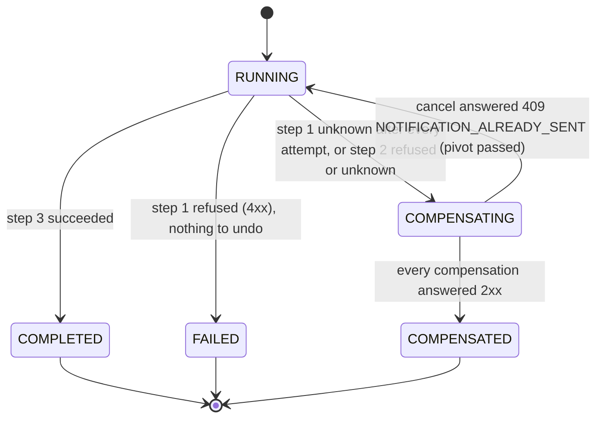

# Saga contract: decision verdict (Lab 5, Grade 9)

Owner: Andi (@blinduandi). Coordinator in `gateway-service` (`app/saga.py`; the Gateway is a common
service), participants `moderation-service` and `discord-dms-service`. Used only by these three;
`contracts/messaging.proto` is unchanged, so no other service regenerates anything. Runbook, demo
and measured results: [`docs/LAB_5_SAGA.md`](../docs/LAB_5_SAGA.md).

## The operation

**Issuing a verdict** (`POST /sagas/decision-verdicts`) changes two stores:

| Participant | Store | Change |
|---|---|---|
| `moderation-service` | `moderation-postgres` | `decision`: the decision, evaluated as for `POST /decisions`. `saga_participation`: the saga's state for it. `outbox_message`: `decision.recorded` and `decision.evaluated`, written only when the saga confirms |
| `discord-dms-service` | `dms-redis` | The applicant's `VERDICT` notification in the delivery queue; the key `dms:saga:{sagaId}` naming it |

Either both changes stay or neither does: a step that fails is undone by the compensations of the
steps before it, in reverse order. A two-phase commit is not possible here, for two reasons:

- Redis has no `PREPARE`.
- A direct message, once delivered to Discord or Telegram, cannot be held or taken back.

The saga therefore orders its steps so that the step that cannot be undone comes after every step
that can (the pivot).

## Steps

| # | Step | Participant | Forward call | Compensation |
|---|---|---|---|---|
| 1 | `record-decision` | `moderation-service` | `POST /internal/sagas/{sagaId}/decision` (body: the `CreateDecisionRequest`) | `POST /internal/sagas/{sagaId}/decision/compensate` |
| 2 | `queue-verdict-notification` | `discord-dms-service` | `POST /internal/sagas/{sagaId}/notification` (body made by the coordinator from step 1's `DecisionResponse`) | `POST /internal/sagas/{sagaId}/notification/cancel` |
| 3 | `confirm-decision` | `moderation-service` | `POST /internal/sagas/{sagaId}/decision/confirm` | none: a retriable step, retried until it succeeds |

- **Step 2 is the pivot.**
  - Before it, everything can be undone. After it, the saga only moves forward.
  - A notification that was already delivered cannot be cancelled
    (`409 NOTIFICATION_ALREADY_SENT`). In that case the coordinator counts step 2 as done and
    confirms.
- **Isolation (countermeasures).** A saga has no isolation of its own, so two countermeasures are
  used:
  - **Semantic lock:** the decision is recorded `PENDING`. While it is pending, `PATCH` and
    `DELETE /decisions/{id}` answer `409 DECISION_PENDING`.
  - **Deferred events:** moderation-service holds the decision's events until step 3. The session
    queue (`decision.recorded`) and the player's XP (`decision.evaluated`) never see a decision
    that is later compensated. A compensation therefore never has to be undone downstream.
- **One verdict message.** `verdict.issued` is never published for a saga decision, because step 2
  queues the `VERDICT` message itself. The applicant gets one message, not two.

```mermaid
sequenceDiagram
    participant C as Client
    participant G as gateway-service (coordinator)
    participant L as saga log (SQLite)
    participant M as moderation-service
    participant D as discord-dms-service
    C->>G: POST /sagas/decision-verdicts (Idempotency-Key)
    G->>L: saga RUNNING; step 1 RUNNING, attempt 1
    G->>M: POST /internal/sagas/{id}/decision
    M-->>G: 201 decision PENDING (no events yet)
    G->>L: step 1 SUCCEEDED; step 2 RUNNING, attempt 1
    G->>D: POST /internal/sagas/{id}/notification
    alt queued
        D-->>G: 202 notification QUEUED
        G->>L: step 2 SUCCEEDED; step 3 RUNNING, attempt 1
        G->>M: POST /internal/sagas/{id}/decision/confirm
        M-->>G: 200 CONFIRMED (events written to the outbox)
        G->>L: saga COMPLETED
        G-->>C: 201 saga document
    else refused, or no answer after every attempt
        G->>L: saga COMPENSATING
        G->>D: POST /internal/sagas/{id}/notification/cancel
        D-->>G: 200 CANCELLED
        G->>M: POST /internal/sagas/{id}/decision/compensate
        M-->>G: 200 COMPENSATED (decision voided)
        G->>L: saga COMPENSATED
        G-->>C: 409 SAGA_COMPENSATED
    end
```

## States



A step is in one of these states:

- `PENDING`, `RUNNING`, `SUCCEEDED`, `FAILED`, `COMPENSATING` or `COMPENSATED`;
- `SKIPPED`: never called, either after the step that failed, or because there was nothing to undo.

## Coordinator API (`gateway-service`)

On the public port 8080 with the API key, like every path. On the internal port 8090 without it
(Compose network only). Errors are `{error, message}` like everywhere else. With
`SAGA_ENABLED=false`, or when the saga log cannot be opened, every `/sagas` route answers
`503 SAGA_UNAVAILABLE` (the rest of the Gateway keeps working). A log that cannot be opened at
startup is logged once as an `ERROR` with the path and the reason, and stays unavailable until the
Gateway restarts with a writable path.

**`POST /sagas/decision-verdicts`** starts a saga and waits for it at most
`SAGA_RESPONSE_TIMEOUT_SECONDS` (8 s). The body is the `CreateDecisionRequest` of
`POST /decisions`, passed to moderation-service unchanged (it validates it):

```json
{
  "sessionId": "string (uuid)",
  "applicantId": "string (uuid)",
  "credentialId": "string (uuid)",
  "moderatorId": "string (uuid)",
  "action": "string (ACCEPT | REJECT | FLAG | BAN, case-insensitive)"
}
```

Optional header `Idempotency-Key` (1-128 visible ASCII characters, sent once): the same key again
answers the saga it started, and no second saga is created. Every answer with a saga document has
a `Location: /sagas/{sagaId}` header; one found by its key also has `Idempotent-Replay: true`.

| Answer | When |
|---|---|
| `201 Created`, the saga document | `COMPLETED`: the decision is confirmed and the notification queued. Found again by its key: `200 OK` |
| `202 Accepted`, the saga document | Still `RUNNING` or `COMPENSATING` after 8 s. The saga goes on in the background; read `GET /sagas/{id}` |
| The participant's status, the saga document with its `error` and `message` | `FAILED`: moderation-service refused the decision, so nothing changed. For example `400 VALIDATION_FAILED`, `409 DUPLICATE_DECISION`, `422 CREDENTIAL_NOT_FOUND`, `422 CREDENTIAL_APPLICANT_MISMATCH`. Also, never expected, a refused step 3 (`CONFIRM_REFUSED`, with the participant's `4xx`) |
| `409 SAGA_COMPENSATED`, the saga document | `COMPENSATED`: a later step failed, or step 1 had no known outcome, and everything was undone. This includes a `503 NO_ACTIVE_RULESET` or `503 DEPENDENCY_UNAVAILABLE` of moderation-service on every attempt of step 1 |
| `400 VALIDATION_ERROR` | The body is not a JSON object, or the `Idempotency-Key` is invalid or sent twice. No saga is created |

**`GET /sagas/{sagaId}`** returns the saga document with its `log`. `404 SAGA_NOT_FOUND` for a saga
the log does not know; `400 VALIDATION_ERROR` when the ID is not a UUID.

**`GET /sagas?state=RUNNING|COMPENSATING|COMPLETED|FAILED|COMPENSATED&limit=1..100`** (default 20)
lists sagas newest first, without their logs: `{ "sagas": [ ... ] }`. These are `400
VALIDATION_ERROR`:

- a `state` outside that set;
- a `limit` outside 1-100;
- a parameter given twice;
- any other parameter.

**Saga document:**

```json
{
  "sagaId": "string (uuid, made by the Gateway)",
  "type": "decision-verdict",
  "state": "string (RUNNING | COMPENSATING | COMPLETED | FAILED | COMPENSATED)",
  "decisionId": "string (uuid) | null (known after step 1)",
  "notificationId": "string (uuid) | null (known after step 2; null when the pivot was passed through 409 NOTIFICATION_ALREADY_SENT)",
  "createdAt": "string (ISO-8601 datetime)",
  "updatedAt": "string (ISO-8601 datetime)",
  "steps": [
    {
      "name": "string (record-decision | queue-verdict-notification | confirm-decision)",
      "participant": "string (moderation-service | discord-dms-service)",
      "state": "string (PENDING | RUNNING | SUCCEEDED | FAILED | COMPENSATING | COMPENSATED | SKIPPED)",
      "attempts": "integer",
      "compensationAttempts": "integer",
      "lastStatus": "integer | null (HTTP status of the last call)",
      "lastError": "string | null (error code of the last call)"
    }
  ],
  "log": [
    {
      "at": "string (ISO-8601 datetime)",
      "step": "string | null",
      "action": "string (forward | compensate | state)",
      "attempt": "integer | null",
      "outcome": "string"
    }
  ],
  "error": "string (only FAILED or COMPENSATED)",
  "message": "string (only FAILED or COMPENSATED)",
  "cause": { "step": "string", "status": "integer | null", "error": "string | null" }
}
```

- `log` is append-only and is returned only by `GET /sagas/{id}`.
  - A `forward` or `compensate` line has the attempt and the call's outcome: the status with the
    participant's error code (`201`, `409 SAGA_COMPENSATED`), or `TIMEOUT`, `UNREACHABLE` or
    `NO_AVAILABLE_INSTANCES` without an answer. A `2xx` of step 1 or 2 without a usable `id` is
    the status with `INVALID_RESPONSE` (`201 INVALID_RESPONSE`).
  - A `state` line has the saga's new state, or `RESUMED` after a restart.
- `error`, `message` and `cause` are present only when the saga failed or was compensated:
  - `FAILED` from step 1 copies the participant's `error` and `message` (`SAGA_STEP_REFUSED` and a
    message of the Gateway's own when it sent none);
  - a refused step 3 is `CONFIRM_REFUSED`;
  - `COMPENSATED` is `SAGA_COMPENSATED`;
  - `cause` is the step, the status (`null` without an answer) and the error code that ended the
    saga.

## Participant API

The participant routes exist only on HTTP. The Gateway's proxy routes no `/internal` path
(`404 ROUTE_NOT_FOUND` on 8080 and 8090), so only the coordinator calls them. The participants do
not authenticate their callers, like `/internal/logs` in Lab 4:

- `moderation-service` publishes no port, so its routes are reachable on the Compose network only.
- `discord-dms-service` publishes `8088` for the chat, so that one instance answers them on the host
  too, like every other route of its REST API. The replica publishes nothing.

Like every request, they accept `X-Request-Id` (at most 64 characters) and `X-Saga-Id`.

**Idempotency and tombstones.** Every route is idempotent per `sagaId`. A compensation of
something that never happened leaves a tombstone. A forward call that arrives after the
compensation is then refused with `409 SAGA_COMPENSATED` instead of creating what was just undone.
This covers a late or duplicated call, for example one the coordinator timed out on.

### `moderation-service`

The table `saga_participation` (migration `AddSagaParticipations`) holds one row per saga:

- `saga_id` (primary key);
- `decision_id` (unique, references `decision(id)`; `NULL` for a tombstone);
- `state` (`PENDING`, `CONFIRMED` or `COMPENSATED`);
- `version` (an optimistic concurrency token);
- `created_at`, `updated_at`.

**`POST /internal/sagas/{sagaId}/decision`**, with the `CreateDecisionRequest` as body:

| Answer | When |
|---|---|
| `201` + `Location: /decisions/{id}`, the `DecisionResponse` | New. The decision is recorded with the same validation, evidence and evaluation as `POST /decisions`, together with the participation `PENDING` in one transaction, and without events |
| `200` + `Idempotent-Replay: true`, the same `DecisionResponse` | The saga's decision exists already (`PENDING` or `CONFIRMED`). Nothing is evaluated again |
| `409 SAGA_COMPENSATED` | A tombstone, or the saga was compensated |
| The errors of `POST /decisions` (`400`, `409 DUPLICATE_DECISION`, `422`, `503`) | Otherwise |

**`POST /internal/sagas/{sagaId}/decision/confirm`** answers `200` with a
`SagaDecisionStateResponse`, `409 SAGA_COMPENSATED`, or `404 SAGA_NOT_FOUND` when the saga recorded
nothing:

- From `PENDING`, in one transaction, it writes the held `decision.recorded` and
  `decision.evaluated` to the outbox and moves to `CONFIRMED`. The payloads are the same as for an
  ordinary decision: `recordedAt` and `evaluatedAt` are the decision's `createdAt`, and the request
  ID is that of the confirm call. `verdict.issued` is not written.
- When it is `CONFIRMED` already, nothing is written again.

**`POST /internal/sagas/{sagaId}/decision/compensate`** always answers `200` with a
`SagaDecisionStateResponse`, except `503` while the database is down:

- `PENDING`: the decision is voided without an event, since nothing was published.
- `CONFIRMED`: an ordinary void that publishes `decision.voided`, like `DELETE /decisions/{id}`.
  The coordinator never compensates after step 3, so this happens only on a call by hand.
- No participation: a tombstone is inserted.
- `COMPENSATED`: nothing to do.

Calls for one saga that race end consistent. The `saga_id` primary key decides concurrent inserts
(a forward call and a tombstone), and the `version` token decides concurrent updates (a confirm and
a compensation). The call that loses reloads the row and answers from the winner's result, so the
saga never records a second decision, and no lock is held while the dependencies are called.

`SagaDecisionStateResponse` (`confirm` answers it only with `CONFIRMED`, `compensate` only with
`COMPENSATED`):

```json
{
  "sagaId": "string (uuid)",
  "state": "string (CONFIRMED | COMPENSATED)",
  "decisionId": "string (uuid) | null (a tombstone)",
  "updatedAt": "string (ISO-8601 datetime)"
}
```

**Public routes during the saga:**

- Every `DecisionResponse` has a field `saga`: `{ "sagaId", "state" }` for a saga decision, `null`
  for an ordinary one. This includes `GET /decisions/{id}` and `GET /sessions/{id}/decisions`.
- `PATCH /decisions/{id}` and `DELETE /decisions/{id}` of a `PENDING` saga decision answer
  `409 DECISION_PENDING`: the decision is part of saga `{sagaId}`, which has not finished.
- A compensated decision is voided, so the public routes answer `404 DECISION_NOT_FOUND`.

### `discord-dms-service`

**`POST /internal/sagas/{sagaId}/notification`**, with a `SagaVerdictNotificationRequest` as body:

| Answer | When |
|---|---|
| `202` + `Location: /notifications/{id}/status`, the queued-notification response with `sagaId` | New. A `VERDICT` notification for `applicantId` is queued, and the key `dms:saga:{sagaId}` (the prefix is `Storage:KeyPrefix`) is set atomically with it |
| `200` + `Idempotent-Replay: true`, the same body, no `Location` | This saga queued it already. The body of the repeated call is not compared with the first one |
| `409 SAGA_COMPENSATED` | The saga was compensated first: a tombstone, or its notification was cancelled |
| `400 VALIDATION_FAILED`, `400 MALFORMED_REQUEST`, `415 UNSUPPORTED_MEDIA_TYPE` | Invalid body |
| `503 STORE_UNAVAILABLE` + `Retry-After: 5` | Redis unavailable (see below) |

**`POST /internal/sagas/{sagaId}/notification/cancel`**, with an empty body:

| Answer | When |
|---|---|
| `200 { "sagaId", "state": "CANCELLED", "notificationId" }` | Not delivered yet (`QUEUED`, `RATE_LIMITED`, `FAILED`): removed from the queue and the store in one Redis transaction, conditional on no delivery being in progress, so it is never sent. A notification removed with `DELETE /notifications/{id}` counts as cancelled too |
| The same, with `notificationId: null` | Nothing queued: a tombstone |
| The same answer again | Already cancelled |
| `409 NOTIFICATION_ALREADY_SENT` | It was delivered, so the pivot is passed |
| `503 NOTIFICATION_IN_DELIVERY` + `Retry-After: 1` | A delivery worker is sending it at this moment. The coordinator counts this as unknown and retries; the next cancel answers `200` or `409 NOTIFICATION_ALREADY_SENT` |
| `503 STORE_UNAVAILABLE` + `Retry-After: 5` | Redis unavailable (see below) |

On both routes a `{sagaId}` that is not a UUID is `404 NOT_FOUND`. `STORE_UNAVAILABLE` covers a lost
connection, a command that waits longer than `Storage:CommandTimeoutMilliseconds` (3 s), and the
errors a member sends during a failover (`READONLY`, `LOADING`, `MASTERDOWN`, and `EXECABORT` for a
transaction one of them discarded).

`SagaVerdictNotificationRequest` has the fields and validation of the `verdict.issued` payload,
without `eventId` and `correct`:

```json
{
  "decisionId": "string (uuid)",
  "applicantId": "string (uuid)",
  "action": "string (ACCEPT | REJECT | FLAG | BAN, case-insensitive)",
  "violatedRules": ["string"],
  "issuedAt": "string (ISO-8601 datetime)"
}
```

`violatedRules` may be omitted.

- The coordinator fills it from step 1's `DecisionResponse`: `id`, `applicantId`, `action`,
  `verdict.violatedRules`, and `createdAt` as `issuedAt`.
- The notification text is the same as for `verdict.issued`.
- Its `metadata` is
  `{ "eventType": "saga.decision-verdict", "sagaId", "decisionId", "action", "violatedRules", "issuedAt" }`.
- `metadata.action` is upper case.
- The receipt `dms:saga:{sagaId}` expires `Storage:RetentionHours` (7 days) after it is written,
  at queueing or at cancellation. A saga repeated after that is treated as new.
- `X-Saga-Id` is accepted but not read: the saga is the `{sagaId}` of the path, which the
  `DiscordDmsService.Application.*` log lines name.
- `dms_saga_operations_total{operation, outcome}` counts the calls: `queue` with `queued`,
  `replayed`, `refused` or `compensated`, and `cancel` with `cancelled`, `tombstone`, `replayed`,
  `already_sent` or `in_delivery`. A call answered `503 STORE_UNAVAILABLE` counts in
  `service_errors_total` only.
- The delivery worker sets `dms:delivering:{id}` before it calls Discord, and only on a
  notification that still exists, so a cancel answered `200` is never followed by a delivery.
- One case is not covered: an instance that stops after Discord accepted the message but before the
  outcome was stored. Its marker expires after `Delivery:LeaseSeconds` (30 s). Until then a cancel
  answers `503 NOTIFICATION_IN_DELIVERY`, and afterwards `200`, although the applicant has received
  the message.

## Retries, timeouts and recovery

| Setting (`gateway-service`; in `.env`: `GATEWAY_` + the name) | Default | Meaning |
|---|---|---|
| `SAGA_ENABLED` | `true` | `false`: every `/sagas` route answers `503 SAGA_UNAVAILABLE` |
| `SAGA_LOG_PATH` | `/data/gateway-sagas.sqlite3` | The saga log (`gateway-data` volume; `synchronous=FULL`) |
| `SAGA_STEP_TIMEOUT_SECONDS` | `5` | Per participant call; no answer in time is an unknown outcome |
| `SAGA_STEP_ATTEMPTS` | `3` | Attempts of a forward call of step 1 or 2 whose outcome stays unknown |
| `SAGA_RETRY_BACKOFF_SECONDS` | `1` | Wait before the second attempt, doubled after each attempt |
| `SAGA_MAX_BACKOFF_SECONDS` | `30` | Cap of that wait (it matters for the calls retried without limit) |
| `SAGA_RECOVERY_INTERVAL_SECONDS` | `5` | How often unfinished sagas in the log are resumed |
| `SAGA_RESPONSE_TIMEOUT_SECONDS` | `8` | How long `POST /sagas/decision-verdicts` waits before answering `202` |
| `SAGA_STEP_DELAY_SECONDS` | `0` | Demonstrations only: wait before steps 2 and 3 |

**Outcome of a call:**

| Outcome | Answer |
|---|---|
| Success | `2xx`. For steps 1 and 2, only with a usable `id` in the body |
| Definitive refusal | `4xx` except `429`; `409 SAGA_COMPENSATED` included |
| Unknown | No answer in time, no connection, no instance available, `5xx`, `429`, or a `2xx` without an `id` |

An unknown outcome is retried with the same idempotent call, so a retry never does anything twice.

| Situation | What the coordinator does |
|---|---|
| Step 1 refused | `FAILED`, nothing to undo |
| Step 1 unknown after every attempt | The decision may exist. Compensate step 1 (a tombstone if it doesn't exist), then `COMPENSATED` |
| Step 2 refused, or unknown after every attempt | `COMPENSATING`: cancel the notification, then compensate the decision. If the cancel answers `409 NOTIFICATION_ALREADY_SENT`, step 2 becomes `SUCCEEDED`, the saga goes back to `RUNNING`, and step 3 runs |
| Step 3 unknown | Retried without limit, since the saga is past the pivot |
| Step 3 refused (never expected) | `FAILED` with `CONFIRM_REFUSED`, logged as an error |
| Compensation | Retried without limit until it answers `2xx` |

- **Write-ahead:** before calling a participant, the coordinator commits the attempt to the log:
  the step's state (`RUNNING` or `COMPENSATING`) and its attempt counter. Right after the answer
  it commits the outcome as a new log line. After a crash, the log therefore shows which call may
  have happened without a recorded answer, and the coordinator repeats it. The participant
  answers a repeated call as a replay.
- **Recovery:** at start, and every `SAGA_RECOVERY_INTERVAL_SECONDS`, the Gateway resumes every
  saga in `RUNNING` or `COMPENSATING` that it is not already driving. It repeats the current
  step's call, or continues compensating. The attempts are counted across restarts. When the last
  allowed attempt of step 1 or 2 was cut off by the stop, its outcome is unknown, and the saga
  compensates (`cause.error` is `INTERRUPTED`).
- **One owner:** one Gateway instance owns the log (Compose runs one). Running several Gateways on
  one log file is not supported.
- **Reaching the participants:** they are reached the way the proxy reaches them. Each attempt
  picks an instance from the Service Discovery through the load balancer, preferring one whose
  circuit lets requests through, otherwise `MODERATION_SERVICE_URL` / `DMS_SERVICE_URL`. While
  every discovered instance is removed, the attempt is `NO_AVAILABLE_INSTANCES`. Saga calls are
  not counted in the proxy's circuit breakers: the saga handles a failed call itself, and its
  retries would otherwise open the circuit for ordinary requests and hold back the compensations.
- **Calls:** every call sends `X-Request-Id` (the ID of the request that started the saga, also
  after a restart) and `X-Saga-Id`.

## Events

- No event is published for a saga decision before step 3.
- At step 3 moderation-service writes `decision.recorded` and `decision.evaluated` to its outbox,
  with the payloads of an ordinary decision (`recordedAt` and `evaluatedAt` are the decision's
  `createdAt`). The dispatcher publishes them as usual; `server-moderation-session-service` and
  `player-service` consume them unchanged.
- `decision.voided` is published only when a confirmed saga decision is compensated (by hand; the
  coordinator never compensates after step 3).
- `verdict.issued` is not published for a saga decision, because step 2 queued the message.
