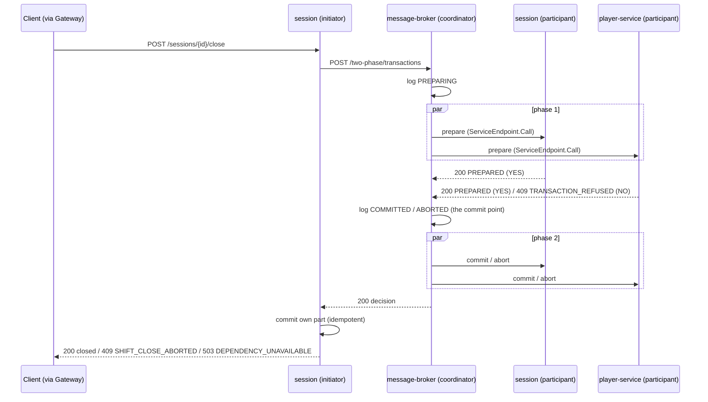

# Two-phase commit contract (Lab 5, Grade 8)

Owner: Daria (`message-broker`, `player-service`, `server-moderation-session-service`). Used only by
these three; `contracts/messaging.proto` is unchanged, so no other service regenerates anything.
Runbook, demo and measured results: [`docs/LAB_5_TWO_PHASE_COMMIT.md`](../docs/LAB_5_TWO_PHASE_COMMIT.md).

## The operation

**Closing a shift** (`POST /sessions/{id}/close`) changes two databases:

| Participant | Database | Change |
|---|---|---|
| `server-moderation-session-service` | `session-postgres` | `sessions`: `status = CLOSED`, `closed_at`, `close_transaction_id`; `session_summary`: final score |
| `player-service` | `player-postgres` | `player_stats` of the moderator and every junior moderator: `total_shifts + 1`, `last_shift_at = closedAt`; `processed_events`: the transaction ID as a `session.closed` |

With `SHIFT_CLOSE_MODE=two-phase` (the CPR compose default) both change in one distributed
transaction or neither does. With `event` (the Lab 4 way) the session closes locally and
`session.closed` credits the players later.

## Roles

- **Coordinator:** `message-broker` (`app/two_phase.py`). Its log is the table
  `two_phase_transactions` in the broker's SQLite file (`QUEUE_STORE_PATH`, `synchronous=FULL`).
- **Initiator:** the session instance that got the close. It asks the coordinator to run the
  transaction and answers the client from the decision.
- **Participants:** both services. They prepare with PostgreSQL's `PREPARE TRANSACTION '<gid>'`
  (`gid = <service>:<transactionId>`) and finish with `COMMIT PREPARED` / `ROLLBACK PREPARED`. A
  prepared transaction is durable, holds its row locks, is replicated to the synchronous standby,
  and can be finished from any instance, also after a restart or a database failover.
  `max_prepared_transactions` must be above 0 (`docker/postgres-ha/patroni.yml`: 20).



## Coordinator API (`message-broker`, HTTP 8091, Compose network only)

Bodies are JSON with a `Content-Length` (the broker refuses chunked bodies: `411`). Errors are
`{error, message}` like everywhere else.

**`POST /two-phase/transactions`** — run a transaction (both phases) and answer its decision.

```json
{
  "transactionId": "string (uuid, chosen by the initiator)",
  "source": "server-moderation-session-service",
  "participants": [
    { "service": "server-moderation-session-service", "payload": { "sessionId": "uuid", "closedAt": "ISO-8601" } },
    { "service": "player-service", "payload": { "moderatorId": "uuid", "juniorModeratorIds": ["uuid"], "closedAt": "ISO-8601" } }
  ]
}
```

Response `200 OK` (for both decisions):

```json
{
  "transactionId": "uuid",
  "source": "server-moderation-session-service",
  "state": "COMMITTED | ABORTED",
  "completed": "boolean (every participant acknowledged phase 2)",
  "reason": "string | null (why it aborted)",
  "createdAt": "ISO-8601", "decidedAt": "ISO-8601", "completedAt": "ISO-8601 | null",
  "participants": [
    { "service": "player-service", "vote": "YES | NO | NO_ANSWER", "reason": "string | null",
      "outcome": "COMMITTED | ABORTED | NOT_PREPARED | ALREADY_COMMITTED | null (not acknowledged yet)" }
  ]
}
```

`400 VALIDATION_ERROR` (not a UUID, no participants, more than 10, a service twice, a payload that
isn't an object). The same `transactionId` again answers the logged decision without preparing
again; while it is still `PREPARING`: `409 TRANSACTION_IN_PROGRESS` + `Retry-After: 1`.

**`GET /two-phase/transactions/{transactionId}`** — the same body; `404 TRANSACTION_NOT_FOUND` for a
transaction the log doesn't know (a participant treats that as aborted: presumed abort).

**`GET /two-phase/transactions?state=PREPARING|COMMITTED|ABORTED&limit=1..1000`** — newest first:
`{ "total": n, "transactions": [ ... ] }`.

## Participant API (`player-service`, `server-moderation-session-service`)

`POST /internal/two-phase/{transactionId}/prepare | commit | abort`. The coordinator sends them over
gRPC `ServiceEndpoint.Call` (instance chosen and circuit breakers as for every `Call`, port HTTP +
1000; `source: "message-broker"`). They exist on HTTP too, for checks on the Compose network; the
Gateway routes no `/internal` path. Only with `TWO_PHASE_PARTICIPANT_ENABLED=true`.

**prepare** — body `{ "transactionId", "source", "payload" }` (the participant's payload above).

| Answer | Meaning |
|---|---|
| `200 {"transactionId", "state": "PREPARED"}` | **YES**: the change is prepared. Asked again: YES again |
| `409 TRANSACTION_REFUSED` | **NO**, with the reason; nothing kept. player: a moderator who isn't a registered player, a player locked longer than `TWO_PHASE_LOCK_TIMEOUT` (2 s), already applied. session: the session is gone, already closed, or locked |
| anything else, or no answer within 3 s | counted as **NO** (`NO_ANSWER`) |

**commit** — `200 {"state": "COMMITTED"}`, also when it was committed before; `409 NOT_PREPARED`
when nothing is prepared and it was never committed.
**abort** — `200 {"state": "ABORTED"}`, also when nothing was prepared (presumed abort);
`409 ALREADY_COMMITTED` when it was committed (never happens in the protocol).

The coordinator sends phase 2 only to participants that may hold a prepared transaction (after an
abort, not to those that voted NO), and sends it again every `TWO_PHASE_RETRY_SECONDS` (5) until
each one answers `200` or one of the two `409`s.

## Timeouts, presumed abort and recovery

| Setting (owner) | Default | Meaning |
|---|---|---|
| `TWO_PHASE_PREPARE_TIMEOUT_SECONDS` (broker) | `3` | Per prepare; no answer in time is a NO |
| `TWO_PHASE_COMMIT_TIMEOUT_SECONDS` (broker) | `2` | Per commit/abort; no answer is retried |
| `TWO_PHASE_RETRY_SECONDS` (broker) | `5` | Recovery: unfinished phase 2 sent again, stale `PREPARING` aborted |
| `TWO_PHASE_PHASE_TWO_DELAY_SECONDS` (broker) | `0` | Demonstrations only: wait between the decision and phase 2 |
| `SHIFT_CLOSE_COORDINATOR_TIMEOUT` (session) | `7s` | How long the close waits for the decision (below `TASK_TIMEOUT` 10 s) |
| `TWO_PHASE_SWEEP_AFTER` / `TWO_PHASE_SWEEP_INTERVAL` (both) | `30s` / `10s` | When a participant asks the coordinator about a transaction still prepared |

- **Presumed abort:** no decision is logged for an abort before it is sent; a transaction the
  coordinator doesn't know, or one still `PREPARING` after prepare timeout + retry period (the
  coordinator stopped mid-vote), is aborted.
- **Coordinator restart:** at start and every retry period it finishes phase 2 of every decided,
  unacknowledged transaction from its log.
- **Participant restart or failover:** the prepared transaction is still in `pg_prepared_xacts`; the
  coordinator's retries finish it. Each participant also sweeps: a transaction still prepared after
  `TWO_PHASE_SWEEP_AFTER` is committed or rolled back as the coordinator answers
  (`GET /two-phase/transactions/{id}`: `COMMITTED` → commit, `ABORTED` or `404` → roll back,
  `PREPARING` or no answer → keep).
- **Blocking:** while a transaction is prepared its rows stay locked (the shift's session row, the
  players' rows). Other writes to them wait or, as broker deliveries, are answered `RETRY`.

## Events

`session.closed` is still published (dms and applicant subscribe), after the commit, by the session
instance that ran `COMMIT PREPARED`, with **`eventId` = `messageId` = the transaction ID**.
`player-service` finds that ID in `processed_events` (written in the same transaction) and skips it,
so the shift is counted once. The SSE `closed` update is sent after the commit too (PostgreSQL can't
prepare a transaction that sent `NOTIFY`).

## Answers of `POST /sessions/{id}/close` with `SHIFT_CLOSE_MODE=two-phase`

| Answer | When |
|---|---|
| `200 OK` (unchanged body) | Committed in both databases |
| `404 SESSION_NOT_FOUND`, `409 SESSION_ALREADY_CLOSED` | As before (also when found by the participant during the vote) |
| `409 SHIFT_CLOSE_ABORTED` | A participant voted NO or didn't answer; nothing changed anywhere |
| `503 DEPENDENCY_UNAVAILABLE` + `Retry-After: 5` | No decision reached the initiator (broker unreachable, slower than 7 s). The outcome is unknown here: the coordinator may still commit, so read `GET /sessions/{id}` before closing again |
