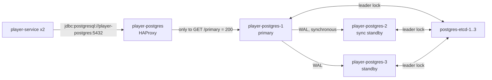

# Laboratory 5: replicated databases with failover

Lab 5, Grade 5: "database redundancy/replication + failover: any kind of replication for your
private services, minimum 2 replicas". This runbook covers the databases of `player-service` and
`server-moderation-session-service` (owner: Daria, @DariaRateeva): how they are replicated, how a
failover works, how to check it, and what the services do meanwhile. The other owners replicate
their own databases; `docker/postgres-ha/` can be reused for any PostgreSQL 16 database.

## What runs

| Container | Image | Role |
|---|---|---|
| `player-postgres-1..3` | `drateeva/postgres-ha:16.16-patroni4.1.5` | The members of player-service's database: PostgreSQL 16 managed by Patroni 4.1.5. One primary, one synchronous standby, one asynchronous standby, all streaming replication |
| `session-postgres-1..3` | same | The same for server-moderation-session-service |
| `player-postgres`, `session-postgres` | `haproxy:3.0.31-alpine` | The cluster's stable address (the hostname the services and every other client already use): forwards each connection to the member that is the primary now |
| `postgres-etcd-1..3` | `quay.io/coreos/etcd:v3.6.17` | The consensus store: Patroni keeps each cluster's leader lock here, so there is never more than one primary |

Everything is private to the Compose network (no published port). The image is built from
`docker/postgres-ha/` (`Dockerfile`, `patroni.yml`, `post-bootstrap.sh`); HAProxy reads
`docker/postgres-ha/haproxy-postgres.cfg`.



## How a failover works

1. Patroni on the primary renews the cluster's leader lock in etcd every 3 s (`loop_wait`); the
   lock expires after 12 s (`ttl`).
2. When the primary is lost (crash, `docker kill`, network), the lock expires; the standbys race
   for it, and only one that is at most 1 MiB of WAL behind may take it. It is promoted to primary
   on a new timeline; the other standby follows it.
3. HAProxy asks every member `GET :8008/primary` each second; two answers in a row mark a member up
   or down. The new primary turns up, the old one down, and the connections still open to the old
   one are closed (`on-marked-down shutdown-sessions`), so the services' pools reconnect to the new one.
4. When the old primary comes back, Patroni rewinds it (`pg_rewind`) and it rejoins as a standby.

**No committed transaction is lost:** `synchronous_mode` makes every commit wait until the
synchronous standby has it, and only that standby (or one at most 1 MiB behind) can be promoted.
With no standby left at all, the primary keeps accepting writes alone (`synchronous_mode_strict:
false`). `failsafe_mode` keeps a primary that loses etcd but still reaches the other members.

## What the services do during a failover

- A request that needs the database while there is no primary gets **`503 DATABASE_UNAVAILABLE`**
  with `Retry-After: 5` within 3 s (`DATABASE_CONNECTION_TIMEOUT_MS`), never a 500 and never a hang
  (every JDBC statement has a 30 s socket timeout). The Gateway's and the broker's circuit breakers
  don't count a 503 against the instance.
- A broker delivery (`decision.evaluated`, `session.closed`, `decision.recorded`) that can't reach
  the database is answered `RETRY`; the broker keeps it and delivers it again after the failover.
- `GET /health` reports `Unhealthy` meanwhile (its database check fails), so the Service Discovery
  alerts.
- Session's live updates between replicas (`LISTEN`/`NOTIFY`, primary only) reconnect on their own,
  and every open SSE stream gets the session's current `state` again; the streams stay open.

## Measured (local Docker, 2026-11-21)

| Check | player-postgres | session-postgres |
|---|---|---|
| Primary before → after (`docker kill`) | `player-postgres-1` → `player-postgres-3` | `session-postgres-1` → `session-postgres-2` |
| Writes refused after the crash | 19.7 s | 20.6 s |
| Row committed just before the crash kept | yes | yes |
| Old primary back as a standby after `start` | 4.4 s | 4.6 s |

Evidence: [`evidence/lab5-postgres-failover-2026-11-21.json`](evidence/lab5-postgres-failover-2026-11-21.json).
The same day both services (built from their Lab 5 branches, 2 replicas each) were queried every
0.5 s while both primaries were killed: player 17 × `200`, 5 × `503 DATABASE_UNAVAILABLE`, 88 × `200`;
session 19 × `200`, 7 × `503`, 84 × `200`; no `500`, no request hung. After the failover a new player
was created (`201`) and a shift closed on the other session replica (`200`), and the SSE stream open
on the first replica received `closed`.

## Start and check

Set the four Lab 5 passwords in `.env` (see `.env.example`; they are set when a cluster is created,
so changing them later needs `docker compose down -v`), then:

```bash
docker compose up -d
docker compose exec player-postgres-1 patronictl -c /etc/patroni/patroni.yml list
docker compose exec session-postgres-1 patronictl -c /etc/patroni/patroni.yml list
```

Expected: one `Leader` (`running`), one `Sync Standby` and one `Replica` (`streaming`, lag 0) per
cluster. HAProxy's view: `docker compose exec player-postgres wget -qO- http://127.0.0.1:8404/stats\;csv`.

**Automatic check** (kills each primary, measures, restarts it; standard library only, no `.env`
read, writes a marker table only in the `postgres` maintenance database):

```bash
python3 scripts/check_postgres_failover.py --cluster both --evidence docs/evidence/lab5-postgres-failover.json
```

**Manual demo:** find the `Leader` with `patronictl list`, `docker compose kill <leader>`, run
`patronictl list` again a few times (a standby becomes `Leader`, `TL` goes up by one), call
`GET /players/<id>` through the Gateway meanwhile (`503 DATABASE_UNAVAILABLE`, then `200`), then
`docker compose start <old leader>` and watch it come back as `Replica`. A planned switch without
downtime for writes beyond a second or two: `patronictl -c /etc/patroni/patroni.yml switchover --force`.

## Notes

- **Upgrading from Lab 4:** the single-container volumes `player-postgres-data` and
  `session-postgres-data` are not used any more; the clusters start empty and Flyway creates the
  schemas. Remove the old volumes with `docker volume rm <project>_player-postgres-data
  <project>_session-postgres-data` once nothing in them is needed.
- **The image** is published by its owner from this directory (both architectures):
  `docker buildx build --platform linux/amd64,linux/arm64 -t drateeva/postgres-ha:16.16-patroni4.1.5 --push docker/postgres-ha`.
- **Timings** come from `ttl` 12 / `loop_wait` 3 / `retry_timeout` 4 (`patroni.yml`, applied when a
  cluster is created; later with `patronictl edit-config`). Shorter values fail over faster but risk
  a failover on a short hiccup.
