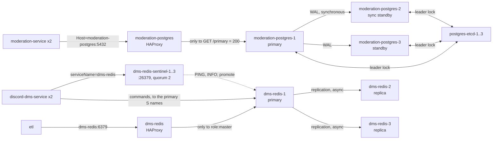

# Laboratory 5: replicated moderation and DMS stores with failover

Lab 5, Grade 5: "database redundancy/replication + failover: any kind of replication for your
private services, minimum 2 replicas". This runbook covers the stores of `moderation-service`
(PostgreSQL) and `discord-dms-service` (Redis), owner: Andi (@blinduandi). It covers how each is
replicated, how a failover works, how to check it, and what the services do meanwhile. The
PostgreSQL side reuses Daria's Patroni setup unchanged (`docker/postgres-ha/`,
[LAB_5_DATABASE_FAILOVER.md](LAB_5_DATABASE_FAILOVER.md)). The Redis side is new
(`docker/redis-ha/`).

## What runs

| Container | Image | Role |
|---|---|---|
| `moderation-postgres-1..3` | `drateeva/postgres-ha:16.16-patroni4.1.5` | The members of moderation-service's database: PostgreSQL 16 managed by Patroni. One primary, one synchronous standby, one asynchronous standby, streaming replication |
| `moderation-postgres` | `haproxy:3.0.31-alpine` | The cluster's stable address (the hostname moderation-service and the ETL job already use): forwards to the member whose `GET :8008/primary` answers 200 |
| `postgres-etcd-1..3` | `quay.io/coreos/etcd:v3.6.17` | Shared with the other PostgreSQL clusters: holds the leader lock of `moderation-postgres` (Patroni scope `moderation-postgres`) |
| `dms-redis-1..3` | `redis:7.4-alpine` | The members of discord-dms-service's Redis: one primary, two replicas (asynchronous replication, AOF on every member) |
| `dms-redis-sentinel-1..3` | `redis:7.4-alpine` | Redis Sentinel: watch the primary under the name `dms-redis`, promote a replica when it is lost, and tell clients which member is the primary |
| `dms-redis` | `haproxy:3.0.31-alpine` | The stable address under the old hostname, for clients that know one address only (the ETL job): forwards to the member that reports `role:master` |

Everything is private to the Compose network (no published port). Every member and every Sentinel
has its own volume (`moderation-postgres-N-data`, `dms-redis-N-data`, `dms-redis-sentinel-N-data`).



## How a failover works

**moderation-postgres** is the same as player-postgres. The primary renews the leader lock in etcd
every 3 s, and the lock expires after 12 s. A standby at most 1 MiB of WAL behind takes the lock
and is promoted. HAProxy marks the new primary up within 2 s, and the old primary comes back as a
standby after `pg_rewind`. Because of `synchronous_mode`, every commit waits for the synchronous
standby, so **no committed transaction is lost**. The details are in
[LAB_5_DATABASE_FAILOVER.md](LAB_5_DATABASE_FAILOVER.md).

**dms-redis:**

1. Each Sentinel PINGs every member once per second. When the primary does not answer for 5 s
   (`down-after-milliseconds`), that Sentinel marks it subjectively down. When two of the three
   agree (`quorum 2`), it is objectively down.
2. The Sentinels elect a leader among themselves; a majority (2 of 3) is needed. The leader
   promotes the replica with the most recent data (`REPLICAOF NO ONE`) and points the other
   replica at it (`parallel-syncs 1`).
3. Clients ask any Sentinel for the primary. discord-dms-service (StackExchange.Redis in Sentinel
   mode) also receives the `+switch-master` message and reconnects to the new primary on its own.
   The HAProxy at `dms-redis` checks every member each second (`AUTH`, `INFO replication`,
   `role:master`). It marks the new primary up and the old one down, and it closes the connections
   still open to the old one.
4. When the old primary comes back, it starts as a replica of the new one. Two mechanisms ensure
   this, so there is never a second primary with older data:
   - The Sentinels rewrite each member's `redis.conf` on its volume.
   - `redis-node.sh` asks the Sentinels for the current primary before it starts Redis.

**What can be lost:** Redis replicates asynchronously, so a write acknowledged by the primary but
not yet copied to a replica when the primary crashes is lost. It is at most the last second of
writes, because the replicas stream continuously. For discord-dms-service that means at most the
last queued notifications or chat messages. The ones the store had already replicated survive:
the queue itself, the event deduplication keys, and the saga keys. A client that needs certainty
can ask for it per write: `WAIT 1 <ms>` returns once a replica has the write. The failover check
writes its marker that way.

## What the services do during a failover

**moderation-service:**

- A request that needs the database while there is no primary gets
  **`503 DATABASE_UNAVAILABLE`** with `Retry-After: 5`. It comes within 3 s
  (`Database:ConnectTimeoutSeconds`), never as a 500 and never as a hang.
- The following also count as "database unavailable":
  - PostgreSQL's shutdown and startup errors (`57P01`, `57P02`, `57P03`);
  - a write refused by a demoted primary (`25006`, read-only transaction);
  - connection errors (SQLSTATE class `08`).
- The outbox dispatcher retries what it could not read or mark as sent, so no event is lost and
  none is published twice.
- `GET /health` reports `Unhealthy` meanwhile (database check), so the Service Discovery alerts.

**discord-dms-service:**

- A request that needs Redis while there is no primary gets **`503 STORE_UNAVAILABLE`** with
  `Retry-After: 5`, within the 3 s Redis timeouts. This also holds for `READONLY` (a write sent to
  a demoted primary), `LOADING` and `MASTERDOWN`.
- The delivery worker and the event consumers keep running and pick up again after the failover.
  A broker delivery that cannot be stored is answered `RETRY`, and the broker delivers it again.
- `GET /health` reports `Unhealthy` meanwhile.

The Gateway's and the broker's circuit breakers do not count a 503 against the instance.

## Measured

Not measured yet. The numbers and the evidence file
(`evidence/lab5-moderation-dms-failover-<date>.json`) are added after the first run of the check
below against the full Compose stack.

## Start and check

Set the two moderation passwords in `.env` (`MODERATION_POSTGRES_SUPERUSER_PASSWORD`,
`MODERATION_POSTGRES_REPLICATION_PASSWORD`; see `.env.example`). They are set when the cluster is
created, so changing them later needs `docker compose down -v`. `DMS_REDIS_PASSWORD` stays the
single password of the Redis members and Sentinels. Then:

```bash
docker compose up -d
docker compose exec moderation-postgres-1 patronictl -c /etc/patroni/patroni.yml list
docker compose exec dms-redis-sentinel-1 redis-cli -p 26379 SENTINEL get-master-addr-by-name dms-redis
docker compose exec dms-redis-sentinel-1 redis-cli -p 26379 SENTINEL replicas dms-redis
```

Expected results:

- **moderation-postgres:** one `Leader` (`running`), one `Sync Standby` and one `Replica`
  (`streaming`).
- **dms-redis:**
  - the Sentinels name `dms-redis-1`, port 6379;
  - two replicas, `flags` `slave`, `master-link-status` `ok`;
  - `SENTINEL master dms-redis` shows `num-other-sentinels 2` and `quorum 2`.

The HAProxy's view: `docker compose exec dms-redis wget -qO- http://127.0.0.1:8404/stats\;csv`.

**Automatic check.** It uses the standard library only and reads no `.env`. For each store it:

- kills the primary;
- measures how long writes are refused;
- checks the marker written before the crash;
- restarts the old primary and waits until it follows the new one.

With `--gateway-url` it also counts what both services answer through the Gateway meanwhile, using
an API key from the `GATEWAY_API_KEY` environment variable. Run it with:

```bash
python3 scripts/check_moderation_dms_failover.py --store both --gateway-url http://localhost:8080 \
    --evidence docs/evidence/lab5-moderation-dms-failover.json
```

**Manual demo (dms-redis):**

1. `docker compose kill $(docker compose exec dms-redis-sentinel-1 redis-cli -p 26379 SENTINEL get-master-addr-by-name dms-redis | head -n 1)`.
2. Ask `SENTINEL get-master-addr-by-name dms-redis` again a few times. Within about 10 s it names
   another member, and `docker compose logs dms-redis-sentinel-1` shows `+odown`,
   `+elected-leader`, `+promoted-slave` and `+switch-master`.
3. Meanwhile, queue a DM through the Gateway (`POST /notifications/dm`). It answers
   `503 STORE_UNAVAILABLE`, then `202`.
4. `docker compose start` the old primary: `INFO replication` on it shows `role:slave` and the new
   primary as `master_host`.

A planned switch: `docker compose exec dms-redis-sentinel-1 redis-cli -p 26379 SENTINEL failover dms-redis`.

**Manual demo (moderation-postgres):**

1. Find the leader with `patronictl list`.
2. `docker compose kill <leader>`.
3. Meanwhile, call `GET /decisions/<id>` through the Gateway: it answers
   `503 DATABASE_UNAVAILABLE`, then `200`.
4. `docker compose start <old leader>`.

## Notes

- **Upgrading from Lab 4:** the single-container volumes `moderation-postgres-data` and
  `dms-redis-data` are no longer used. The cluster starts empty, and moderation-service's EF Core
  migrations create the schema on start. The DMS keeps no long-lived data (`Storage:RetentionHours`).
  Remove the old volumes with `docker volume rm <project>_moderation-postgres-data
  <project>_dms-redis-data` once nothing in them is needed.
- **Configuration on the volumes:**
  - `redis-node.sh` creates each member's `redis.conf` once, and `sentinel.sh` creates each
    Sentinel's `sentinel.conf` once. Redis and the Sentinels then rewrite those files themselves.
  - A changed `DMS_REDIS_PASSWORD` is passed on the command line at every start. A Sentinel's
    configuration, however, keeps the old one: remove the `dms-redis-sentinel-N-data` volumes after
    changing it.
- **Timings:** `down-after-milliseconds` 5000, `failover-timeout` 20000 and quorum 2 come from
  `sentinel.sh` (`REDIS_DOWN_AFTER_MS`, `REDIS_FAILOVER_TIMEOUT_MS`, `REDIS_QUORUM`). They are
  applied when a Sentinel is created; for an existing one, use `SENTINEL SET dms-redis ...`.
- **Why Sentinel and not Redis Cluster:** the DMS keeps one small dataset that fits on one node and
  uses multi-key transactions (`MULTI`/`EXEC`, Lua) across its keys, which Redis Cluster would
  restrict to one hash slot. Sentinel gives replication and automatic failover without changing a
  single key.
