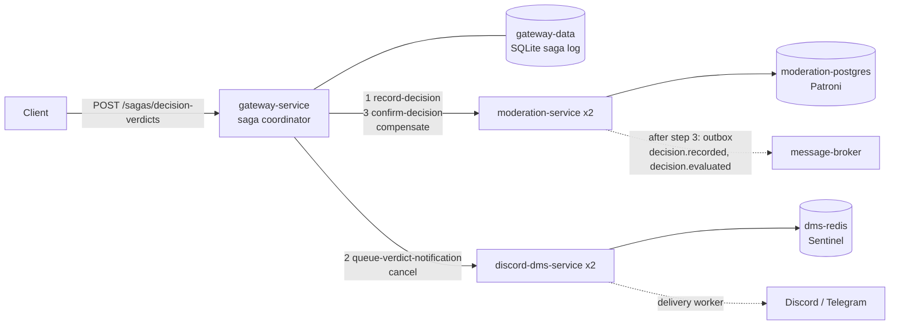

# Laboratory 5: a saga for issuing a verdict

Lab 5, Grade 9: "for functionality that requires changes in 2 or more databases implement Long
Running Saga Transactions with a coordinator". Owner: Andi (@blinduandi). Issuing a verdict changes
two stores:

- `moderation-postgres`: the decision;
- `dms-redis`: the applicant's `VERDICT` direct message.

The saga makes both stay, or undoes every step that ran. The contract (API, answers, timeouts):
[`contracts/saga.md`](../contracts/saga.md).

## What runs

| Piece | Where | Role |
|---|---|---|
| Coordinator | `gateway-service` (`app/saga.py`): `POST /sagas/decision-verdicts`, `GET /sagas/{id}`, `GET /sagas` | Runs the three steps in order. Logs every attempt before the call and every outcome after it, in SQLite (`gateway-data` volume). Compensates in reverse order. Resumes unfinished sagas after a restart |
| Participant: step 1 and step 3 | `moderation-service`: `POST /internal/sagas/{id}/decision`, `/decision/confirm`, `/decision/compensate` | Records the decision `PENDING`, with its events held. Confirm releases the events to the outbox; compensate voids the decision or leaves a tombstone. All of it in local transactions on `moderation-postgres` (Patroni) |
| Participant: step 2 (the pivot) | `discord-dms-service`: `POST /internal/sagas/{id}/notification`, `/notification/cancel` | Queues the `VERDICT` DM together with the key `dms:saga:{id}`, atomically. Cancel removes it before the delivery worker sends it, or answers `409 NOTIFICATION_ALREADY_SENT`. All of it on `dms-redis` (Sentinel) |
| Saga log | `/data/gateway-sagas.sqlite3` in the Gateway (`gateway-data` volume) | Three tables: `sagas`, the steps, and an append-only log. `synchronous=FULL`, so a committed line survives a crash |

The Compose file turns it on: `SAGA_ENABLED: "true"` and `SAGA_LOG_PATH:
/data/gateway-sagas.sqlite3` on `gateway-service`. Every other setting comes from `.env`
(`GATEWAY_SAGA_*`, see `.env.example`). Only the Gateway's proxy is in front of the participants,
and it routes no `/internal` path, so clients reach the saga only through `/sagas`.



## Why it is safe

- **All or nothing, by compensation.**
  - A step that is refused, or still has no answer after `SAGA_STEP_ATTEMPTS` (3), is undone in
    reverse order: the notification is cancelled, then the decision voided.
  - The client gets `409 SAGA_COMPENSATED` once the saga is `COMPENSATED`. If undoing takes
    longer than the 8 s the Gateway waits (for example while discord-dms-service is down), it
    answers `202` with the saga still `COMPENSATING`; `GET /sagas/{id}` shows the outcome.
  - A refusal of step 1 (for example `422 CREDENTIAL_NOT_FOUND`) changed nothing. The saga is
    `FAILED`, and the client gets moderation-service's own status.
- **The pivot comes last among the undoable steps.**
  - A DM, once delivered, cannot be taken back. The saga therefore records the decision first,
    which can always be voided.
  - Once the DM is queued, the only remaining step (confirm) is retried until it succeeds.
  - If a cancel finds the DM already sent, the saga goes forward instead of compensating.
- **Isolation by countermeasures.** A saga commits each step on its own, so other transactions
  could see a half-done saga. Two countermeasures prevent that:
  - **Semantic lock:** until step 3, the decision is `PENDING`, and `PATCH` / `DELETE
    /decisions/{id}` answer `409 DECISION_PENDING`.
  - **Deferred events:** `decision.recorded` and `decision.evaluated` are written to the outbox
    only at step 3. The session queue and the player's XP never react to a decision that is later
    compensated, so no compensation has to reach another service.
- **Idempotent participants and tombstones.**
  - Each route is idempotent per saga ID, so the coordinator can repeat any call after a timeout or
    a restart. A repeated forward call answers `Idempotent-Replay: true` and does nothing again.
  - Compensating something that never happened leaves a tombstone. A late forward call is then
    refused (`409 SAGA_COMPENSATED`) instead of creating what was just undone.
- **Durable coordinator.**
  - Each attempt is committed to the log before the participant is called, and each outcome right
    after.
  - At start and every 5 s the Gateway resumes every saga that is still `RUNNING` or
    `COMPENSATING`, from the step the log names.
  - The participants' stores are replicated with failover (Grade 5:
    [LAB_5_MODERATION_DMS_FAILOVER.md](LAB_5_MODERATION_DMS_FAILOVER.md)). Their
    `503 DATABASE_UNAVAILABLE` / `503 STORE_UNAVAILABLE` during a failover counts as an unknown
    outcome and is retried.
- **One DM.** `verdict.issued` is not published for a saga decision; step 2 queues the message.

## Start

Nothing to prepare: `moderation-service` creates the table `saga_participation` with its EF Core
migrations on start, and the Gateway creates its log on start.

```bash
docker compose up -d
docker compose exec gateway-service printenv SAGA_ENABLED SAGA_LOG_PATH
```

`SAGA_ENABLED` prints `true`. With `false`, or a log the Gateway cannot open, every `/sagas` route
answers `503 SAGA_UNAVAILABLE`; the rest of the Gateway is not affected.

## Check

**Automatic** (`scripts/check_saga.py`): standard library only, no `.env` read. Every call goes
from inside the `service-discovery` container to the Gateway's internal port 8090 or to a
participant, so no API key is needed. The check creates its own decisions, for new sessions, with
the seeded applicant and credential of the Postman collections.

The recovery scenario kills the Gateway between two steps, so start it with a step delay first:

```bash
echo GATEWAY_SAGA_STEP_DELAY_SECONDS=4 >> .env && docker compose up -d gateway-service
python3 scripts/check_saga.py --evidence docs/evidence/lab5-saga.json
```

Remove the line from `.env` and run `docker compose up -d gateway-service` again afterwards.
`--scenario complete|replay|refused|compensation|recovery|api` runs one. Without the delay the
recovery scenario is reported as skipped, not failed.

| Scenario | What it does | Expected |
|---|---|---|
| `complete` | One saga for the seeded applicant | `201 COMPLETED`; every step `SUCCEEDED`; the decision's `saga.state` is `CONFIRMED`; a `VERDICT` notification for the applicant with the saga ID in its `metadata` |
| `replay` | The same request with the same `Idempotency-Key` | `200`, `Idempotent-Replay: true`, the same saga ID; still one decision in the session |
| `refused` | An unknown credential; then a body that is not a JSON object | `422` with the saga `FAILED`, step 1 `FAILED`, the others `SKIPPED`, no decision; then `400 VALIDATION_ERROR` and no saga |
| `compensation` | Every `discord-dms-service` replica stopped, the saga started, the DMS started again after 10 s | `202`. While the DMS is down: `COMPENSATING`, the decision `PENDING`, `PATCH` → `409 DECISION_PENDING`. After the restart: `COMPENSATED`, notification cancelled before the decision was voided, the decision `404`, and a late forward call to either participant → `409 SAGA_COMPENSATED` |
| `recovery` | `gateway-service` killed between two steps (after step 1, before step 3), then started | The saga is resumed from the log (`RESUMED`) and `COMPLETED`, with one decision and one notification |
| `api` | Unknown saga, a non-UUID, the filtered listing, `/internal/sagas/...` through the Gateway | `404 SAGA_NOT_FOUND`, `400 VALIDATION_ERROR`, only `COMPLETED` sagas, `404 ROUTE_NOT_FOUND` |

**Manual demo** through the Gateway, with the API key (`docs/postman/`, collection
`gateway-saga`):

1. `POST /sagas/decision-verdicts` with a new `sessionId` and the seeded applicant and credential
   answers `201`. `GET /decisions/{decisionId}` shows `saga.state` `CONFIRMED`, and
   `GET /notifications/{notificationId}` shows the `VERDICT` message.
2. Stop the DMS with `docker compose stop discord-dms-service discord-dms-service-replica` and
   start another saga. It answers `202`, and `GET /sagas/{id}` shows `COMPENSATING`, with the
   cancel repeated in its `log`.
3. `docker compose start discord-dms-service discord-dms-service-replica`. Within the backoff
   (at most 30 s) the saga is `COMPENSATED` and the decision is gone.

The coordinator's log lines: `docker compose logs gateway-service | grep Saga`.

## Measured

The 26 November 2026 isolated run at CPR commit `152ec94` verified compensation and recovery
after stopping Gateway between the first and second steps. The saga completed 10.3 seconds after
Gateway restarted. Refusal and API checks also passed. The published Gateway passed completion
and replay when rerun with a local diagnostic sorting correction. That correction is now in
`scripts/check_saga.py`: log entries with `step: null` sort first instead of failing the sort
([#321](https://github.com/caramisca/cpr-pad-team-19/issues/321)).

## Notes

- **One Gateway instance owns the log.** Compose runs one. A second Gateway on the same file would
  drive the same sagas twice. The calls are idempotent, so the result would still be correct, but
  this is not supported.
- **Losing the log** (`docker compose down -v`) loses the coordinator's memory of unfinished
  sagas. A decision left `PENDING` then stays locked, and its events held, until it is compensated
  by hand: `POST /internal/sagas/{id}/decision/compensate` on the Compose network.
- **Why not the two-phase commit of Grade 8:** Redis cannot prepare a transaction, and a message
  delivered to Discord or Telegram cannot be rolled back. The saga needs no locks held across
  services, only the semantic lock on one decision.
- The participants' tests cover the routes without the Gateway; the Gateway's tests run the
  coordinator against mocked participants:
  - happy path, replay, refusal, compensation order;
  - `NOTIFICATION_ALREADY_SENT`;
  - recovery from the SQLite file by a new app instance.
